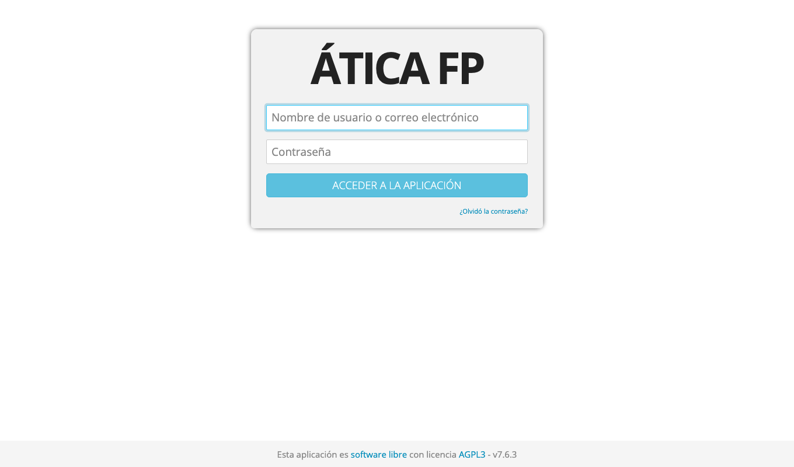
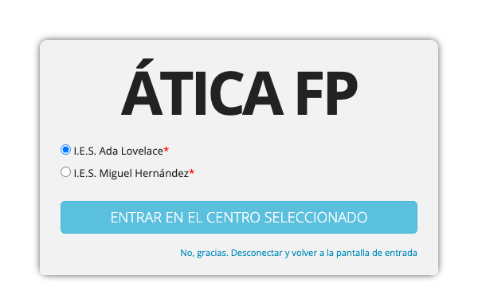
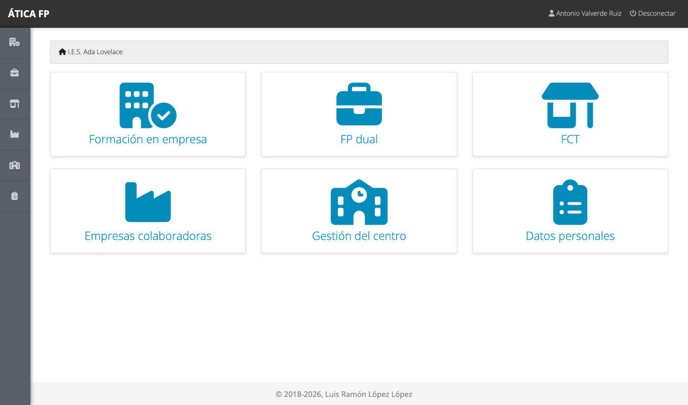
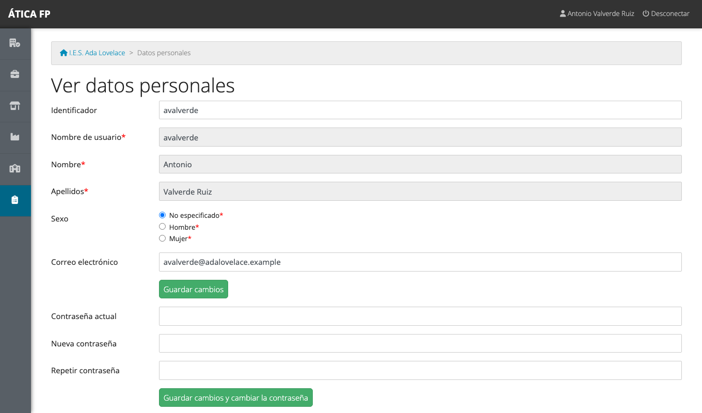
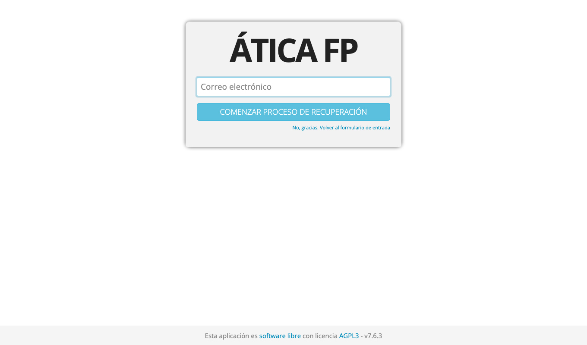

# Primeros pasos

Este capítulo es para **todas las personas** que usan ÁTICA FP, sea cual sea su perfil: profesorado,
alumnado, tutoría laboral o administración. Explica cómo entrar, qué ves al hacerlo, cómo moverte por
la aplicación y cómo cuidar tus datos y tu contraseña.

## Entrar en la aplicación

Abre en el navegador la dirección que te haya dado tu centro. La pantalla de acceso te pide tu
**nombre de usuario o tu correo electrónico** y tu **contraseña**.

Según quién seas, tu usuario te lo habrá dado una persona distinta:

- **Profesorado y alumnado**: el centro los crea al importar los datos desde Séneca. Tu usuario
  suele ser tu usuario IdEA (profesorado) o el que te haya asignado la secretaría (alumnado).
- **Tutoría laboral** (la persona de la empresa que tutoriza al alumnado): la administración del
  centro o la persona que gestiona el módulo te crea el usuario cuando se firma el acuerdo.

Si no sabes cuál es tu usuario o tu contraseña, pídelo a tu centro, o usa la recuperación de
contraseña (más abajo).

!!! note "Intentos fallidos"
    Tras **cinco intentos fallidos** seguidos con el mismo usuario, el acceso se bloquea durante
    quince minutos. Es una protección de la aplicación: espera y vuelve a intentarlo, o recupera tu
    contraseña.

### Elegir el centro

Si tu usuario pertenece a **más de un centro** (por ejemplo, una persona que trabaja en dos
institutos, o la administración de la plataforma), después de entrar la aplicación te pregunta con
cuál quieres trabajar.

Marca el centro y pulsa **Entrar en el centro seleccionado**. Más tarde puedes cambiar de centro desde
el nombre del centro que aparece arriba, a la derecha, junto a tu nombre. Si perteneces a un único
centro entras directamente, sin esta pantalla.

!!! warning "«El usuario no pertenece a ningún centro»"
    Si ves este mensaje, tu usuario existe pero no está dado de alta como docente ni como alumnado en el
    curso activo de ningún centro. Contacta con la dirección de tu centro.

## La pantalla de inicio y el menú

Al entrar ves la **pantalla de inicio** de tu centro. A la izquierda está el **menú lateral**, con
un icono por cada apartado al que tienes acceso (en pantallas anchas, también su nombre; al pasar el
ratón por encima aparece su descripción). Arriba, a la derecha, tienes tu nombre (que lleva a tus datos
personales) y **Desconectar**.

**El menú es distinto para cada persona.** Solo aparece lo que tu perfil puede usar: una persona de
la administración ve la gestión del centro, las empresas y los tres módulos; el alumnado ve únicamente
su seguimiento. Por eso es normal que alguien de tu centro tenga opciones que tú no ves.

Los apartados posibles son:

| Apartado | Para qué sirve | Quién lo ve |
| --- | --- | --- |
| **Administración** | Gestionar los centros y los usuarios de toda la plataforma | Administración de la plataforma ([capítulo 8](08-administrar-la-plataforma.md)) |
| **Gestión del centro** | Profesorado, alumnado, grupos, enseñanzas, importaciones... | Administración del centro; el responsable económico, solo sus itinerarios ([capítulo 4](04-administrar-el-centro.md)) |
| **Empresas colaboradoras** | Empresas y sus centros de trabajo | Administración del centro, jefaturas de departamento, coordinación de FP dual y gestión de la FFEOE ([capítulo 6](06-empresas-y-centros-de-trabajo.md)) |
| **FCT**, **FP dual**, **FFEOE** | Cada módulo de formación en empresa | Quien interviene en ese módulo; solo si el módulo está activo en el curso |
| **Datos personales** | Tus datos y tu contraseña | Todo el mundo |

Cada página muestra arriba una **ruta de navegación** (por ejemplo, «I.E.S. Ada Lovelace › Gestión
del centro › Cursos académicos»). Pulsa en cualquiera de sus partes para volver atrás sin usar el botón
del navegador.

### Los listados

La mayoría de las pantallas son listados con el mismo aspecto y las mismas herramientas:

- **Filtrar**: escribe en la caja de arriba y el listado se reduce a lo que coincide.
- **Seleccionar**: la casilla de la cabecera marca todas las filas, y los botones de debajo del listado
  (**Eliminar...** y los propios de cada pantalla) actúan sobre las filas marcadas.
- **Paginar**: cuando hay muchos elementos, se reparten en páginas con un paginador debajo.
- **Curso académico**: los listados que dependen del curso (profesorado, matrículas, grupos...)
  tienen un selector arriba para ver otro curso distinto del activo.

Antes de **eliminar** nada, la aplicación siempre te muestra una pantalla de confirmación con lo que
se va a borrar; no se borra hasta que la confirmas.

## Tus datos personales

Pulsa tu nombre, arriba a la derecha (o el apartado **Datos personales**), para ver tus datos.

Puedes cambiar tu **sexo** y tu **correo electrónico**. El nombre de usuario, el nombre y los apellidos
son de solo lectura porque vienen de Séneca o los gestiona la administración; si alguno es incorrecto,
pide que lo corrijan.

!!! tip "Mantén tu correo al día"
    El correo electrónico es el que usa la aplicación para la recuperación de contraseña y para los
    avisos. Si está vacío o es antiguo, no recibirás nada.

!!! note "Cambiar el correo exige confirmarlo"
    Cuando cambias tu correo, la aplicación envía un mensaje a la **dirección nueva** con un enlace. El
    cambio no entra en vigor hasta que pulses ese enlace, y mientras tanto la pantalla te avisa de que hay
    una petición pendiente. Si el enlace caduca, vuelve a pedir el cambio.

### Cambiar tu contraseña {#cambiar-tu-contrasena}

En la parte baja de **Datos personales** escribe tu **contraseña actual**, la **nueva** y repítela;
después pulsa **Guardar cambios y cambiar la contraseña**. La nueva contraseña tiene al menos ocho
caracteres y no puede ser igual que la actual.

Si la administración te ha creado un usuario con una contraseña provisional o ha pedido que la
cambies, la aplicación te llevará a una pantalla de **cambio obligatorio de contraseña** nada más
entrar; hasta que la cambies no podrás usar nada más.

!!! note "Profesorado con contraseña de Séneca"
    Si tu usuario tiene activada la comprobación de contraseña en Séneca, la aplicación valida primero
    tu contraseña de Séneca y, si no está disponible, la guardada en local. En ese caso, para cambiar
    la contraseña tienes que hacerlo en Séneca.

## He olvidado mi contraseña

En la pantalla de acceso, pulsa **¿Olvidó la contraseña?** y escribe tu **correo electrónico**.

Si la dirección corresponde a una cuenta, recibirás un correo con un enlace para elegir una contraseña
nueva. El enlace **caduca a los pocos minutos**, y entre una solicitud y la siguiente hay que esperar un
poco; si has pedido demasiadas veces seguidas, la aplicación te lo dirá.

Por seguridad, la pantalla responde lo mismo exista o no la dirección: no te dice si hay una cuenta con
ese correo. Si no te llega nada, comprueba la carpeta de correo no deseado y que el correo guardado en
tus datos personales es el correcto, y si no, pide a la administración de tu centro que lo revise.

!!! warning "Si tu contraseña es la de Séneca"
    Si tu usuario usa la autenticación de Séneca, la aplicación no puede restablecerla: se hace en
    Séneca.

## Salir

Pulsa **Desconectar**, arriba a la derecha. En un ordenador compartido, hazlo siempre al terminar.
