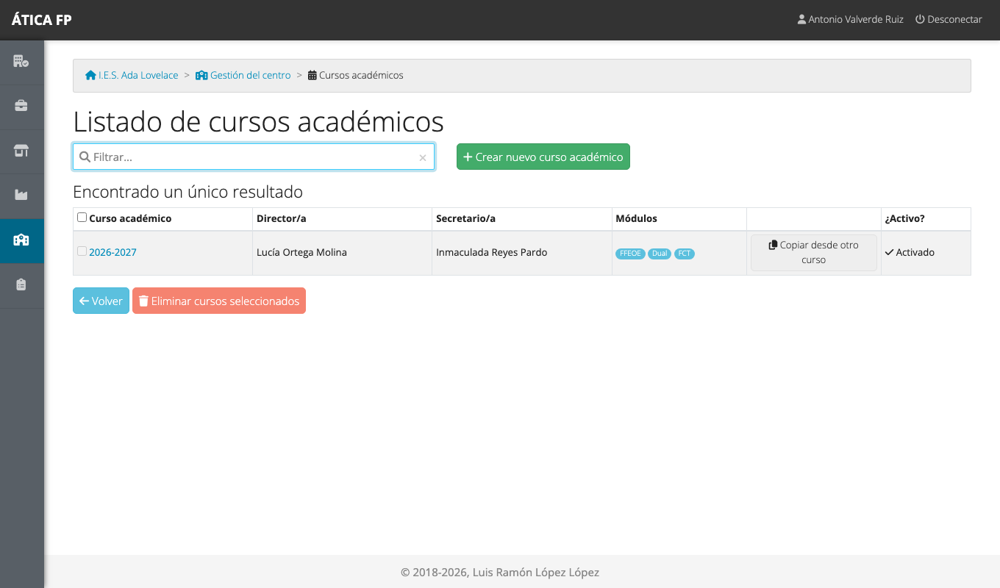
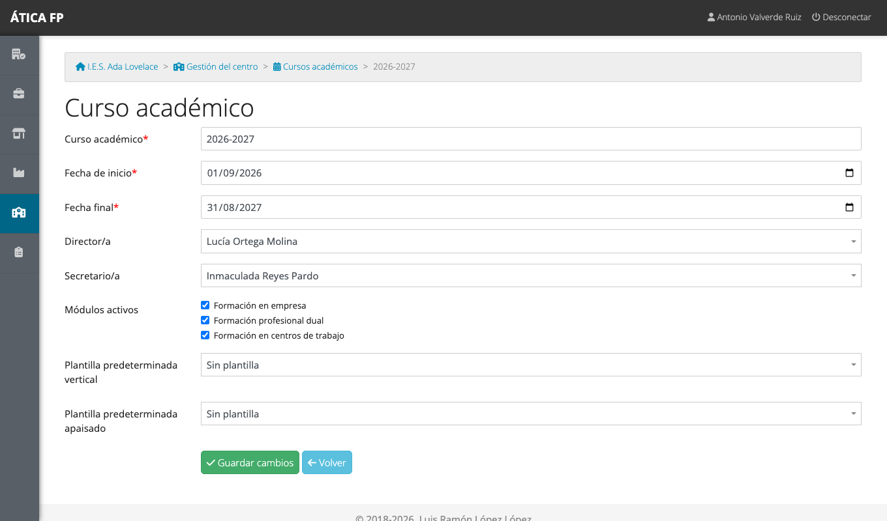
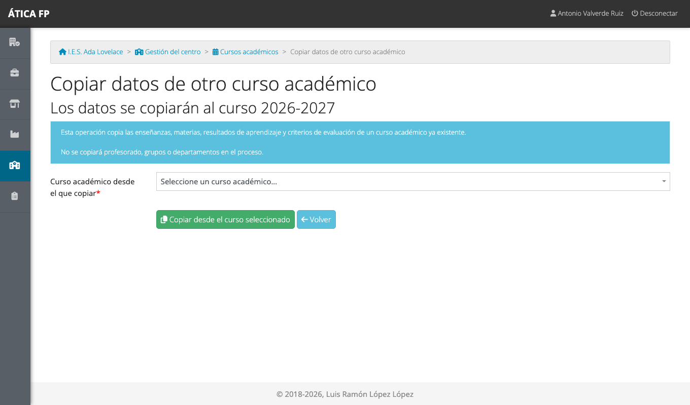

# Preparar el curso académico

Este capítulo es para la **administración del centro**. Casi todo en ÁTICA FP depende del **curso
académico**: el profesorado, los grupos, el alumnado matriculado, los módulos activos y las
convocatorias de prácticas se definen para un curso concreto. Al empezar un curso nuevo, hay que
prepararlo antes de que el profesorado empiece a trabajar.

Todo lo que se explica aquí está en **Gestión del centro → Cursos académicos**.

## Cursos académicos

Un centro puede tener varios cursos (el actual y los anteriores), pero **siempre hay uno activo**: el
que ven todas las personas por defecto al entrar. Los anteriores siguen disponibles para consultarlos.

En el listado ves, por cada curso, quién es la dirección y la secretaría, qué módulos tiene activos y si
es el activo. Con **Crear nuevo curso académico** añades uno; para convertir otro en el activo, pulsa
el botón **Activar** de su fila. Un curso no se puede eliminar si ya tiene datos
asociados.

## Los datos de un curso {#los-datos-de-un-curso}

Pulsa en el nombre del curso para editarlo.

- **Curso académico**: el nombre, por ejemplo «2026-2027».
- **Fecha de inicio** y **Fecha final**: la final debe ser posterior a la de inicio; si no, la aplicación
  no deja guardar.
- **Director/a**: se elige entre el profesorado del curso (por eso conviene importar antes el
  profesorado). Es un dato informativo: no da permisos especiales.
- **Secretario/a**: es la persona que actúa como **responsable económico** del centro. Quien
  se elija aquí podrá consultar y verificar los itinerarios y los gastos de desplazamiento del
  profesorado en los tres módulos. Es el único sitio donde se asigna ese perfil, y cambia con cada curso.
- **Módulos activos**: marca **FCT**, **FP dual** y **FFE** (Formación en centros de trabajo,
  Formación profesional dual y Formación en empresa) según los que vaya a usar el centro este curso. Un
  módulo desactivado desaparece del menú de todo el mundo.
- **Plantillas predeterminadas vertical y apaisado**: la plantilla de PDF que se usará como fondo de los
  informes de ese curso. Se explican en
  [Encuestas y plantillas de informe](07-encuestas-y-plantillas-de-informe.md#plantillas-de-informe).

!!! note "Los datos del centro"
    Los datos del propio centro (nombre, código, dirección, teléfono...) los cambia la administración
    de la plataforma, no la del centro. Ver [Administrar la plataforma](08-administrar-la-plataforma.md).

## Copiar datos de otro curso {#copiar-datos-de-otro-curso}

Para no empezar de cero, en el listado de cursos pulsa **Copiar desde otro curso** en la fila del curso
nuevo y elige el curso del que copiar.

La operación copia **las enseñanzas, las materias, los resultados de aprendizaje y los criterios de
evaluación**. **No copia** el profesorado, los grupos ni los departamentos: eso se carga cada curso
(normalmente importándolo desde Séneca, ver [Importaciones](05-importaciones.md)).

!!! warning "Hazlo al principio"
    Copia los datos cuando el curso nuevo aún no tiene enseñanzas ni materias propias. Copiar sobre un
    curso que ya tiene datos mezcla lo copiado con lo que había.

## Orden recomendado {#orden-recomendado}

Los datos de un curso dependen unos de otros, así que importa el orden. El que menos problemas da:

1. **Crea el curso y actívalo**, con sus fechas y los módulos que vas a usar.
2. **Copia los datos del curso anterior** (arriba): enseñanzas, materias, resultados de aprendizaje y
   criterios. Si es el primer curso del centro, sáltate este paso: las enseñanzas se crearán al
   importar los grupos.
3. **Importa los departamentos** de familia profesional y sus jefaturas
   ([Importaciones](05-importaciones.md#departamentos)).
4. **Importa el profesorado**: sin él no se pueden asignar tutorías, jefaturas ni docencia
   ([Importaciones](05-importaciones.md#profesorado)).
5. **Importa los grupos**, con sus tutorías ([Importaciones](05-importaciones.md#grupos)).
6. **Importa las materias** con la docencia de cada docente
   ([Importaciones](05-importaciones.md#materias-y-docencia)) y, si hace falta, los resultados de
   aprendizaje y criterios de evaluación.
7. **Importa el alumnado**; cada estudiante queda matriculado en su grupo
   ([Importaciones](05-importaciones.md#alumnado)).
8. **Carga los días no lectivos** del calendario escolar
   ([Importaciones](05-importaciones.md#dias-no-lectivos)).
9. **Asigna la secretaría y la dirección** en los datos del curso, y las **administraciones locales**
   que necesites ([Administrar el centro](04-administrar-el-centro.md#administracion-local)).
10. **Revisa las empresas** y centros de trabajo que se van a usar
    ([Empresas y centros de trabajo](06-empresas-y-centros-de-trabajo.md)).
11. **Prepara cada módulo**: ya pueden empezar quienes gestionan FCT, FP dual y FFE (partes B, C y D de
    este manual).

Cada paso corresponde a una tarjeta de **Gestión del centro**, la pantalla de arriba. Si algo no está
cargado, el resto de pantallas lo muestra con listas vacías: es la señal de que falta un paso anterior.
