# Administrar el centro

Este capítulo es para la **administración del centro**. Recorre las pantallas de **Gestión del
centro**, donde se mantienen los datos académicos sobre los que trabajan los tres módulos:
profesorado, alumnado, grupos, enseñanzas, materias y algunos catálogos. La mayoría de estos datos se
cargan una vez por curso desde Séneca (ver [Importaciones](05-importaciones.md)); aquí se explica
cómo consultarlos, corregirlos y completarlos a mano.

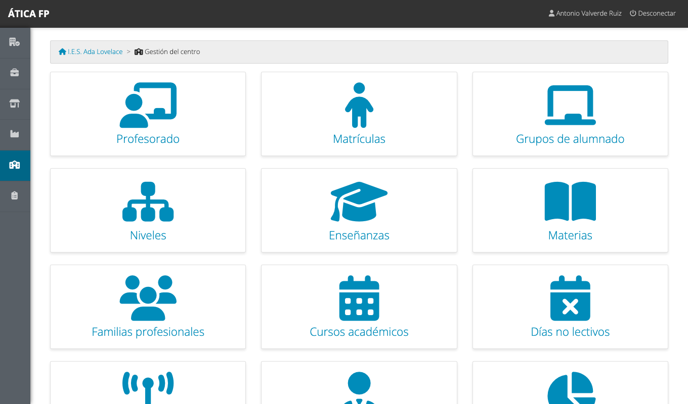

Salvo que se indique otra cosa, **todo lo de este capítulo es solo para la administración del centro**
(ver la [matriz de permisos](09-permisos-generales.md)). Las excepciones son los itinerarios de
desplazamiento, que también gestiona el responsable económico, y las empresas, que se tratan en su
[propio capítulo](06-empresas-y-centros-de-trabajo.md).

!!! note "Muchas pantallas dependen del curso"
    Profesorado, matrículas, departamentos, enseñanzas, niveles, grupos, materias, días no lectivos y
    tipos de contacto pertenecen a un curso académico. Cada listado muestra arriba un selector con el
    curso que estás viendo (por defecto, el activo).

## Profesorado

**Gestión del centro → Profesorado** lista el profesorado del curso, con las materias y grupos en los
que imparte docencia.

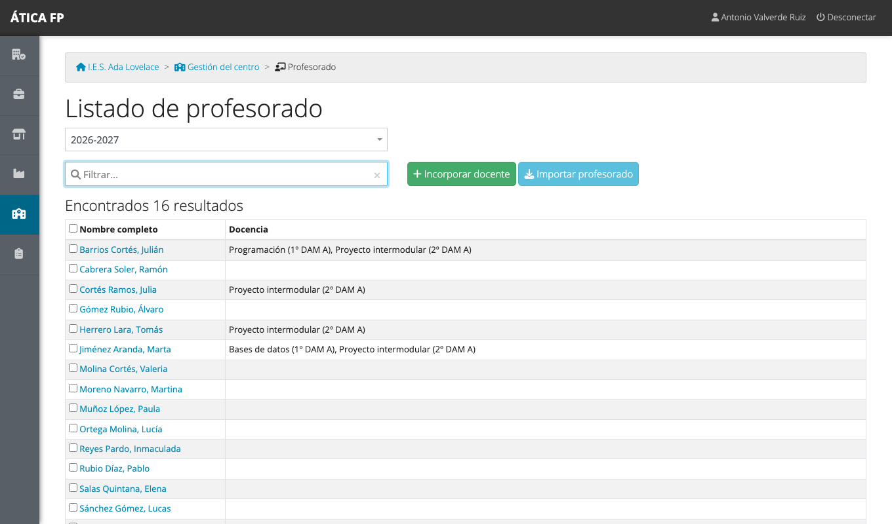

- **Incorporar docente** añade al curso a una persona que **ya tiene usuario** en la plataforma (porque
  estuvo en otro curso o la creó la administración de la plataforma). Elige su usuario en la lista y
  guarda.
- **Importar profesorado** carga el listado completo desde Séneca; es lo habitual al empezar el curso
  ([Importaciones](05-importaciones.md#profesorado)).
- Pulsa un nombre para ver y editar la ficha del docente.

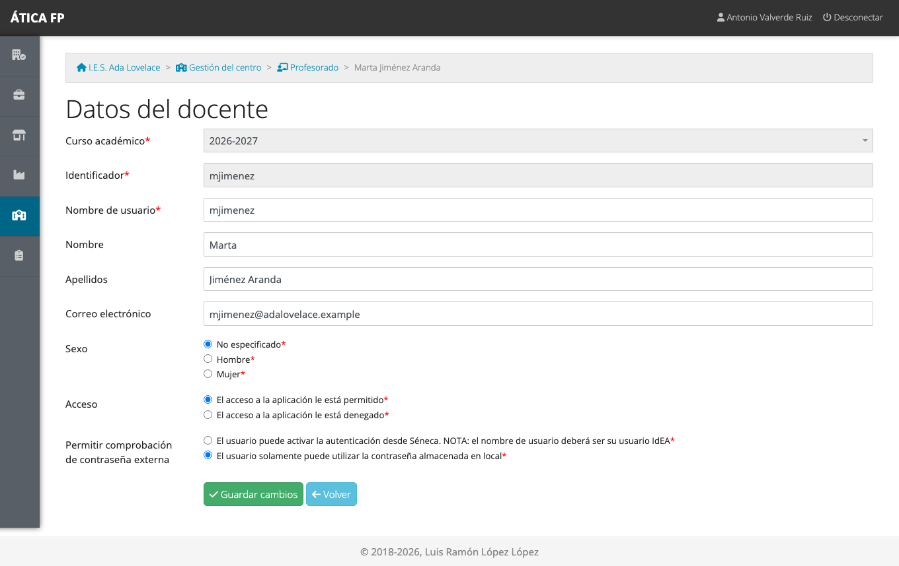

En la ficha puedes corregir el nombre de usuario, el nombre y apellidos, el correo y el sexo. Dos
opciones merecen atención:

- **Acceso**: si lo pones en «denegado», esa persona no puede entrar en la aplicación, aunque siga en
  la lista (por ejemplo, durante una baja larga).
- **Permitir comprobación de contraseña externa**: permite que el docente use su contraseña de Séneca
  para entrar (el nombre de usuario tiene que ser su usuario IdEA). Con la opción desactivada, solo
  vale la contraseña guardada en la aplicación.

Para quitar a alguien del curso, marca su fila y pulsa **Eliminar el profesorado seleccionado**. Quitar
a un docente del curso no borra su usuario ni sus datos de otros cursos.

## Matrículas

**Gestión del centro → Matrículas** lista al alumnado matriculado en el curso, con su identificador, su
grupo y su usuario.

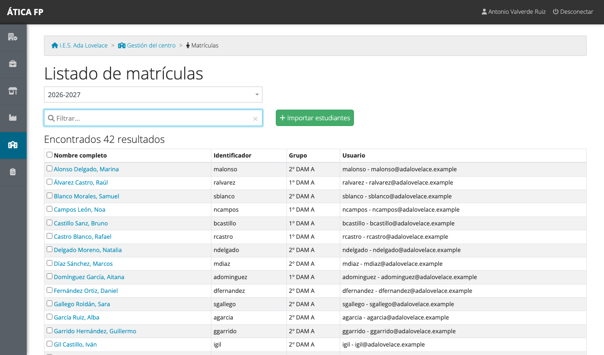

El alumnado se incorpora **solo por importación** ([Importaciones](05-importaciones.md#alumnado)): aquí
no existe un botón para dar de alta a un estudiante a mano. Lo que sí puedes hacer es abrir una matrícula
para corregir sus datos.

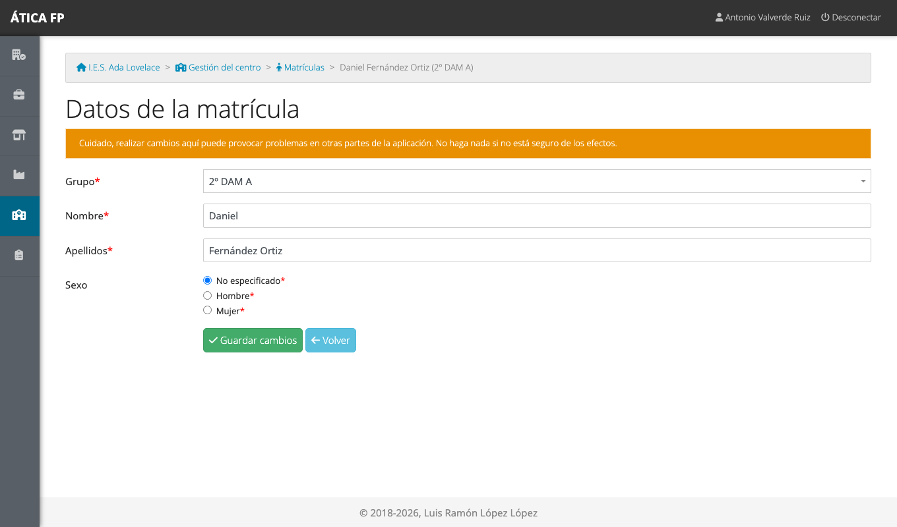

Puedes **cambiar el grupo** del estudiante y corregir su nombre, sus apellidos o su sexo. La propia
pantalla avisa en naranja de que cambiar datos aquí puede provocar problemas en otras partes de la
aplicación: toca solo lo que estés seguro de entender. Una matrícula se puede eliminar marcándola en el
listado; hazlo con cuidado, porque se pierde el vínculo con todo el seguimiento del alumno en los
módulos.

## Departamentos (familias profesionales) {#departamentos}

**Gestión del centro → Familias profesionales** lista los departamentos de familia profesional, cada
uno con su **jefatura**.

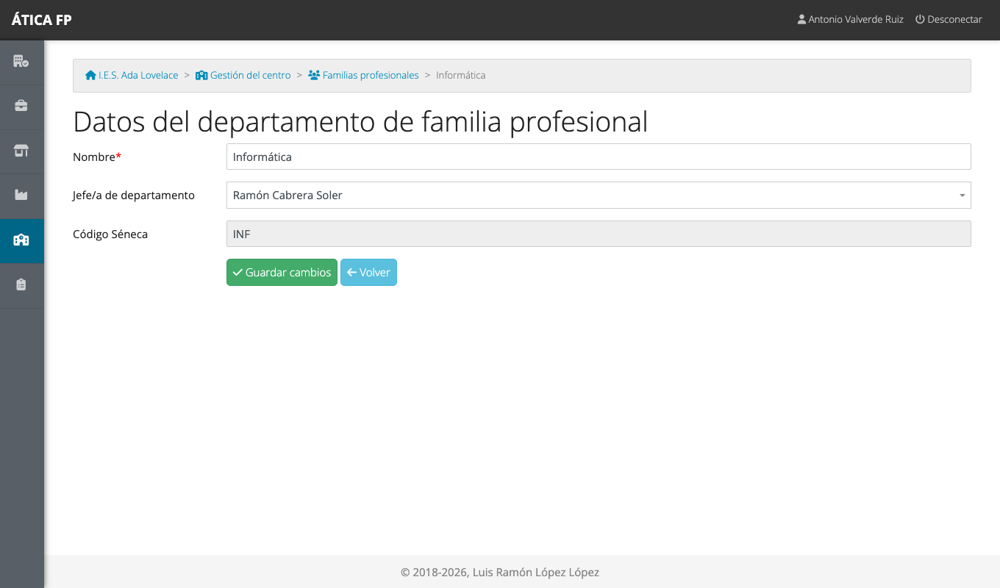

La **jefatura de departamento** es una de las personas con más peso en los módulos: puede gestionar la
formación de **todas las enseñanzas de su departamento**. Se asigna aquí (al importar los departamentos
puede asignarse automáticamente) y se elige entre el profesorado del curso.

!!! warning "Enlaza cada enseñanza con su familia profesional"
    Una jefatura de departamento solo ve las enseñanzas que pertenecen a su departamento. Al importar
    grupos, las enseñanzas se crean **sin familia profesional**: ábrelas (siguiente apartado) y elige la
    que corresponda. Mientras no lo hagas, la jefatura no tendrá acceso a la formación de esa enseñanza.

## Enseñanzas, niveles y grupos {#ensenanzas-niveles-y-grupos}

Los estudios del centro se organizan en tres niveles:

- **Enseñanza**: el título completo, por ejemplo «CFGS Desarrollo de Aplicaciones Multiplataforma».
- **Nivel**: cada curso de la enseñanza («1º DAM», «2º DAM»).
- **Grupo**: cada clase concreta de un nivel («1º DAM A»).

### Enseñanzas

**Gestión del centro → Enseñanzas** lista las enseñanzas del curso, con su familia profesional y sus
niveles.

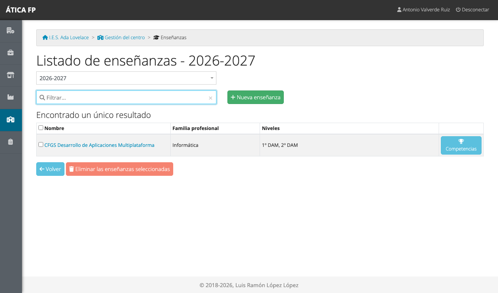

Pulsa el nombre para editarla.

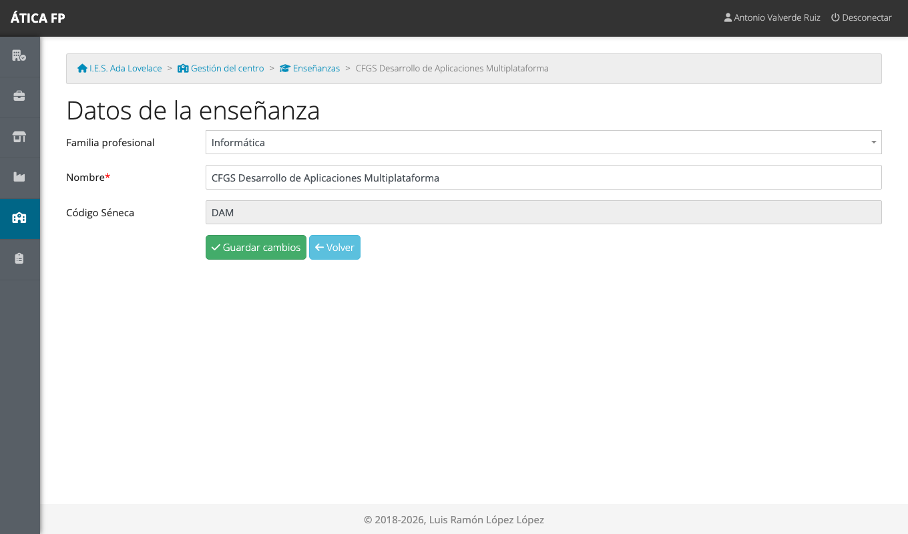

- **Familia profesional**: el departamento al que pertenece. Elige «No es una enseñanza de FP» para las
  que no lo son; no entran en ningún módulo.
- **Nombre**: el que se muestra en toda la aplicación. Al importar, se rellena con el código de Séneca;
  cámbialo por el nombre oficial.

El botón **Competencias** abre la lista de competencias de la enseñanza, que se pueden añadir una a una o
**importar en bloque** pegando un texto con el formato `CÓDIGO: descripción`, una por línea.

### Niveles

**Gestión del centro → Niveles** lista los niveles de las enseñanzas; cada uno pertenece a una
enseñanza. Se crean al importar los grupos y rara vez hay que tocarlos.

### Grupos

**Gestión del centro → Grupos de alumnado** lista los grupos del curso.

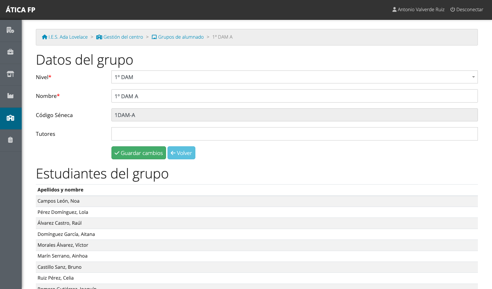

En la ficha eliges el **nivel**, el **nombre** y las **tutorías** del grupo (una o varias personas del
profesorado). Debajo ves el alumnado del grupo. La tutoría de grupo es otro perfil con permisos propios
en los módulos, así que mantenerla al día es importante.

## Materias y docencia

**Gestión del centro → Materias** lista las materias o módulos profesionales del curso, con el nivel y
quién las imparte.

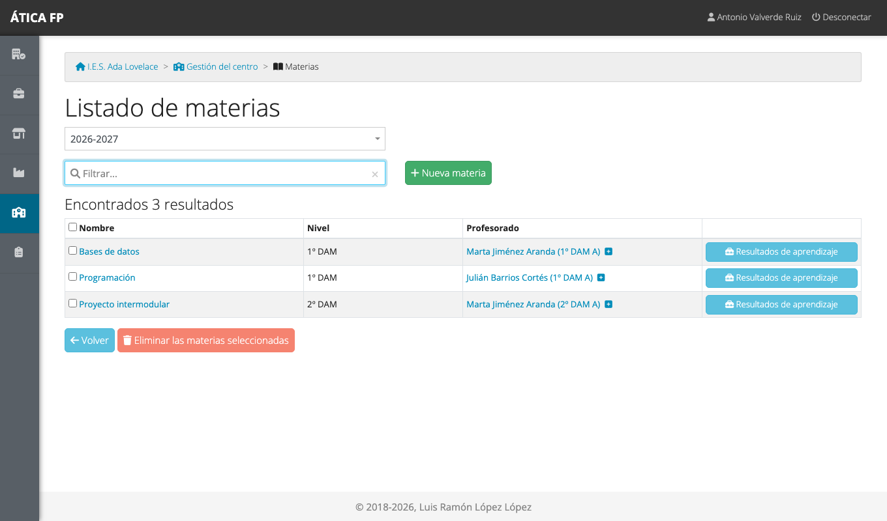

- La **docencia** de cada materia aparece en la columna «Profesorado» como *docente (grupo)*. El pequeño
  botón «+» añade a otro docente en otro grupo; pulsa sobre una asignación para cambiarla o quitarla. La
  docencia suele cargarse al importar las materias.
- Pulsa el nombre de la materia para editarla.

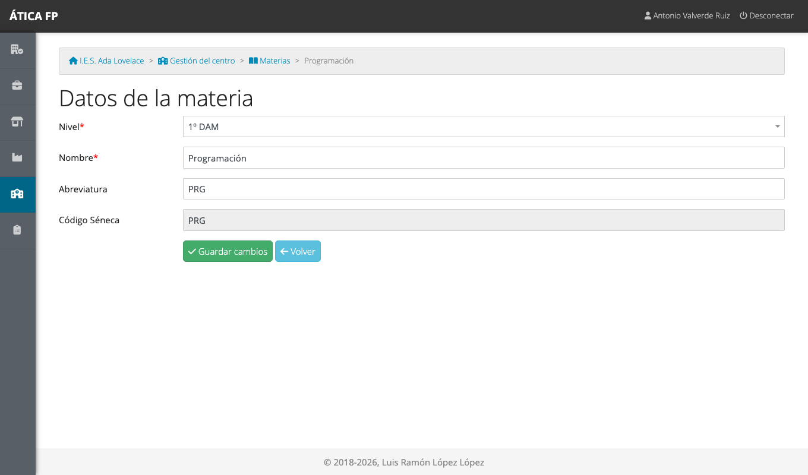

!!! note "Quién da clase a quién"
    En FP dual y en la FFE, **quien da clase a un grupo** puede evaluar a su alumnado y consultar sus
    informes. Esa información sale de aquí, de la docencia de cada materia: si falta, un docente no podrá
    evaluar a sus estudiantes.

### Resultados de aprendizaje y criterios de evaluación {#resultados-de-aprendizaje-y-criterios-de-evaluacion}

El botón **Resultados de aprendizaje** de cada materia abre su lista; cada resultado tiene a su vez sus
**criterios de evaluación**. Son el catálogo sobre el que se evalúa en FP dual y en la FFE.

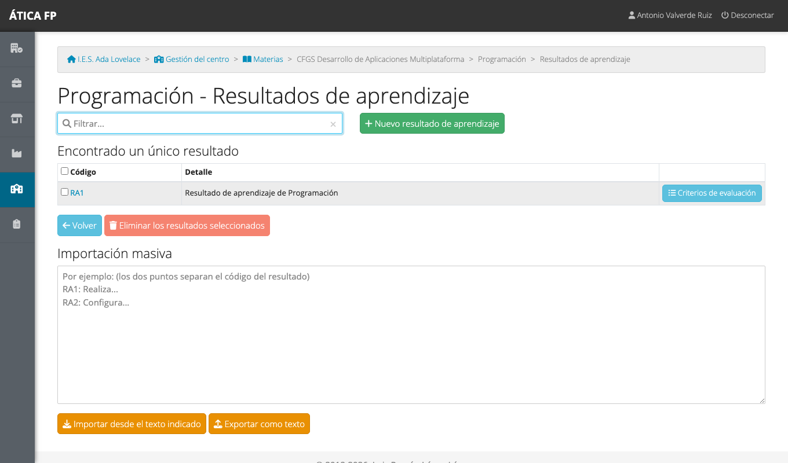

Se pueden crear uno a uno, o cargarlos de golpe desde Séneca
([Importaciones](05-importaciones.md#resultados-de-aprendizaje-y-criterios)). También se pueden
importar o exportar como texto (`RA1: descripción`, uno por línea) con los botones de la parte
inferior de cada lista, y se arrastran de un curso a otro con
[Copiar datos de otro curso](03-preparar-el-curso-academico.md#copiar-datos-de-otro-curso).

## Días no lectivos {#dias-no-lectivos}

**Gestión del centro → Días no lectivos** lista los días del curso en que no hay clase: festivos y
puentes.

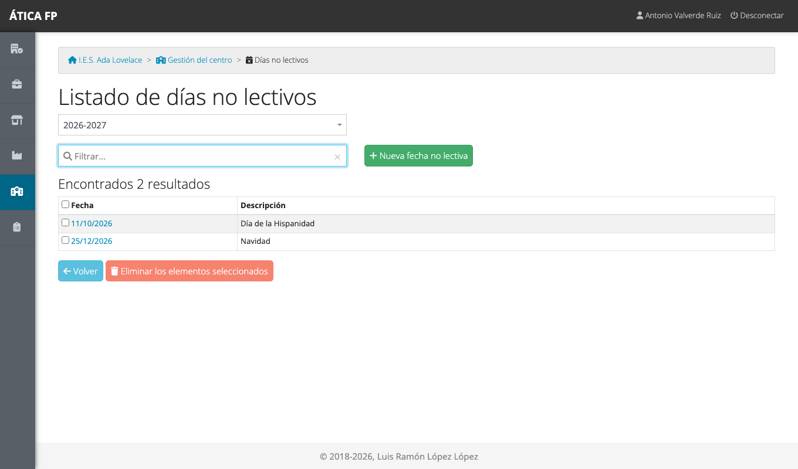

Se usan al generar los calendarios de prácticas de los tres módulos: por defecto, los días no lectivos
se saltan (quien prepara el calendario puede indicar que los ignore). Puedes crearlos uno a uno (fecha y descripción) o importar el calendario escolar oficial
([Importaciones](05-importaciones.md#dias-no-lectivos)).

## Tipos de contacto con empresas {#tipos-de-contacto-con-empresas}

**Gestión del centro → Tipos de contacto con empresas** es el catálogo de formas de contacto que el
profesorado puede elegir al registrar un contacto con una empresa (correo electrónico, teléfono...).

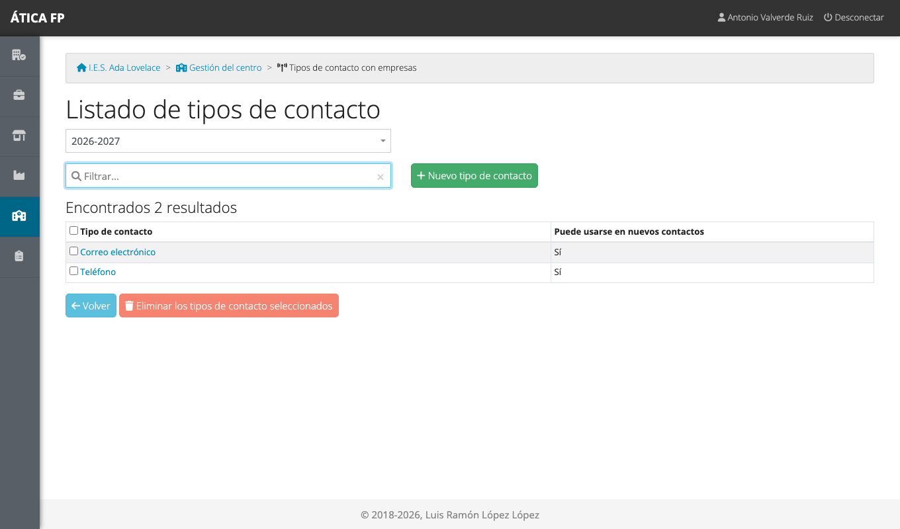

Cada tipo tiene una **descripción** y un indicador de si está **disponible**: un tipo no disponible no
puede usarse para registrar contactos nuevos, pero se conserva en los que ya existen. Así puedes retirar
un tipo sin perder el historial.

## Administración local {#administracion-local}

**Gestión del centro → Roles** asigna la administración del centro: las personas del profesorado del
curso que pueden hacer todo lo de este capítulo.

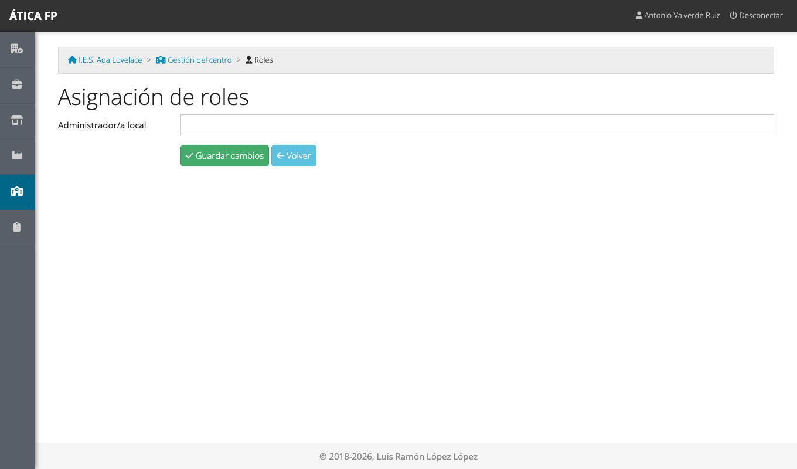

Elige en **Administrador/a local** a una o varias personas del profesorado y guarda. Ten en cuenta:

- Solo se pueden elegir docentes del curso activo, así que importa antes el profesorado.
- La administración local tiene acceso total a los datos **de su centro**, y a ninguno de otro. La que
  llega a todos los centros es la [administración de la plataforma](08-administrar-la-plataforma.md).
- Procura que haya siempre al menos dos personas, para que nadie quede fuera si una cambia de centro.

## Itinerarios de desplazamiento {#itinerarios-de-desplazamiento}

**Gestión del centro → Itinerarios de desplazamiento** es el catálogo de trayectos que el profesorado
selecciona al registrar un gasto de desplazamiento (por ejemplo, «Linares > Jaén > Linares»), con su
distancia en kilómetros.

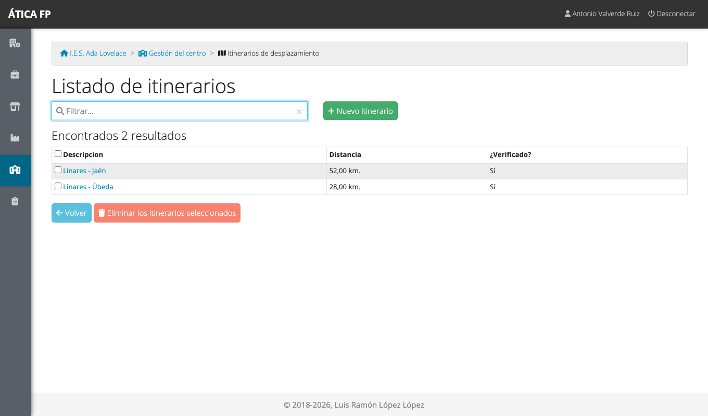

Este apartado lo gestionan **la administración del centro y el responsable económico**. La razón es el
control del gasto: cuando un docente crea un itinerario nuevo al registrar un desplazamiento, queda
**sin verificar** hasta que alguien con ese permiso comprueba los kilómetros y lo marca como
verificado.

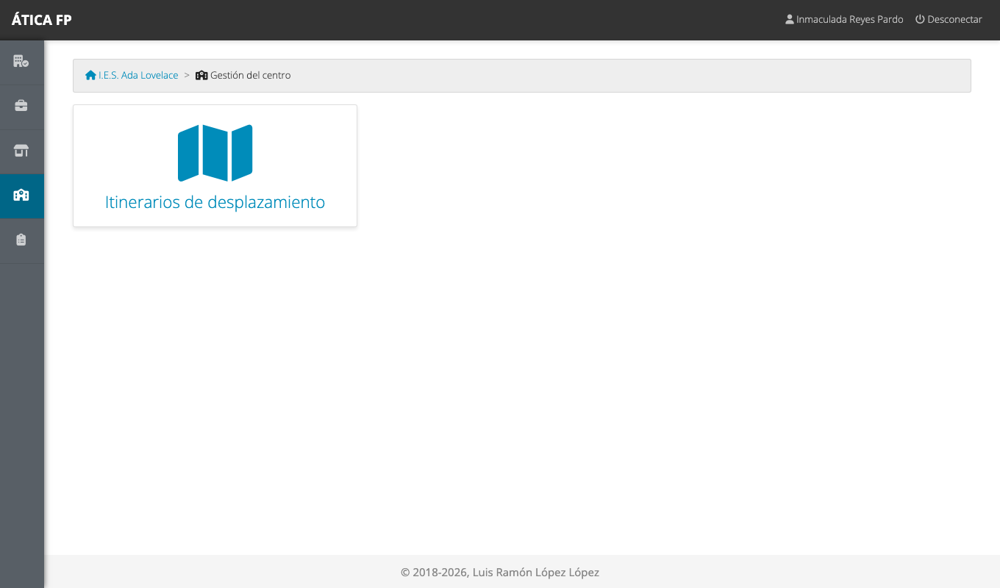

El responsable económico, que es quien figura como secretario o secretaria del curso, ve en
**Gestión del centro** únicamente esta tarjeta. El resto del apartado le está cerrado.

## Escalas de valoración del desempeño {#escalas-de-valoracion-del-desempeno}

**Gestión del centro → Escalas de valoración del desempeño** define los niveles con los que se valora
el desempeño del alumnado en los módulos que evalúan por actividades o resultados de aprendizaje.

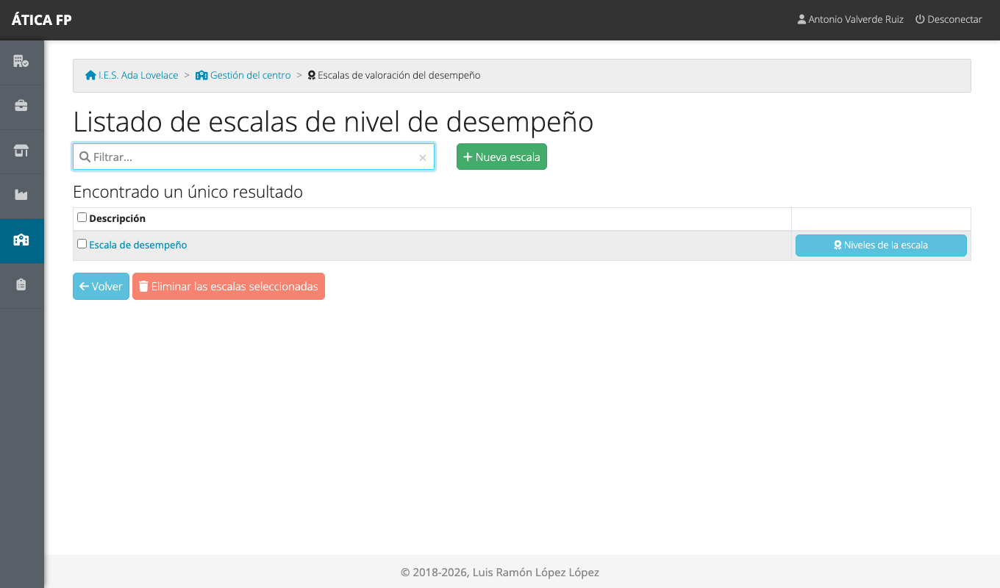

Una **escala** agrupa una serie de **niveles de desempeño** (por ejemplo, «Insuficiente», «Suficiente»,
«Notable»...), cada uno con su descripción y su calificación numérica. Al crear una escala nueva puedes
partir de una existente («Copiar desde»). Una escala **activa** puede seleccionarse al evaluar; una
inactiva se conserva en las evaluaciones antiguas pero ya no se ofrece.
