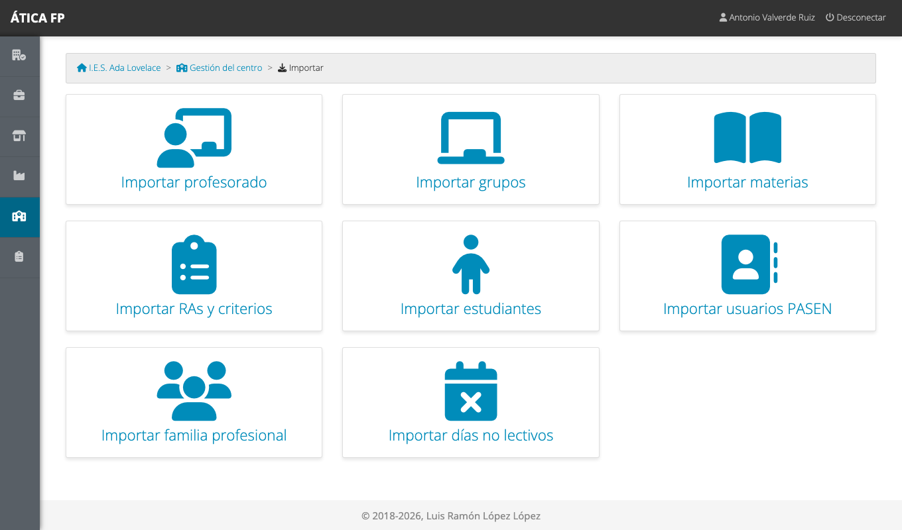
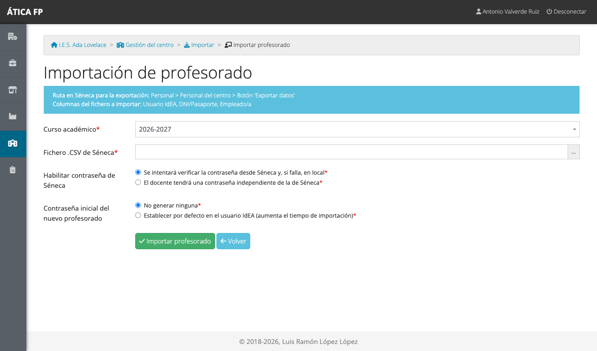
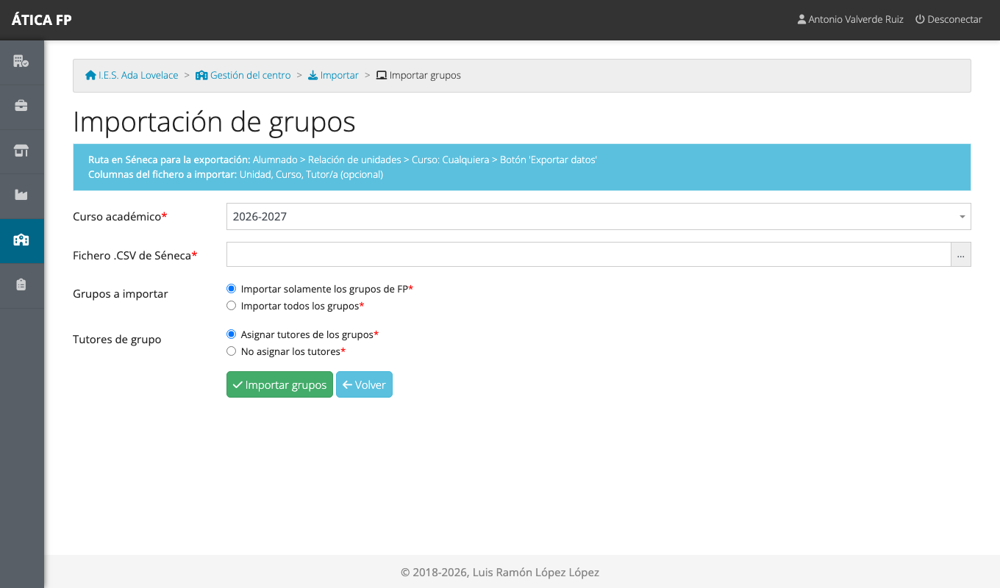
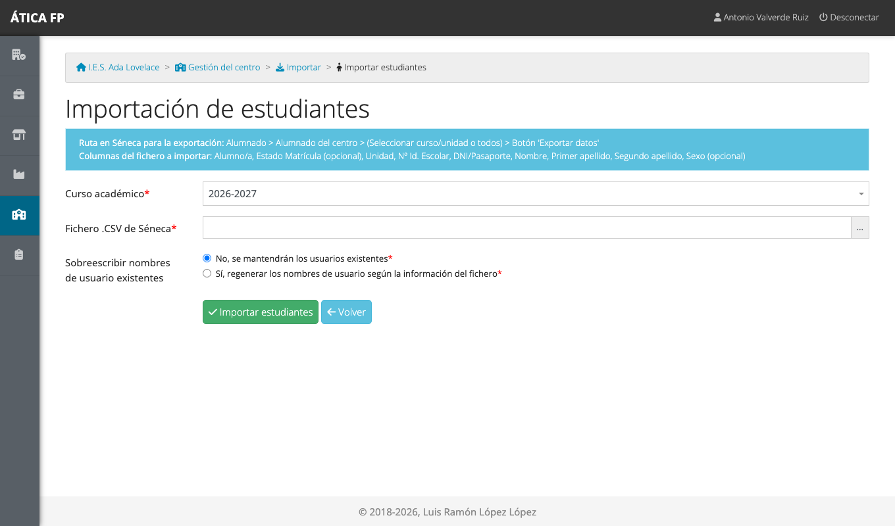
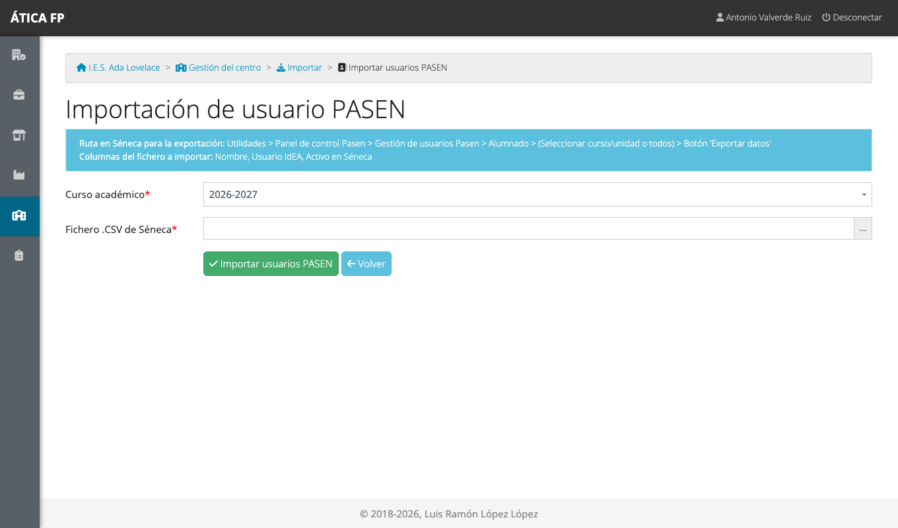
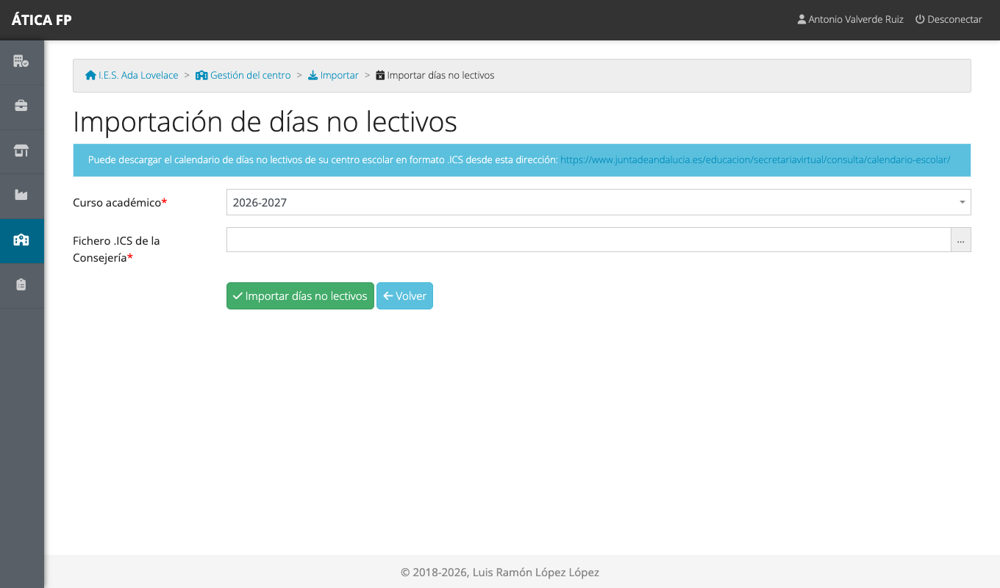

# Importaciones

Este capítulo es para la **administración del centro**. La forma normal de cargar los datos de un curso
es **importarlos desde Séneca**: el profesorado, los grupos, las materias, el alumnado y otros datos se
exportan de Séneca en ficheros CSV y se suben a ÁTICA FP. Así no hay que teclear nada y los datos
coinciden con los oficiales.

Todas las importaciones están en **Gestión del centro → Importar**.

## Cómo funcionan las importaciones

Todas siguen el mismo esquema:

1. **Exporta el fichero desde Séneca.** Cada pantalla de importación te dice, en un recuadro azul, la
   **ruta exacta de Séneca** para la exportación y las **columnas** que debe tener el fichero. No las
   cambies de nombre ni las quites: si falta alguna obligatoria, la importación se rechaza.
2. **Elige el curso académico** al que van los datos (por defecto, el activo) y el fichero **.CSV**.
3. **Marca las opciones** de esa importación, si las tiene.
4. **Pulsa el botón de importar.** Al terminar, la aplicación muestra el **resultado**: cuántos elementos
   eran nuevos, cuántos existían ya y la lista de lo procesado.

Dos propiedades hacen que importar sea seguro:

- **Se puede repetir.** Lo que ya existe se reconoce (por su código de Séneca o, en el alumnado, por su identificador) y no
  se duplica: puedes
  importar de nuevo el mismo fichero, o uno más completo, y solo se añade lo que falta.
- **Todo o nada.** Si el fichero tiene filas vacías o con un formato no válido, no se importa nada y se
  muestra un mensaje: corrige el fichero y vuelve a intentarlo.

!!! warning "Respeta el orden"
    Cada importación necesita datos de las anteriores (las materias necesitan que los grupos existan, los
    grupos necesitan al profesorado para asignar tutorías...). El orden recomendado está en
    [Preparar el curso académico](03-preparar-el-curso-academico.md#orden-recomendado) y es el de este
    capítulo.

## Departamentos {#departamentos}

**Importar familia profesional.** Carga los departamentos de familia profesional del curso.

- **Ruta en Séneca**: *Centro › Datos propios › Órganos de coordinación docente › Departamentos*.
- **Jefaturas de departamento**: puedes elegir **asignarlas automáticamente**. La jefatura se busca
  por su código en el profesorado del curso, así que, si importas los departamentos antes que el
  profesorado, las jefaturas quedarán sin asignar (se pueden poner a mano después).

## Profesorado {#profesorado}

**Importar profesorado.** Carga el personal del centro como profesorado del curso.

- **Ruta en Séneca**: *Personal › Personal del centro › botón «Exportar datos»*. Columnas: Usuario IdEA,
  DNI/Pasaporte y Empleado/a.
- **Habilitar contraseña de Séneca**: con la primera opción, el profesorado puede entrar con su contraseña
  de Séneca (se verifica allí y, si falla, en local). Con la segunda, cada docente tendrá una contraseña
  independiente.
- **Contraseña inicial del nuevo profesorado**: «No generar ninguna» o «Establecer por defecto en el
  usuario IdEA» (la contraseña inicial es el propio usuario IdEA; hace la importación más lenta).

!!! warning "Contraseñas iniciales"
    Si estableces la contraseña inicial igual al usuario IdEA, **cada docente debe cambiarla en su primer
    acceso**. La propia aplicación lo recuerda en el resultado de la importación.

El resultado distingue **docentes nuevos** y **ya existentes**.

## Grupos {#grupos}

**Importar grupos.** Crea los grupos del curso y, a partir de ellos, sus **niveles** y **enseñanzas**.

- **Ruta en Séneca**: *Alumnado › Relación de unidades › Curso: Cualquiera › botón «Exportar datos»*.
  Columnas: Unidad, Curso y Tutor/a (opcional).
- **Grupos a importar**: «solamente los de FP» (lo recomendable en un centro que también imparte ESO o
  Bachillerato) o «todos».
- **Tutores de grupo**: asignar o no las tutorías que figuran en el fichero. Las tutorías se buscan
  entre el profesorado ya importado.

!!! warning "Completa las enseñanzas después"
    El fichero de grupos solo trae códigos. Las enseñanzas y los niveles se crean con el código como
    nombre y **sin familia profesional**. Abre cada enseñanza
    ([Administrar el centro](04-administrar-el-centro.md#ensenanzas-niveles-y-grupos)), ponle su nombre
    completo y elige su familia profesional; si no, la jefatura de ese departamento no verá la formación
    de esa enseñanza.

## Materias y docencia {#materias-y-docencia}

**Importar materias.** Carga las materias y módulos profesionales de cada nivel y, si quieres, quién los
imparte en cada grupo.

- **Ruta en Séneca**: *Personal › Personal del centro › botón «Materias y grupos» › Unidad: Cualquiera ›
  botón «Exportar datos»*. Columnas: Materia, Unidad, Curso y Profesor/a (opcional).
- **Profesorado asociado a las materias**: «asignar automáticamente» crea la docencia de cada docente en
  cada grupo. Imprescindible para que el profesorado pueda evaluar (en FP dual y FFEOE solo evalúa quien da
  clase al grupo).
- **Materias iguales en la misma enseñanza de FP**: si un módulo aparece en varios cursos de la misma
  enseñanza, puedes **dejar solo el del curso mayor** o conservarlos como materias independientes.

Las materias solo se importan para los **grupos que ya existen** en la plataforma; las de grupos no
importados se ignoran.

## Resultados de aprendizaje y criterios {#resultados-de-aprendizaje-y-criterios}

**Importar RAs y criterios.** Carga el catálogo de evaluación de los módulos profesionales de un curso
(nivel).

- **Ruta en Séneca**: *Alumnado › Evaluación › Currículo F.P. › Criterios de Evaluación › (elegir curso) ›
  Módulo: Cualquiera › botón «Exportar datos»*. Columnas: Módulo Profesional, Resultado de Aprendizaje y
  Criterios de Evaluación.
- Elige el **curso** al que pertenecen los módulos.

El resultado informa de los módulos profesionales, resultados de aprendizaje y criterios **incorporados** y
**actualizados**. Es la importación que puedes repetir cuando Séneca actualiza el currículo.

## Alumnado {#alumnado}

**Importar estudiantes.** Da de alta al alumnado y lo **matricula** en su grupo.

- **Ruta en Séneca**: *Alumnado › Alumnado del centro › (seleccionar curso/unidad o todos) › botón
  «Exportar datos»*. Columnas: Alumno/a, Estado Matrícula (opcional), Unidad, N.º Id. Escolar,
  DNI/Pasaporte, Nombre, Primer apellido, Segundo apellido y Sexo (opcional).
- **Sobreescribir nombres de usuario existentes**: por defecto «No»: se mantienen los usuarios que ya
  tiene el alumnado. Con «Sí» se regeneran a partir del fichero.

Qué hace la importación:

- **Ignora** las filas con estado de matrícula distinto de vacío (bajas, matrículas anuladas o
  trasladadas) y las de **grupos que no existen** en la plataforma.
- A cada estudiante nuevo le crea un **usuario** cuyo nombre es su **N.º Id. Escolar**, con la **contraseña
  inicial igual al código del centro**, y obliga a **cambiarla en el primer acceso**.
- Reconoce a quien ya existía (por su identificador o su DNI) y solo le añade la matrícula en el grupo.

!!! warning "Avisa al alumnado"
    Quien reparte los usuarios debe indicar a cada estudiante cuál es su usuario y que la contraseña
    inicial hay que cambiarla nada más entrar. Mientras no se cambie, cualquiera que conozca el código del
    centro podría entrar con su usuario.

### Usuarios PASEN {#usuarios-pasen}

**Importar usuarios PASEN.** Si tu centro quiere que el alumnado entre con sus credenciales de Séneca
(PASEN), esta importación **sustituye el nombre de usuario** de cada estudiante por su usuario IdEA y
activa la comprobación de contraseña en Séneca.

- **Ruta en Séneca**: *Utilidades › Panel de control Pasen › Gestión de usuarios Pasen › Alumnado ›
  (seleccionar curso/unidad o todos) › botón «Exportar datos»*. Columnas: Nombre, Usuario IdEA y Activo en
  Séneca.
- El fichero **no trae el identificador del alumno**, así que la aplicación lo asocia por **nombre y
  apellidos**. Eso provoca **conflictos** cuando dos estudiantes del curso tienen exactamente el mismo
  nombre, o cuando varios usuarios PASEN comparten nombre.

Al terminar, el resultado lista los estudiantes **actualizados** y, en la parte inferior, los
**conflictos** que hay que resolver a mano: estudiantes con el mismo nombre y apellidos, y alumnado de
cursos anteriores que tiene asignado un usuario PASEN que ahora corresponde a otro. Revisa esa parte siempre:
los conflictos no se importan.

## Días no lectivos {#dias-no-lectivos}

**Importar días no lectivos.** Carga los festivos y días sin clase del calendario escolar.

A diferencia de las demás, esta importación **no es un CSV de Séneca**, sino un fichero **.ICS** (de
calendario) que se descarga del calendario escolar de la Consejería de Educación; la propia pantalla
ofrece el enlace. El resultado indica qué fechas son nuevas y cuáles ya estaban.

## Qué hacer si algo sale mal

| Qué ves | Qué ha pasado |
| --- | --- |
| «En el fichero faltan columnas que son necesarias» | Has exportado el fichero con otra configuración de Séneca. Repite la exportación siguiendo la ruta del recuadro azul. |
| «El fichero contiene filas con datos vacíos o con un formato no válido» | No se ha importado nada. Revisa en el fichero las filas incompletas. |
| «Han fallado las operaciones en la base de datos» | Error interno de la importación; no se ha guardado nada. Si se repite, consulta [Resolución de problemas](90-resolucion-de-problemas.md). |
| El alumnado importado no aparece | Su grupo no existía cuando importaste el alumnado (se ignora a quien no tiene grupo): importa antes los grupos. |
| Falta la docencia de un docente | Importaste las materias sin marcar «Profesorado asociado», o el docente no estaba importado. |
