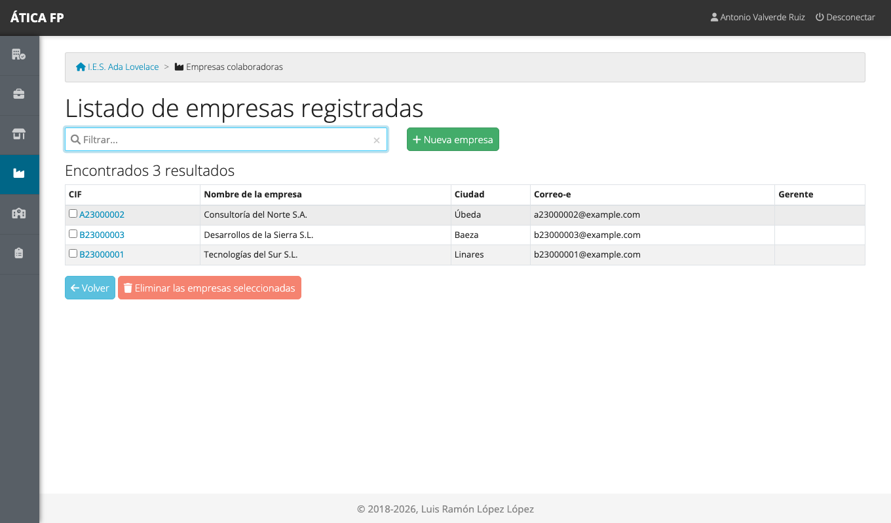
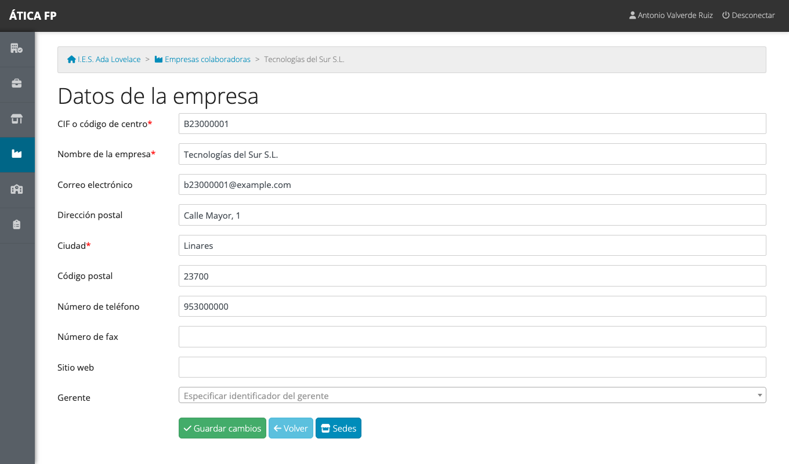
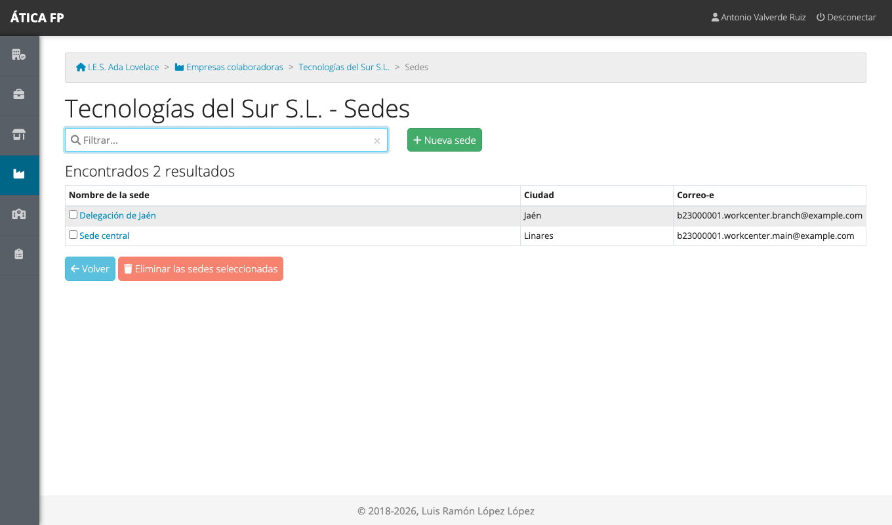

# Empresas y centros de trabajo

Este capítulo es para quien da de alta las empresas donde el alumnado hace las prácticas: la
**administración del centro**, las **jefaturas de departamento**, la **coordinación de FP dual** y la
**gestión de la FFEOE**. Las tres modalidades de formación (FCT, FP dual y FFEOE) trabajan sobre el mismo
catálogo de empresas y centros de trabajo, por eso se gestionan aquí, una sola vez, y no dentro de cada
módulo.

Se accede desde **Empresas colaboradoras** en el menú. Nadie más ve ese apartado (consulta la
[matriz de permisos](09-permisos-generales.md)).

!!! warning "El catálogo de empresas es común a todos los centros"
    Las empresas y sus centros de trabajo **no pertenecen a un centro**: son los mismos para todos los
    centros de la plataforma. Si otro instituto ya dio de alta una empresa, la verás en tu listado, y lo que
    cambies en ella lo verán también ellos. Por eso conviene **buscar antes de crear** y editar con
    cuidado los datos de las empresas que ya existen.

## Dos niveles: empresa y sede

El catálogo tiene dos niveles:

- **Empresa**: la entidad legal, identificada por su CIF.
- **Sede** (o centro de trabajo): cada lugar físico de la empresa donde puede realizar las prácticas el
  alumnado. Una empresa tiene una o varias sedes (por ejemplo, «Sede central» y «Delegación de Jaén»).

Los acuerdos de prácticas se firman con una **sede** concreta, así que una empresa sin sedes no puede
recibir alumnado.

## Empresas

El listado de **Empresas colaboradoras** muestra el CIF, el nombre, la ciudad, el correo y el gerente de
cada empresa. Escribe en **Filtrar** para buscar por CIF, nombre, ciudad o correo.

### Dar de alta una empresa

1. Pulsa **Nueva empresa**.
2. Rellena los datos. Son obligatorios el **CIF o código de centro**, el **nombre** y la **ciudad**; el
   resto (correo, dirección, código postal, teléfono, fax y sitio web) es opcional, aunque conviene
   completarlo.
3. Pulsa **Guardar cambios**.

El campo **Gerente** es opcional. Para asignarlo, escribe su identificador (DNI), su usuario o su
correo: la aplicación busca a la persona y, si no la encuentra, te ofrece **registrarla como persona
nueva** sin salir de la pantalla.

### Editar y eliminar

Pulsa el CIF de una empresa para abrir su ficha y editarla. Para eliminarla, marca su fila en el listado y
pulsa **Eliminar las empresas seleccionadas**; verás una pantalla de confirmación.

!!! note "Qué no se puede eliminar"
    Una empresa **que ya tiene datos asociados** (sedes con acuerdos o estancias, por ejemplo) no se puede
    eliminar: el borrado no se realiza. Si una empresa ya no colabora, déjala como está.

## Centros de trabajo (sedes)

Desde la ficha de una empresa, el botón **Sedes** abre su lista de centros de trabajo.

- **Nueva sede** añade un centro de trabajo: nombre de la sede, dirección, ciudad, código postal,
  teléfono, fax, correo y gerente de la sede.
- Pulsa el nombre de una sede para editarla. Para eliminar sedes, márcalas y usa **Eliminar las sedes
  seleccionadas**. Igual que con las empresas, una sede con acuerdos o estancias no se elimina.

## Y las personas de contacto

Este catálogo guarda **empresas y sedes**, no las personas que tutorizan al alumnado. La **tutoría
laboral** (la persona de la empresa que supervisa al alumno) se indica en cada acuerdo de FCT o FP dual y
en cada estancia de la FFEOE, y se explica en los capítulos de cada módulo. La única persona que se
registra aquí es el **gerente**, que es opcional.
