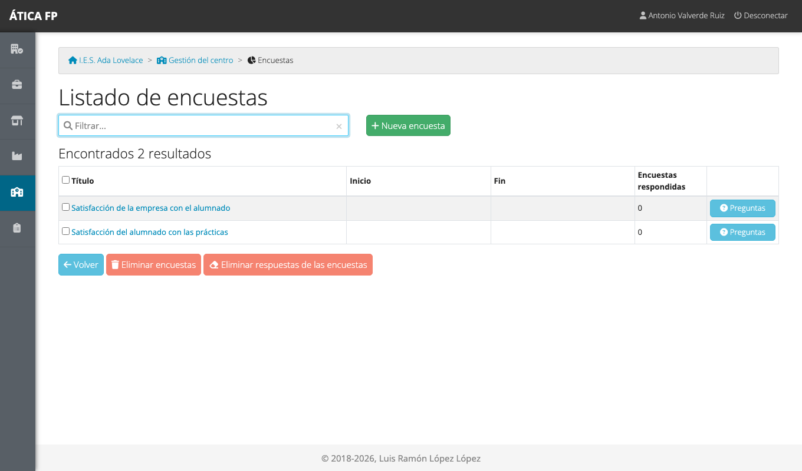
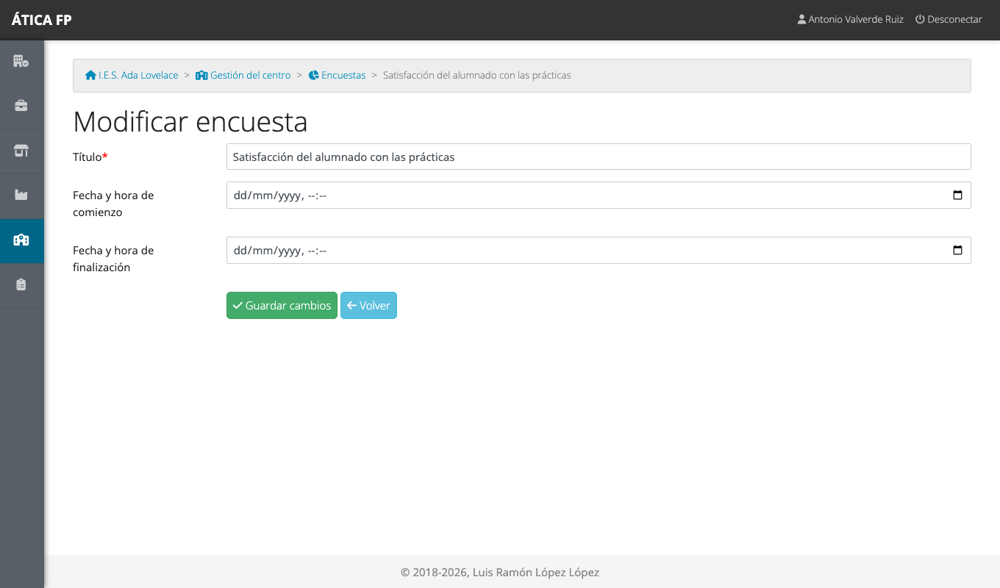
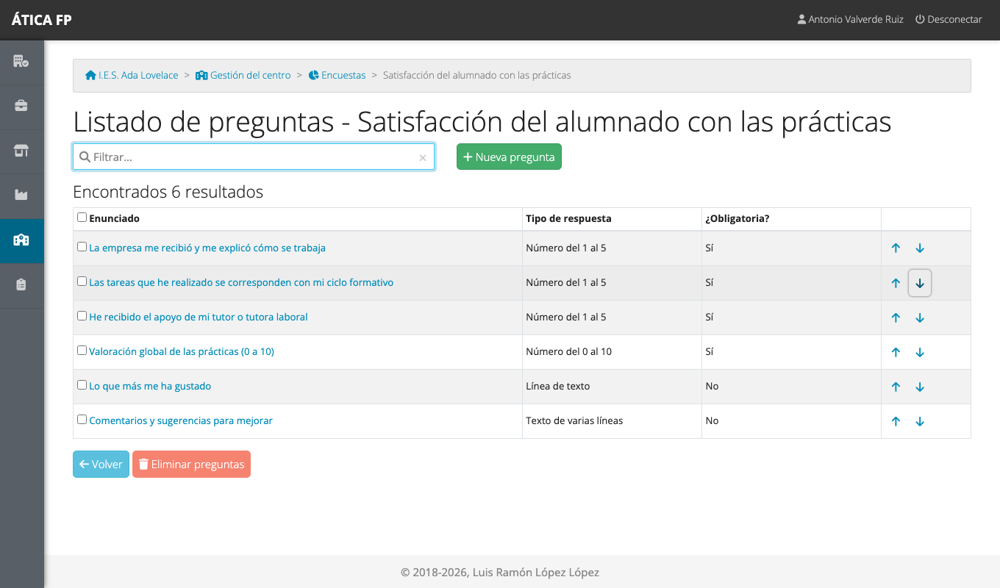
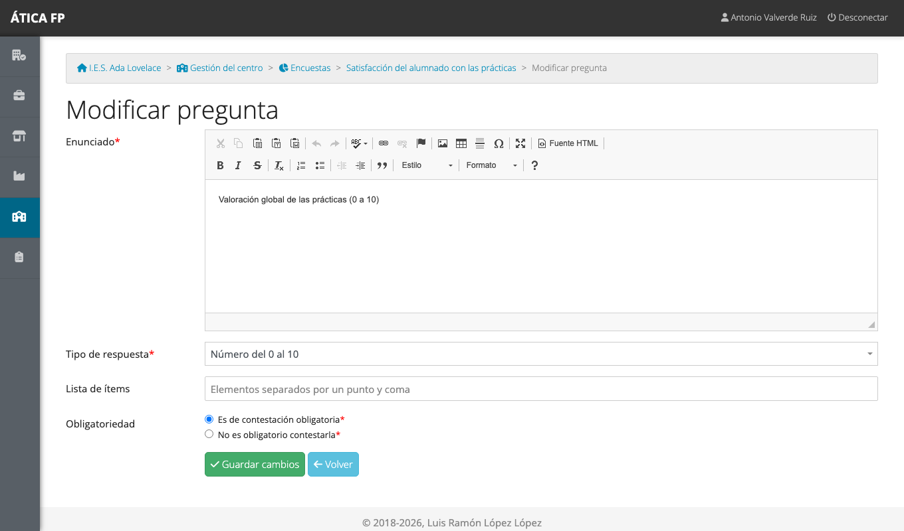
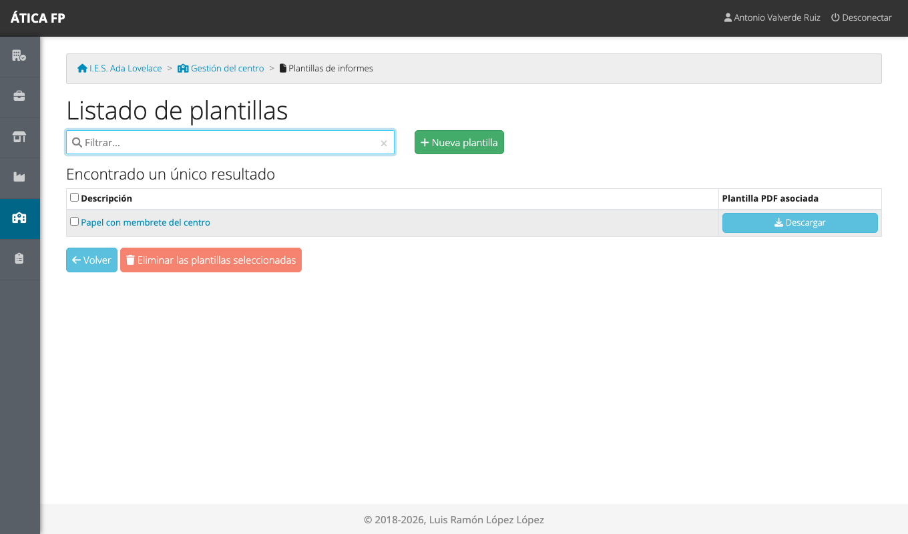
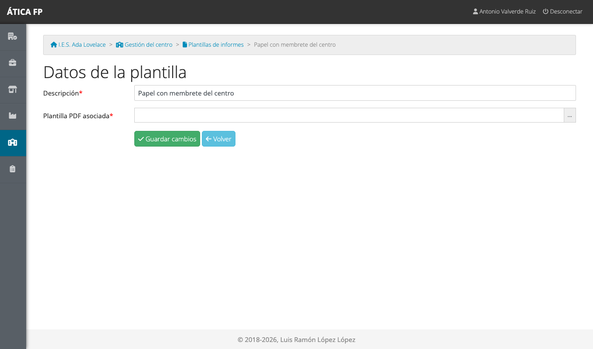

# Encuestas y plantillas de informe

Este capítulo es para la **administración del centro**. Explica dos recursos que se preparan una vez y se
usan después en los tres módulos: las **encuestas** de satisfacción y las **plantillas de informe**.

## Encuestas

En cada módulo se pide opinión a tres colectivos: el **alumnado**, las **empresas** (la tutoría laboral) y
el **centro educativo** (la tutoría docente). Las preguntas de esas encuestas se definen aquí, en
**Gestión del centro → Encuestas**, y después se **asigna cada encuesta** a una convocatoria de FCT, a un
proyecto de FP dual o a un programa de FFE (en los capítulos de cada módulo).

Un mismo modelo de encuesta puede usarse en varios módulos y en varios cursos. Lo normal es tener un
modelo por colectivo (alumnado, empresas, centro) y reutilizarlo.

### Crear una encuesta

1. Pulsa **Nueva encuesta**.
2. Escribe el **título**.
3. Opcionalmente, en **Copiar preguntas desde**, elige otra encuesta para partir de sus preguntas en
   lugar de empezar vacía. Es la forma más rápida de preparar la del curso siguiente.
4. Pulsa **Guardar cambios**.

Además del título, la encuesta tiene una **fecha y hora de comienzo** y otra de **finalización**,
ambas opcionales. Fuera de ese periodo nadie puede responderla: antes de comenzar no se abre, y pasada la
finalización se cierra. Si las dejas vacías, siempre está abierta. Cuando se acerca la fecha de cierre,
la aplicación avisa por correo a quien tiene la encuesta pendiente (ver
[Instalación y puesta en marcha](01-instalacion-y-puesta-en-marcha.md#tareas-periodicas)).

### Las preguntas

El botón **Preguntas** de cada encuesta abre su lista. Aquí se añaden, se editan, se ordenan con las
flechas y se eliminan.

Cada pregunta tiene:

- **Enunciado**: el texto de la pregunta, con un editor que permite negritas, listas y enlaces.
- **Tipo de respuesta**: elige entre las opciones de la tabla.
- **Lista de ítems**: opcional. Para los tipos numéricos, permite poner **etiquetas** a cada valor, separadas
  por punto y coma. Con una pregunta del 1 al 5, `Nada;Poco;Algo;Bastante;Mucho` hace que quien responde
  vea esas palabras en lugar de números.
- **Obligatoriedad**: si hay que contestarla para poder enviar la encuesta.

| Tipo | Cómo responde quien rellena la encuesta |
| --- | --- |
| Número del 0 al 5 / del 1 al 5 | Elige un valor entre 0 (o 1) y 5 |
| Número del 0 al 10 / del 1 al 10 | Elige un valor entre 0 (o 1) y 10 |
| Línea de texto | Escribe una respuesta breve |
| Texto de varias líneas | Escribe una respuesta larga |
| Texto fijo (sin respuesta) | No responde: es un texto, por ejemplo un título de sección o una explicación |

El orden de las preguntas es el de la lista; usa las flechas de la derecha para subir o bajar una.

!!! warning "Una encuesta con respuestas queda bloqueada"
    En cuanto alguien responde una encuesta, **ya no se pueden añadir, cambiar ni eliminar preguntas**: la
    aplicación lo avisa en la lista de preguntas. Para modificarla, hay que eliminar antes todas las
    respuestas (botón **Eliminar respuestas de las encuestas** del listado de encuestas, que pide
    confirmación y no se puede deshacer) o, mejor, **crear una encuesta nueva copiando** la anterior. Así se conservan los
    resultados del curso que ya terminó.

### Eliminar encuestas

Marca las encuestas en el listado y pulsa **Eliminar encuestas**. Solo se eliminan las que no tienen
respuestas: la pantalla de confirmación muestra únicamente las que se pueden borrar.

## Plantillas de informe {#plantillas-de-informe}

Los módulos generan documentos en PDF: el programa formativo de un acuerdo, los informes de visitas, la
relación de gastos de desplazamiento... Una **plantilla de informe** es un PDF que sirve de **fondo** de
esas páginas: normalmente el **papel con membrete** del centro, con el escudo, el nombre y el pie ya
impresos. Así, los documentos salen listos para firmar y presentar.

### Crear una plantilla

1. En **Gestión del centro → Plantillas de informes**, pulsa **Nueva plantilla**.
2. Escribe una **descripción** (por ejemplo, «Membrete vertical» o «Membrete apaisado»).
3. Sube el **PDF** asociado.
4. Pulsa **Guardar cambios**.

Prepara el PDF con el mismo tamaño y orientación que los informes que va a servir: una plantilla
**vertical** para los documentos en vertical y otra **apaisada** para los apaisados (por ejemplo, el
informe de visitas). Puedes descargarlo de nuevo desde la ficha para revisarlo.

### Dónde se usan

Las plantillas no se eligen en cada informe: se **predeterminan por curso académico**. En
[los datos del curso](03-preparar-el-curso-academico.md#los-datos-de-un-curso) hay dos campos,
**Plantilla predeterminada vertical** y **Plantilla predeterminada apaisado**. Cada informe que
genera la aplicación usa la que corresponda a su orientación; si dejas «Sin plantilla», sale sobre papel
en blanco.

!!! note "Eliminar una plantilla"
    Una plantilla que se está usando (porque es la predeterminada de algún curso) no se puede eliminar.
    Cámbiala primero en los datos del curso.
