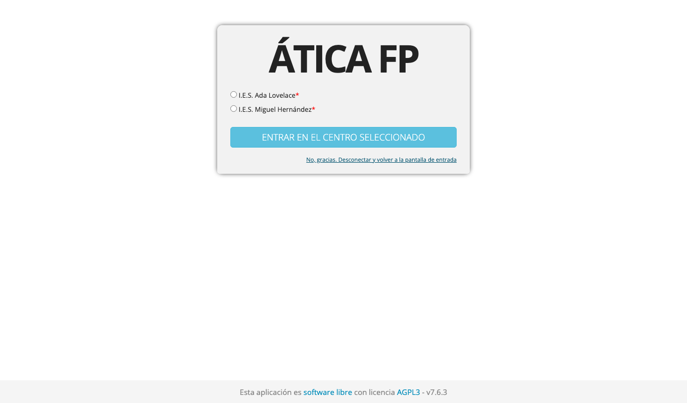
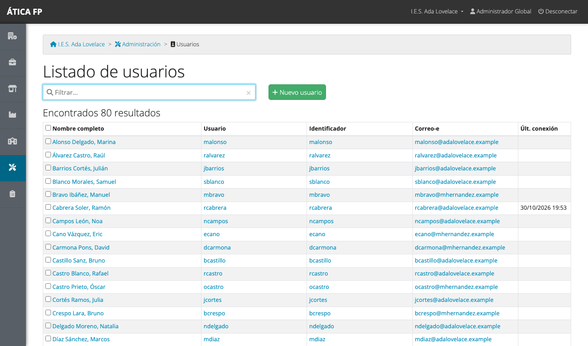

# Administrar la plataforma

Este capítulo es para la **administración de la plataforma**: la persona o personas que gestionan la
instalación de ÁTICA FP en su conjunto, por encima de cada centro. Si trabajas en la administración de un
centro concreto, no lo necesitas: tu gestión está en [Administrar el centro](04-administrar-el-centro.md).

La administración de la plataforma es una cuenta con el permiso de **administrador global**. Puede
**entrar en cualquier centro** como si fuera su administración local, y es la única que ve el apartado
**Administración** del menú, con dos secciones: **Centros educativos** y **Usuarios**.

!!! warning "Úsalo con prudencia"
    Una cuenta de administración global puede ver y cambiar datos de todos los centros. Usa estas
    cuentas solo para tareas de plataforma, no para el trabajo diario, y limita cuántas hay.

## Centros educativos

**Administración → Centros educativos** lista los centros de la plataforma.

- **Cambiar a** hace que pases a trabajar en ese centro (también puedes hacerlo desde el nombre del
  centro, arriba a la derecha). El centro en el que estás aparece marcado como **Activo**.
- **Nuevo centro** da de alta un centro. Desde el instalador también se puede crear el primero
  ([Instalación y puesta en marcha](01-instalacion-y-puesta-en-marcha.md)).
- Pulsa el nombre de un centro para editar sus datos.

Son obligatorios el **nombre**, el **código de centro** y la **ciudad**; el resto es opcional.

!!! danger "Eliminar un centro borra todos sus datos"
    Al eliminar un centro (marca su fila y pulsa **Eliminar centros seleccionados**), la aplicación
    borra **toda su configuración y todos sus datos**: cursos, grupos, matrículas, acuerdos, seguimientos y
    el resto. Los usuarios no se borran, pero se quedan sin ese centro. La operación **no se puede
    deshacer**: antes de hacerlo, saca una copia de seguridad
    ([Despliegue y mantenimiento](92-despliegue-y-mantenimiento.md)).

### Cada centro es independiente

Los datos de un centro (profesorado, alumnado, convocatorias, acuerdos...) son **invisibles para los
demás centros**: nadie de un instituto puede ver o abrir datos de otro, aunque conozca la dirección de la
página. La administración de la plataforma es la única excepción. El único catálogo compartido es el de
[empresas y centros de trabajo](06-empresas-y-centros-de-trabajo.md).

## Usuarios

**Administración → Usuarios** lista **todas las personas** con cuenta en la plataforma, de todos los
centros: profesorado, alumnado, tutorías laborales y administradores.

Escribe en **Filtrar** para buscar por usuario, nombre, apellidos o correo. En una instalación grande el
listado tiene muchas filas y se reparte en páginas.

### Crear y editar un usuario

El profesorado y el alumnado se crean al importarlos desde Séneca
([Importaciones](05-importaciones.md)); las personas de empresa (tutorías laborales) se crean desde el
módulo correspondiente. **Nuevo usuario** sirve para el resto de casos: por ejemplo, una persona
administradora o alguien que no viene de ninguna importación.

Además de los datos personales, la ficha tiene opciones que solo ve la administración de la plataforma:

- **Acceso**: permitido o denegado. Con «denegado», la persona no puede entrar en ninguno de los
  centros, aunque conserve sus datos. Es la forma correcta de **desactivar** una cuenta sin borrarla.
- **El usuario puede administrar todos los centros**: convierte la cuenta en administración de la
  plataforma. Concédelo con mucho cuidado.
- **Permitir comprobación de contraseña externa** y **Comprobación de contraseña**: si la persona puede
  entrar con su contraseña de Séneca (su usuario debe ser el usuario IdEA).
- **Forzar cambio de contraseña en el próximo inicio**: la aplicación pedirá una contraseña nueva la
  próxima vez que entre. Úsalo cuando restableces una contraseña a mano.
- Al final de la ficha, los campos para **poner una contraseña nueva** a esa persona.

### Acceder como otro usuario

Cuando alguien tiene un problema que no logras reproducir, puedes ver la aplicación **tal como la ve esa
persona**. En su ficha, pulsa **Acceder como el usuario**. Pasarás a trabajar con su cuenta, con su menú y
sus permisos, y un enlace **Volver al usuario normal** (arriba a la derecha, donde antes estaba
«Desconectar») te devuelve a la tuya.

!!! warning "Es una suplantación"
    Mientras accedes como otra persona, **todo lo que haces queda a su nombre** (registros de jornada,
    evaluaciones, mensajes...). Úsalo solo para diagnosticar, no para trabajar por ella, y vuelve a tu
    usuario en cuanto termines.

### Eliminar usuarios

Marca las filas y pulsa **Eliminar usuarios seleccionados**. Un usuario que tiene datos asociados en
algún centro (matrículas, acuerdos, seguimientos) **no se elimina**: el borrado no se realiza. Para
impedir que una persona entre, usa mejor el **Acceso: denegado**.

## Los módulos de cada centro

No hay un interruptor de módulos a nivel de plataforma: **cada centro activa FCT, FP dual y FFEOE por
curso académico**, desde los [datos del curso](03-preparar-el-curso-academico.md#los-datos-de-un-curso).
La administración de la plataforma puede hacerlo entrando en el centro, igual que su administración local.
