# FCT: gestión de la convocatoria

Este capítulo es para la **administración del centro** y las **jefaturas de departamento**: las
personas que preparan las prácticas de cada curso. Cubre las convocatorias, sus actividades, los
acuerdos con las empresas y su calendario, y los informes de resultados. La administración del centro
gestiona todas las convocatorias; **la jefatura, solo las de las enseñanzas de su departamento** (por eso
es importante que cada enseñanza esté enlazada con su
[familia profesional](04-administrar-el-centro.md#departamentos)).

## Qué puedes hacer

- Crear y editar **convocatorias** de FCT.
- Definir las **actividades formativo-productivas** y asociarlas a los criterios de evaluación.
- Crear los **acuerdos de colaboración** con las empresas, con su alumnado, sus tutorías y su programa
  formativo.
- Preparar el **calendario** de cada acuerdo.
- **Seguir** el estado de todos los acuerdos, y consultar las visitas, los desplazamientos y los
  informes del profesorado.
- Obtener los **informes de resultados** de las encuestas.

La [matriz de permisos](16-fct-permisos.md) detalla cada acción.

## Dónde está

En el menú de **FCT**, con las tarjetas **Convocatorias** (convocatorias, actividades y acuerdos),
**Seguimiento de actividad**, **Informe del tutor/a laboral**, **Visitas a empresas**, **Dietas de
desplazamiento**, **Encuestas** e **Informes**.

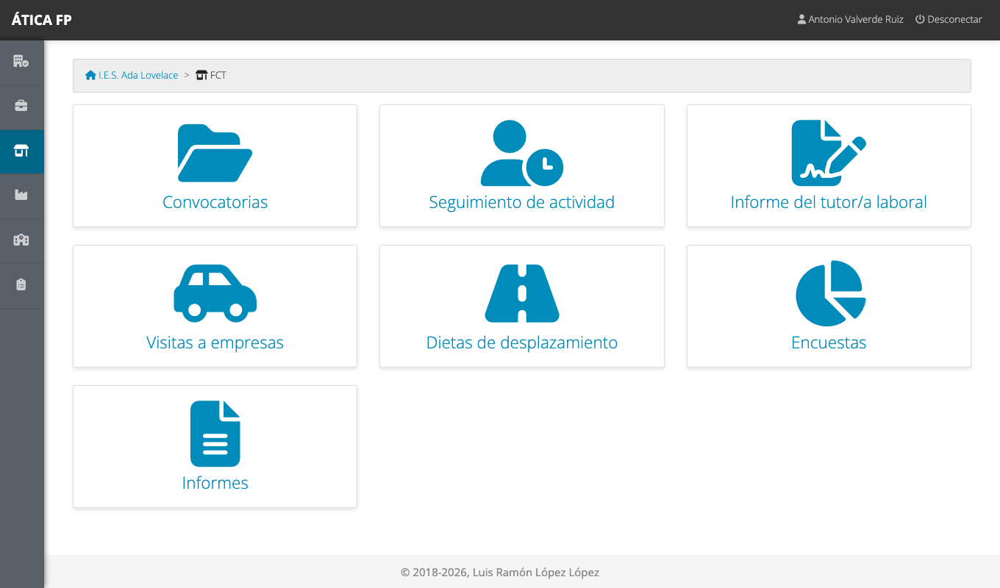

La jefatura ve las mismas tarjetas, pero solo con los datos de su departamento.

## Convocatorias {#convocatorias}

**FCT → Convocatorias** lista las convocatorias del curso (hay un selector para ver otro curso).

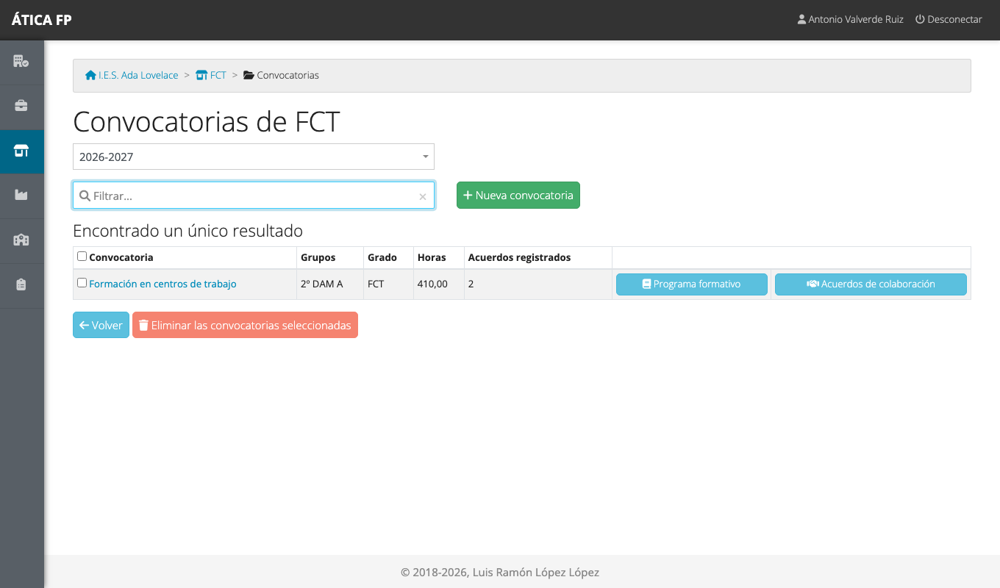

Cada fila muestra el grupo, el grado, las horas y el número de acuerdos registrados. Con los botones
de la derecha accedes al **programa formativo** (las actividades) y a los **acuerdos de colaboración**.

### Crear una convocatoria

1. Pulsa **Nueva convocatoria**.
2. Rellena la ficha y guarda.

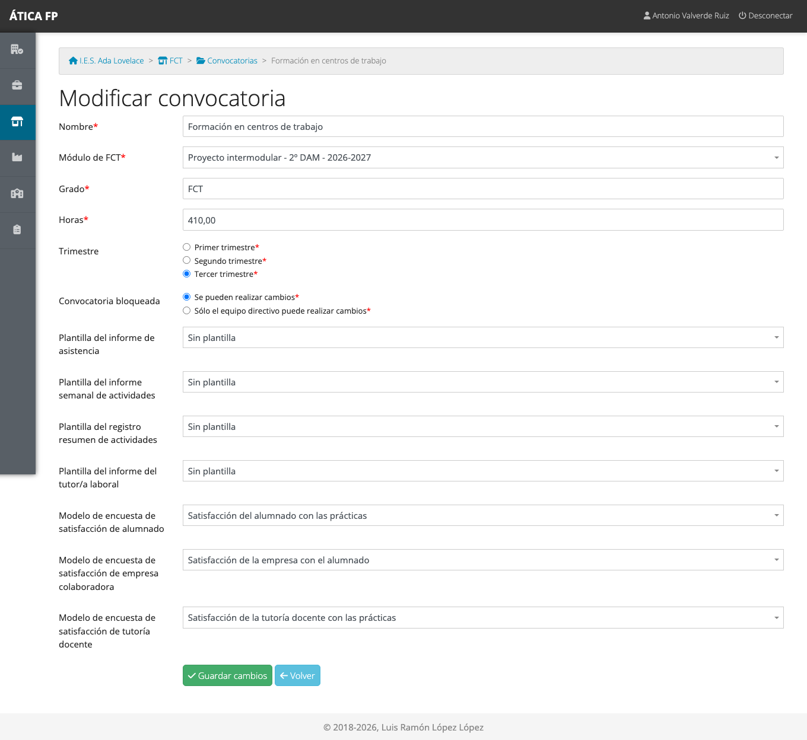

- **Nombre**: el que verán todos. Por ejemplo, «FCT de 2º de DAM, tercer trimestre».
- **Módulo de FCT**: la materia (módulo profesional) a la que corresponden las prácticas. Se elige entre las
  materias del curso; **la jefatura solo ve las de su departamento**.
- **Grado**: el tipo de formación, en texto libre («FCT»).
- **Horas**: el total de horas de prácticas que tiene que hacer cada estudiante.
- **Trimestre**: primero, segundo o tercero.
- **Convocatoria bloqueada**: marcada como «bloqueada», la convocatoria queda cerrada y el seguimiento se
  congela: ya no se pueden registrar ni modificar jornadas, informes ni encuestas. Tampoco la jefatura de
  departamento puede ya cambiar la convocatoria, su programa formativo ni sus acuerdos, ni eliminarla: los abre
  en solo lectura. Solo la administración del centro puede seguir modificándolos, por ejemplo para
  desbloquearla. Úsalo cuando la convocatoria ha terminado y está todo revisado.
- **Plantillas de informe** (asistencia, informe semanal de actividades, registro resumen de actividades
  e informe del tutor/a laboral): el [papel con membrete](07-encuestas-y-plantillas-de-informe.md#plantillas-de-informe)
  de cada documento. «Sin plantilla» genera el documento sobre papel en blanco.
- **Modelos de encuesta** de satisfacción del alumnado, de la empresa colaboradora y de la tutoría docente:
  las [encuestas](07-encuestas-y-plantillas-de-informe.md) que se usarán en esta convocatoria. «Ninguna»
  desactiva esa encuesta.

!!! warning "Eliminar una convocatoria elimina todo lo que contiene"
    Si eliminas una convocatoria (marca su fila y pulsa **Eliminar las convocatorias seleccionadas**), se
    borran **todos los datos asociados**: acuerdos, calendarios, jornadas registradas, informes y
    encuestas. La aplicación lo advierte en la pantalla de confirmación y no se puede deshacer. En una
    convocatoria ya terminada, es preferible **bloquearla**.

## Actividades formativo-productivas {#actividades-formativo-productivas}

El **programa formativo** de una convocatoria es la lista de actividades que el alumnado puede hacer en las
empresas. En la fila de la convocatoria, pulsa **Programa formativo**.

Cada actividad tiene un **código** (A1, A2...), una **descripción** y los **criterios de evaluación**
que trabaja. Estos criterios salen de los resultados de aprendizaje de la materia de la convocatoria
([capítulo 4](04-administrar-el-centro.md#resultados-de-aprendizaje-y-criterios-de-evaluacion)), así que
conviene tenerlos cargados antes de definir las actividades.

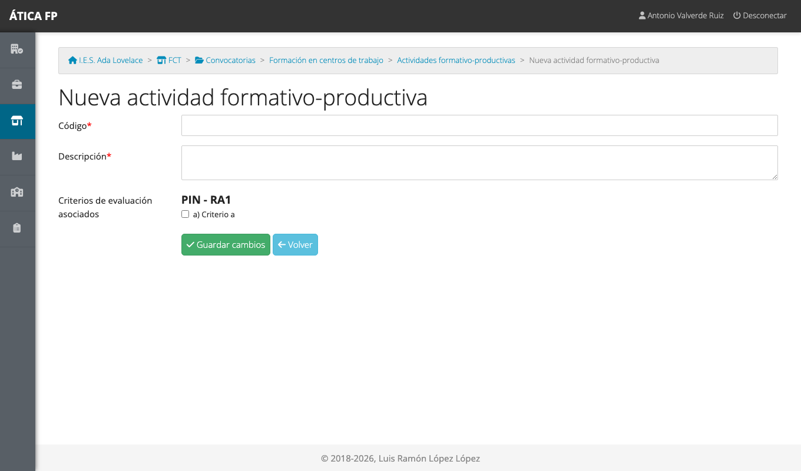

Hay cuatro formas de rellenar el programa:

- **Una a una**, con **Nueva actividad formativo-productiva**.
- **Importación masiva**: debajo de la lista, pega un texto con una actividad por línea en el formato
  `CÓDIGO: descripción` (por ejemplo, `A1: Instalación de equipos`) y pulsa el botón de importar. Es lo
  más cómodo para cargar muchas.
- **Copiar desde otra convocatoria** de la misma enseñanza: copia las actividades y los criterios
  asociados. Es la forma de reutilizar el programa de un curso a otro.

  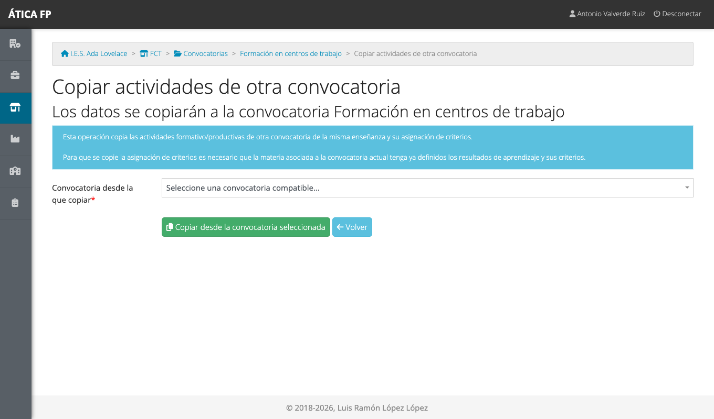

- **Copiar desde un convenio de FP dual**, para aprovechar las actividades de un proyecto de
  [FP dual](20-dual-vision-general.md) ya definido.

Para quitar actividades, márcalas y pulsa **Eliminar las actividades seleccionadas**.

## Acuerdos de colaboración {#acuerdos-de-colaboracion}

Un **acuerdo** reúne a una **sede de una empresa** con el **alumnado** que hará allí las prácticas, durante
un periodo. En la fila de la convocatoria, pulsa **Acuerdos de colaboración**.

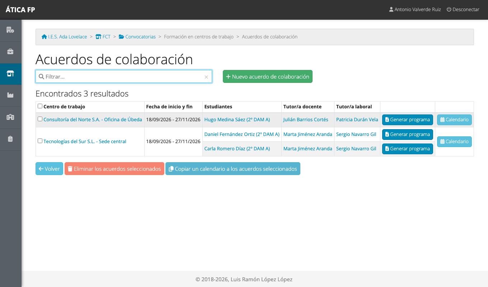

La tabla muestra, por cada acuerdo, la empresa y la sede, las fechas, cada estudiante con su tutor o tutora
docente y laboral, y los botones **Generar programa** (el programa formativo individual de ese estudiante
en PDF) y **Calendario**.

### Crear un acuerdo

1. Pulsa **Nuevo acuerdo de colaboración**.
2. Rellena la ficha y guarda.

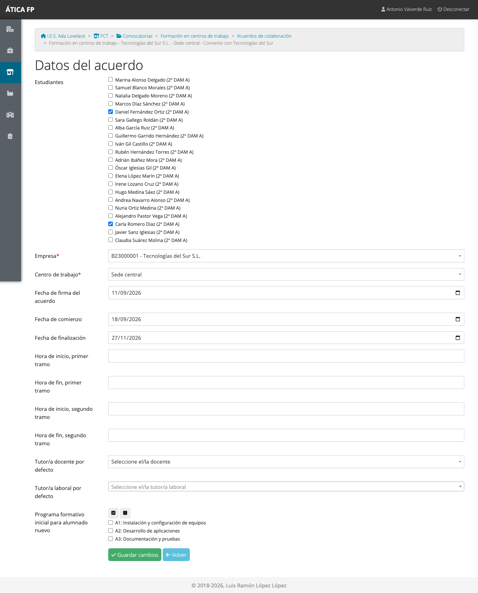

- **Estudiantes**: marca al alumnado del grupo que irá a esa empresa. Un estudiante no puede estar dos veces en
  el mismo acuerdo ni tener dos acuerdos en la misma sede.
- **Empresa** y **Centro de trabajo**: se eligen del catálogo ([capítulo 6](06-empresas-y-centros-de-trabajo.md)).
  La empresa se elige primero y de ella se ofrecen sus sedes.
- **Fecha de firma del acuerdo**, **fecha de comienzo** y **fecha de finalización**.
- **Horas de inicio y de fin**, en **dos tramos** como máximo (por ejemplo, mañana y tarde): el horario
  habitual del alumnado en la empresa. Es opcional.
- **Tutor/a docente por defecto** y **tutor/a laboral por defecto**: se asignan a todo el alumnado del acuerdo
  (después se pueden cambiar uno a uno). Para la tutoría laboral, busca a la persona por su identificador,
  usuario o correo; si no existe, puedes registrarla desde la propia pantalla.
- **Programa formativo inicial para alumnado nuevo**: las actividades que tendrá cada estudiante al
  incorporarse. Los botones sobre la lista marcan o desmarcan todas.

!!! tip "La tutoría laboral necesita un usuario"
    Para que la persona de la empresa pueda entrar en la aplicación, debe tener un usuario. Al registrarla
    desde el acuerdo se crea el usuario, con su **identificador (DNI o NIE) como contraseña inicial**, que la
    aplicación le obliga a cambiar al entrar. Hay que **comunicarle** su nombre de usuario. Si la registras sin
    identificador, no tendrá contraseña inicial: dile que use «¿Olvidó la contraseña?» con su correo (por eso
    conviene rellenarlo).

### Los datos de cada estudiante

Pulsa el nombre de un estudiante en la tabla de acuerdos para ver sus datos dentro del acuerdo.

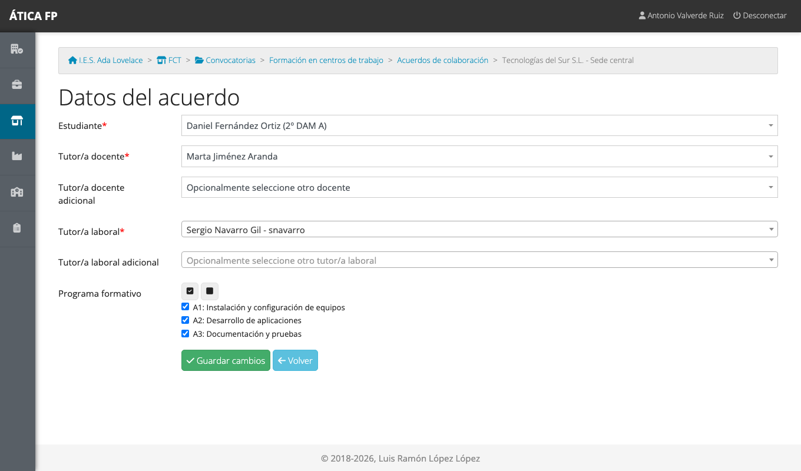

Aquí ajustas, para esa persona: su **tutoría docente** (obligatoria) y una **tutoría docente adicional**
opcional, su **tutoría laboral** (obligatoria) y una **adicional** opcional, y las **actividades** que
incluye su programa formativo. Las tutorías adicionales dan los mismos permisos que las principales.

### El calendario de un acuerdo {#el-calendario-de-un-acuerdo}

El **calendario** indica qué días hay que ir a la empresa y cuántas horas cada día. Pulsa **Calendario** en
la fila del acuerdo.

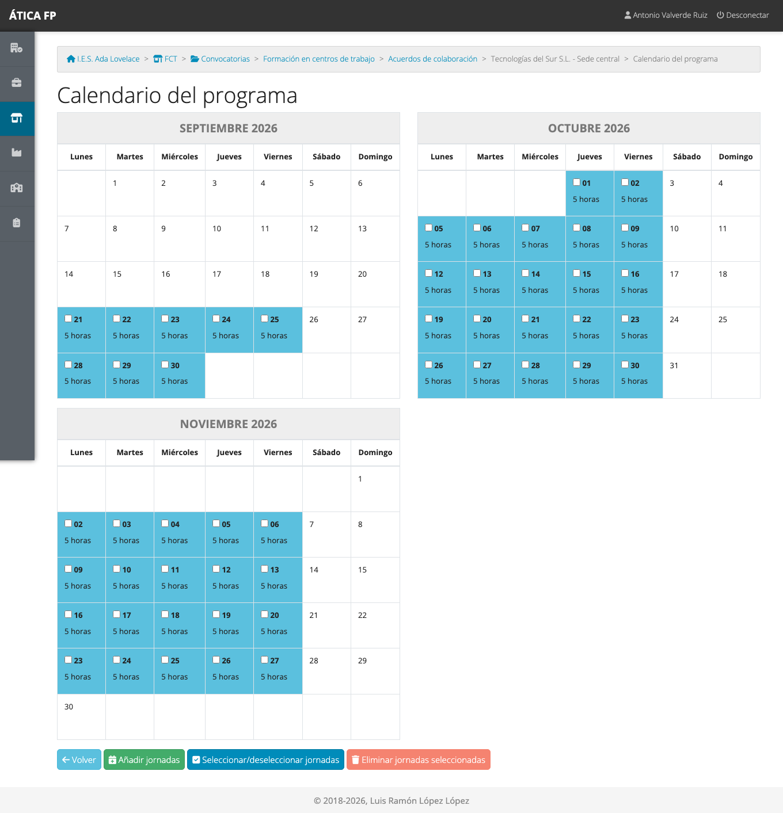

- **Añadir jornadas** genera días de prácticas de golpe.

  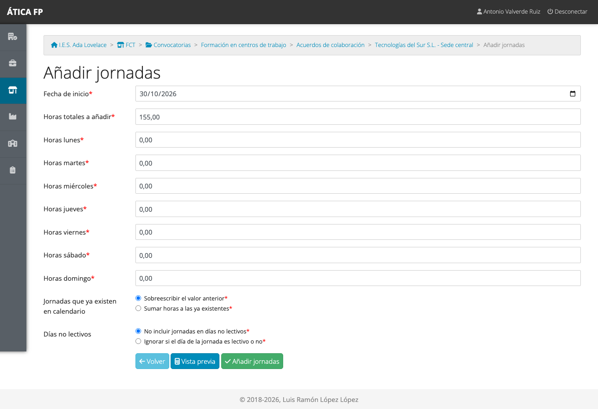

  Indica la **fecha de inicio**, las **horas totales a añadir** (la aplicación propone las que faltan para
  completar las de la convocatoria) y las **horas de cada día de la semana**. Reparte las horas por los días
  que correspondan hasta completar el total. Con **Vista previa** ves el resultado antes de guardar.
  Las jornadas que ya existían se pueden **sobrescribir** o **sumar**, y por defecto **no se incluyen los días
  no lectivos** ([capítulo 4](04-administrar-el-centro.md#dias-no-lectivos)).
- Para quitar jornadas, márcalas y pulsa **Eliminar jornadas seleccionadas**. **Seleccionar/deseleccionar
  jornadas** marca todos los días a la vez.
- Pulsa una jornada para cambiar sus horas.

Cuando el calendario de un acuerdo está listo, puedes **copiarlo a otros acuerdos** que tengan el mismo
horario: en la tabla de acuerdos, marca los acuerdos de destino y pulsa **Copiar un calendario a los
acuerdos seleccionados**. La aplicación te pide el **acuerdo de origen** (uno de los que no has marcado) y
qué hacer con las jornadas que ya existan en el destino: **sobreescribir** el valor anterior o **sumar** las
horas.

!!! warning "La copia no se puede deshacer"
    Con «sobreescribir», copiar un calendario cambia las horas de los días que ya tuvieran los acuerdos de
    destino. Revisa bien la selección antes de confirmar.

### Eliminar acuerdos

Marca los acuerdos y pulsa **Eliminar los acuerdos seleccionados**. Un acuerdo que ya tiene datos asociados
(jornadas registradas, por ejemplo) no se elimina.

## Seguimiento, visitas y desplazamientos

Como administración o jefatura puedes ver el trabajo del profesorado y del alumnado:

- **Seguimiento de actividad**: todos los acuerdos del curso, con el estudiante, la empresa, las tutorías, las
  fechas y las horas bloqueadas sobre las totales con las faltas. Pulsa un estudiante para abrir su
  [calendario de seguimiento](12-fct-tutoria-docente-y-de-grupo.md#el-calendario-de-seguimiento), donde
  puedes hacer lo mismo que la tutoría docente.

  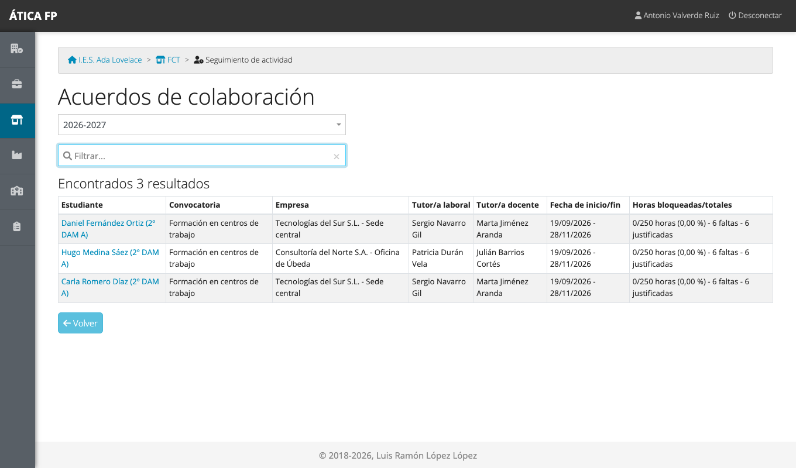

- **Visitas a empresas**: un resumen por docente. Desde él accedes a las visitas de cada persona.

  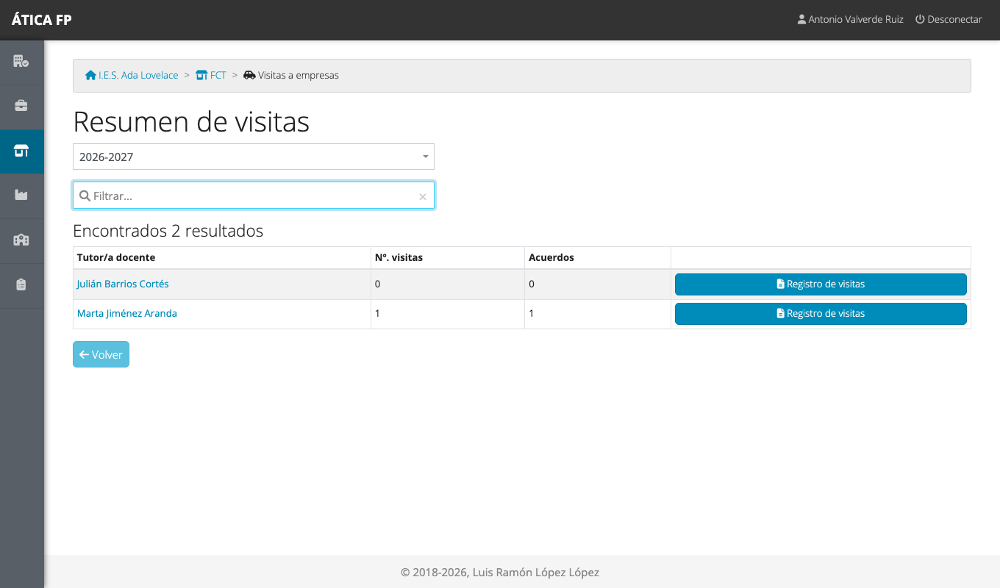

- **Dietas de desplazamiento**: un resumen por docente, con los kilómetros y los otros gastos, y si están
  verificados.

  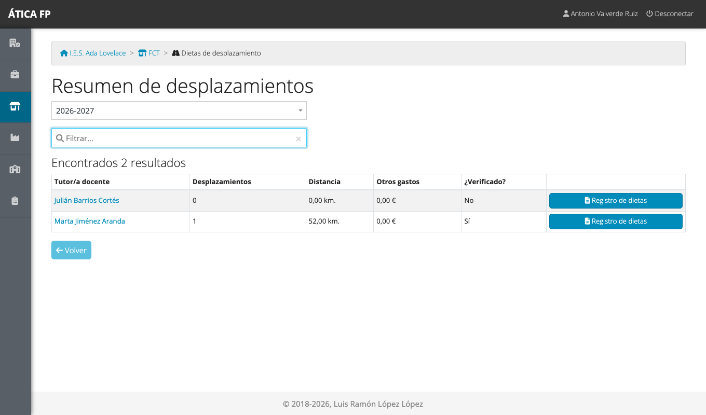

  El botón **Registro de dietas** descarga la relación de gastos de ese docente en PDF.
- **Informe del tutor/a laboral**: la lista de acuerdos con el estado de la valoración final de cada uno
  ([capítulo 14](14-fct-tutoria-laboral.md#el-informe-final)).

## Informes de resultados {#informes}

La tarjeta **Informes** (solo para administración y jefatura) obtiene el análisis de las **encuestas de
satisfacción** de la convocatoria.

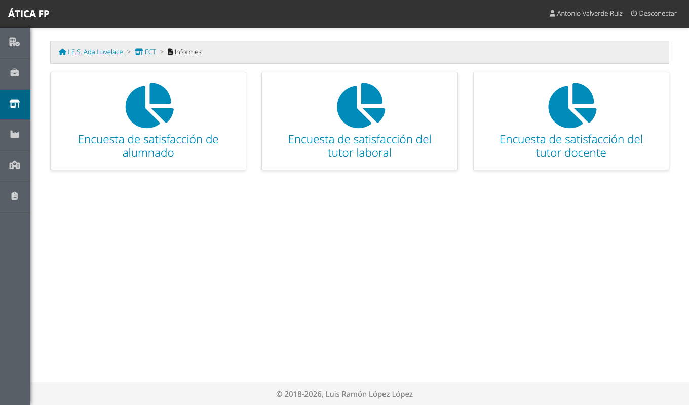

Elige la encuesta (alumnado, tutoría laboral o tutoría docente), después la convocatoria en el listado, y la
aplicación genera un **PDF** con el resultado de cada pregunta de las respuestas recibidas.

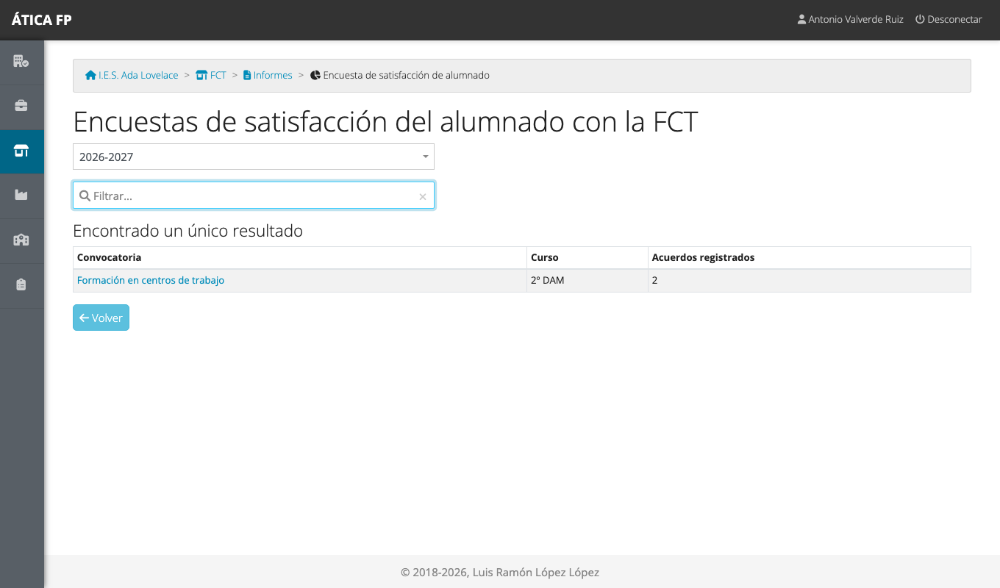

El informe se puede obtener en cualquier momento, aunque todavía falten respuestas: refleja las que haya.

## Qué no puedes hacer y a quién pedirlo

- **La jefatura solo gestiona su departamento.** Para las convocatorias de otras enseñanzas, la
  administración del centro.
- **Los registros diarios los hacen las tutorías y el alumnado.** Como gestión puedes consultarlos y también
  modificarlos, pero no es tu labor habitual.
- **Los usuarios del alumnado y del profesorado** se crean al
  [importarlos](05-importaciones.md); las tutorías laborales, al darlas de alta en el acuerdo.
