# FCT: tutoría docente y de grupo

Este capítulo es para el **profesorado que hace el seguimiento del alumnado** en las prácticas: la
**tutoría docente** (la persona responsable de hacer el seguimiento de un alumno o de un acuerdo) y la
**tutoría de grupo** (quien tutoriza al grupo al que pertenece el alumnado). Una misma persona puede ser
las dos cosas a la vez; lo que cambia es lo que puedes hacer según la relación que tengas con cada
estudiante.

## Qué puedes hacer

| Tarea | Tutoría docente | Tutoría de grupo |
| --- | :-: | :-: |
| Consultar el seguimiento y el calendario de tu alumnado | ✅ | ✅ |
| Registrar y revisar jornadas | ✅ | ✅ |
| **Bloquear** jornadas ya revisadas | ✅ | ✅ |
| Marcar faltas justificadas e injustificadas | ✅ | ✅ |
| Descargar la hoja de asistencia | ✅ | ✅ |
| Descargar el registro resumen de actividades | ✅ | — |
| Registrar **visitas** a las empresas | ✅ | — |
| Registrar **gastos de desplazamiento** | ✅ | — |
| Rellenar el informe del tutor/a laboral y las encuestas, en nombre de la empresa o del alumnado | ✅ | ✅ |
| Rellenar tu **encuesta de satisfacción de tutoría docente** | ✅ | — |

La [matriz de permisos](16-fct-permisos.md) lo detalla pantalla a pantalla. La administración y la
jefatura de departamento pueden hacer lo mismo con todo el alumnado de su ámbito
([capítulo 11](11-fct-gestion.md)).

## Dónde está

En **FCT**, tu menú tiene las tarjetas **Seguimiento de actividad**, **Informe del tutor/a laboral** y
**Encuestas**, y, si eres tutor o tutora docente, también **Visitas a empresas** y **Dietas de
desplazamiento**.

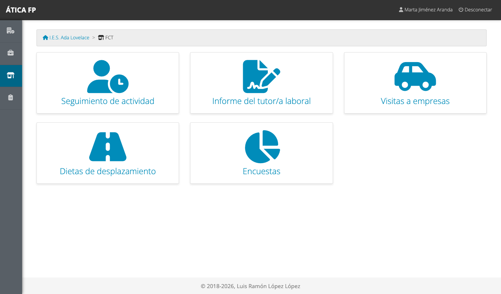

## Seguimiento diario

**FCT → Seguimiento de actividad** lista los acuerdos de tu alumnado (los tuyos como tutoría docente y los de
los grupos que tutorizas).

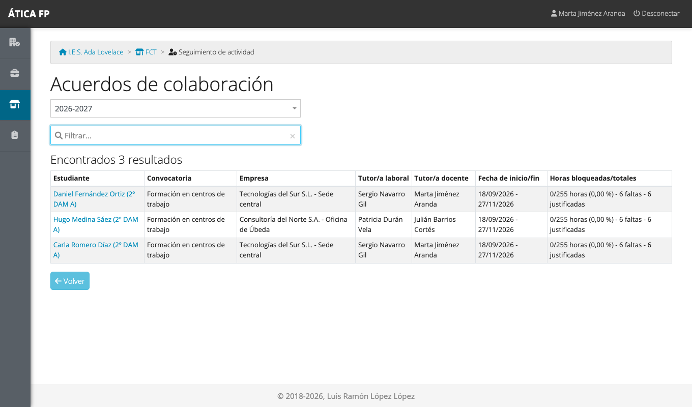

Cada fila muestra la persona, la empresa, las tutorías, el periodo y el **estado de las horas**:
las horas bloqueadas sobre el total, las faltas y cuántas están justificadas. Pulsa el nombre del
estudiante para abrir su calendario.

### El calendario de seguimiento {#el-calendario-de-seguimiento}

El **calendario formativo** muestra todas las jornadas del acuerdo mes a mes, con un código de color:

- **Verde**: jornada con todas sus horas repartidas entre las actividades.
- **Naranja**: jornada con actividades registradas, pero que no suman todas las horas del día.
- **Rayado amarillo**: falta **justificada**. El **rayado oscuro** es una falta **injustificada**.
- **Azul**: jornada todavía sin registrar.

Encima del calendario, una barra indica el **progreso de las actividades** (cuántas actividades del programa
formativo se han llegado a realizar) y el botón **Ir a hoy** te lleva al mes actual. Cada semana tiene a
su derecha un **candado** (bloquear o desbloquear la semana entera) y una **impresora** (el informe semanal
de actividades en PDF).

#### Registrar o revisar una jornada

Pulsa un día para abrir su ficha.

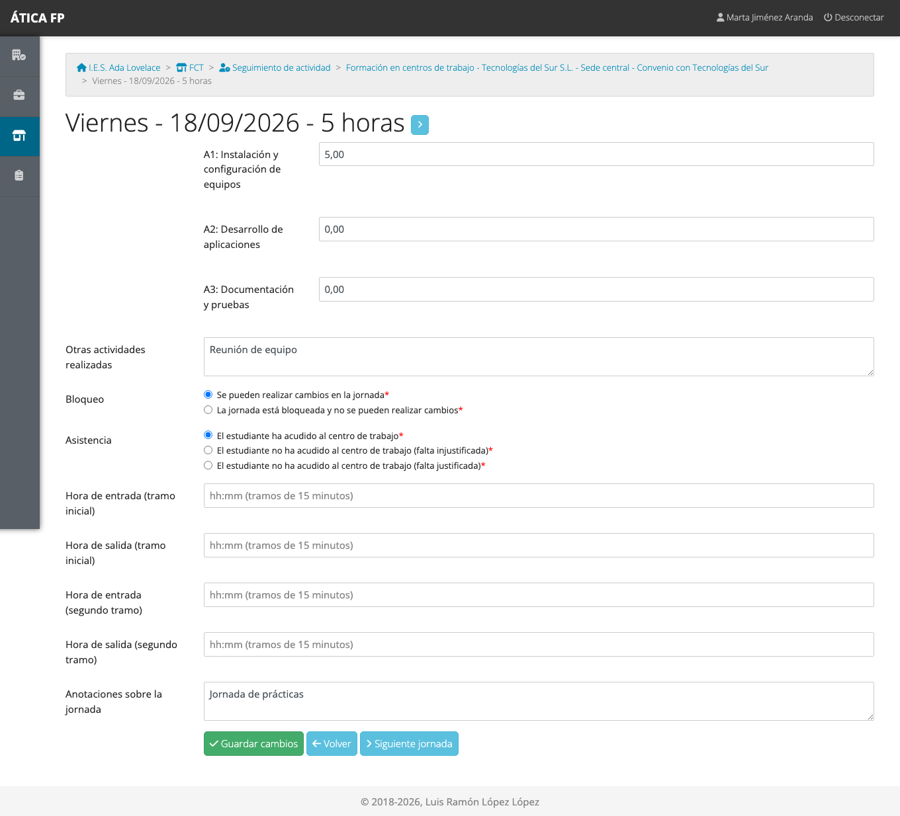

- **Horas de cada actividad**: cuántas horas de la jornada se dedicaron a cada una de las actividades del
  programa formativo del alumno.
- **Otras actividades realizadas**: texto libre para lo que no esté en el programa.
- **Bloqueo** y **Asistencia**: el alumnado no los ve. El bloqueo («se pueden realizar cambios» o «la jornada
  está bloqueada») lo ven las tutorías docente y de grupo; con la jornada bloqueada, **nadie puede modificar**
  las horas ni las anotaciones hasta que se desbloquee. La asistencia («ha acudido» o falta **justificada** o
  **injustificada**) la ve también la tutoría laboral.
- **Horas de entrada y de salida**, en uno o dos tramos y en múltiplos de 15 minutos (opcional).
- **Anotaciones sobre la jornada**: observaciones libres.

!!! note "Una falta borra las actividades de la jornada"
    Si marcas la jornada como falta (de cualquier tipo), la aplicación **borra las horas de actividades**
    que hubiera y **bloquea la jornada** automáticamente: un día en el que no se ha ido no puede tener
    actividades.

Las flechas junto al título y los botones **Jornada anterior** y **Siguiente jornada** recorren el calendario
sin volver al mes.

#### Bloquear y justificar faltas

Para actuar sobre varios días a la vez, marca las casillas de las jornadas en el calendario (o usa
**Seleccionar/deseleccionar jornadas**) y pulsa:

- **Bloquear** / **Desbloquear**: fija las jornadas marcadas para que no se vuelvan a modificar. Lo normal es
  bloquear por semanas, cuando has revisado lo que ha registrado el alumno y la empresa. La semana entera se
  bloquea con el candado de su fila.
- **Falta justificada** / **Falta injustificada**: marca como faltas las jornadas seleccionadas.

!!! tip "Bloquea al revisar"
    Una jornada bloqueada cuenta en el estado de las horas del acuerdo (las «horas bloqueadas»). Es la forma de
    dar por buenas las horas hechas, y la cifra que se usa para saber cuánto falta para completar las horas
    de la convocatoria.

#### Documentos del seguimiento

Debajo del calendario hay dos botones que generan un PDF:

- **Informe de acreditación de asistencia**: la hoja con la asistencia del alumno, lista para firmar. La puede
  descargar también el alumnado y la tutoría laboral.
- **Registro de actividades**: el resumen de las actividades realizadas y sus horas (solo la tutoría docente,
  la jefatura y la administración).

## Visitas a las empresas {#visitas-a-las-empresas}

**FCT → Visitas a empresas** guarda el registro de las visitas que haces a las empresas del alumnado. Solo
puedes registrar visitas en tu propio nombre (la administración y la jefatura pueden hacerlo por cualquier
docente). La tarjeta abre el **resumen** con todo el profesorado; pulsa **tu nombre** para ver tus visitas.

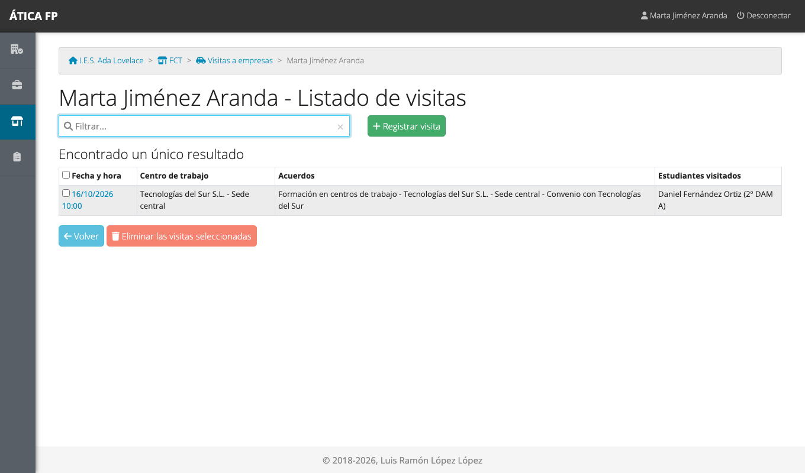

Para registrar una visita nueva pulsa **Registrar visita**:

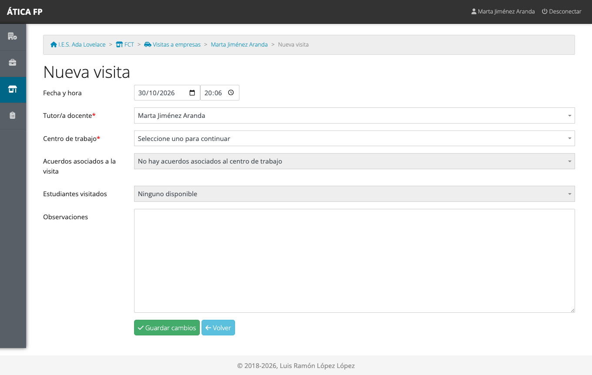

1. Elige la **fecha y la hora** (por defecto, el momento actual).
2. Elige el **centro de trabajo** visitado. Solo salen las sedes de los acuerdos en los que eres tutoría
   docente.
3. Marca los **acuerdos** y los **estudiantes visitados**. Las dos listas se rellenan solas cuando eliges la
   sede.
4. Escribe las **observaciones** de la visita y guarda.

Para quitar visitas, márcalas y pulsa **Eliminar las visitas seleccionadas**. El botón **Registro de
visitas** del resumen genera en PDF el listado de tus visitas.

## Gastos de desplazamiento {#gastos-de-desplazamiento}

**FCT → Dietas de desplazamiento** guarda los viajes que haces para visitar a las empresas, para que el centro
pueda reintegrar los gastos. Igual que con las visitas, la tarjeta abre un resumen del profesorado; pulsa
**tu nombre**.

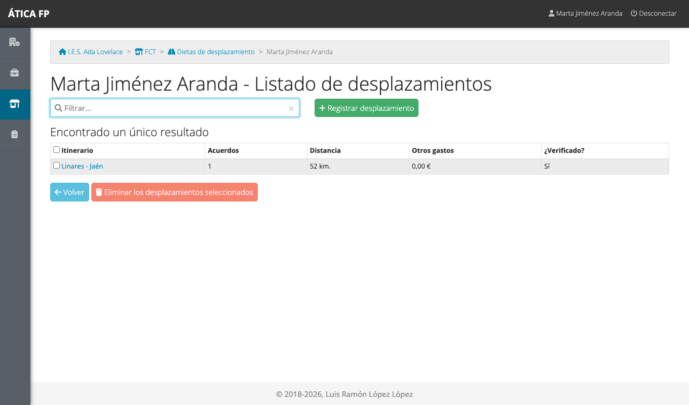

Pulsa **Registrar desplazamiento**:

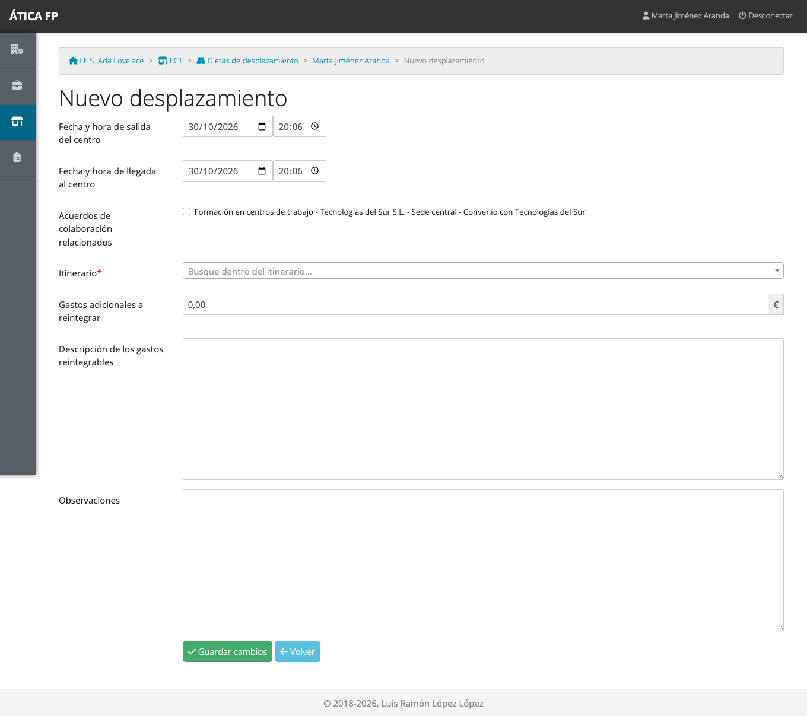

1. Indica la **fecha y hora de salida** del centro y de **llegada** de vuelta.
2. Marca los **acuerdos de colaboración** relacionados con el viaje.
3. Elige el **itinerario** entre los del catálogo del centro. Si no está el trayecto que has hecho, puedes
   **registrar un itinerario nuevo** sin salir de la pantalla: escribe la descripción y los kilómetros.
4. Si has tenido **gastos adicionales** (peajes, aparcamiento...), anota el importe y descríbelos en el cuadro de
   texto, para que se sepa qué se reintegra.
5. Guarda.

!!! note "Itinerarios sin verificar"
    Un itinerario que acabas de crear queda **sin verificar** hasta que el responsable económico o la
    administración comprueban sus kilómetros ([capítulo 4](04-administrar-el-centro.md#itinerarios-de-desplazamiento)).
    El desplazamiento se guarda igualmente, pero el documento de gastos lo marca como pendiente de
    verificar.

El botón **Registro de dietas** del resumen genera en PDF la relación de tus desplazamientos. Para quitar
alguno, márcalo y pulsa **Eliminar los desplazamientos seleccionados**.

## El informe del tutor/a laboral

Además de la propia tutoría laboral, **puedes rellenar el informe en su nombre** si no lo ha hecho. El
informe y su listado están explicados en el [capítulo 14](14-fct-tutoria-laboral.md#el-informe-final); la lista
**Informe del tutor/a laboral** del menú indica, por acuerdo, si está cumplimentado.

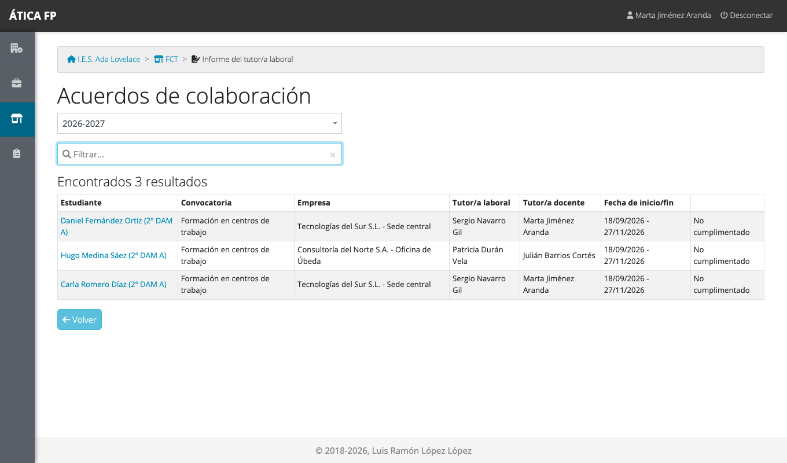

## Encuestas

**FCT → Encuestas** reúne tres encuestas de satisfacción; en cada una ves un listado y entras a contestar.

- **Satisfacción de alumnado**: la contesta el propio alumno ([capítulo 13](13-fct-alumnado.md#la-encuesta-de-satisfaccion)).
  Si no la ha contestado, puedes rellenarla tú en su nombre.

  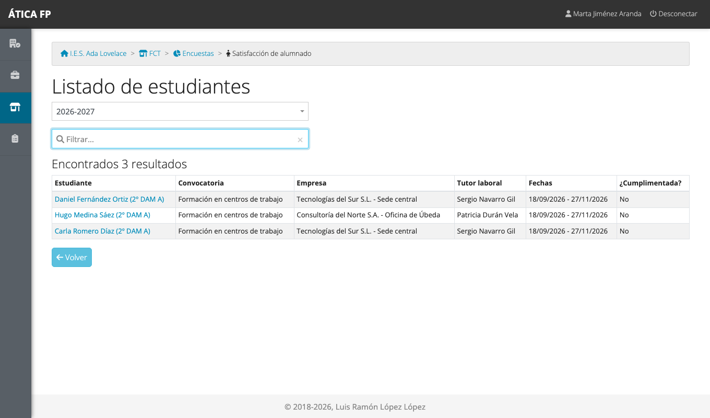

- **Satisfacción del tutor laboral** (la empresa): la contesta la tutoría laboral
  ([capítulo 14](14-fct-tutoria-laboral.md#la-encuesta-de-satisfaccion-de-la-empresa)); también puedes
  rellenarla en su nombre.
- **Satisfacción del tutor docente**: la contestas **tú**, una vez por convocatoria, con tu opinión sobre cómo
  ha ido el seguimiento.

  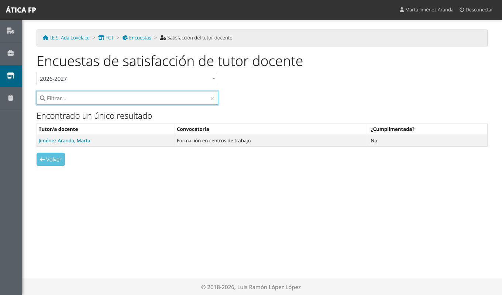

  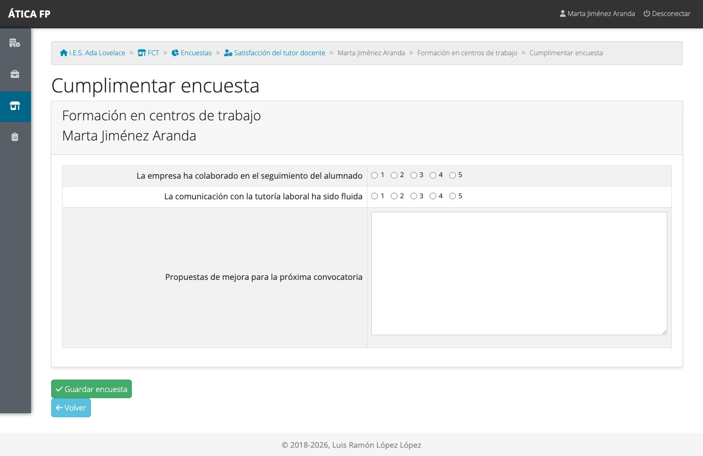

Una encuesta solo se puede contestar mientras está abierta (entre su fecha de comienzo y de finalización, si
las tiene) y si la convocatoria no está bloqueada.

## Qué no puedes hacer y a quién pedirlo

- **No puedes crear ni cambiar acuerdos, calendarios ni actividades.** Pídelo a la jefatura de departamento o a
  la administración del centro ([capítulo 11](11-fct-gestion.md)).
- **No ves el alumnado de otras tutorías.** En los listados de visitas y gastos de otros docentes puedes
  consultar el resumen, pero no abrir ni modificar sus datos.
- **No puedes verificar itinerarios ni ver los resúmenes de gastos de todo el centro**, salvo el tuyo: es
  tarea del [responsable económico](15-fct-responsable-economico.md).
- **Un acuerdo bloqueado o de un curso anterior es de solo lectura.** Pide a la administración que lo
  desbloquee si hay que corregir algo.
