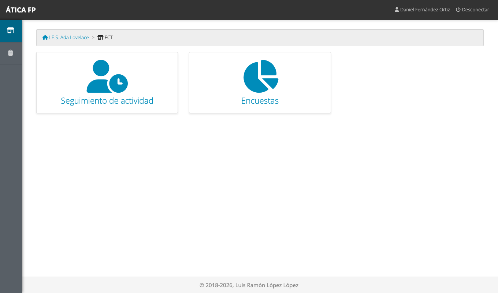
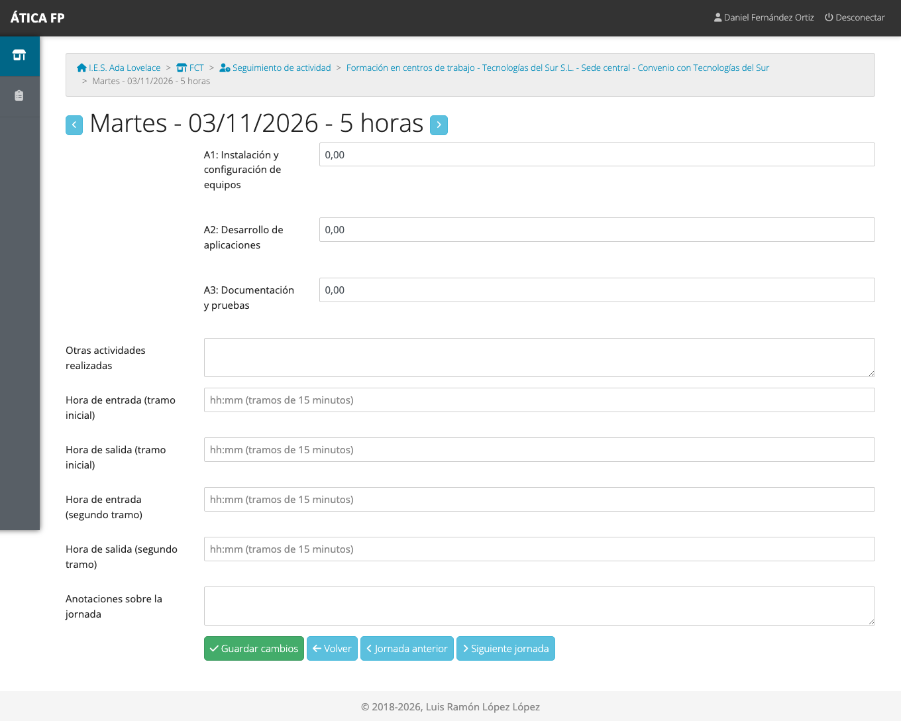
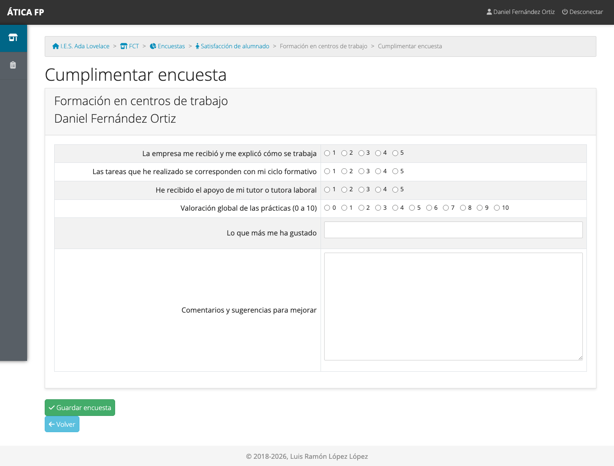

# FCT: alumnado

Este capítulo es para el **alumnado que hace las prácticas** (FCT) en una empresa. Explica qué tienes que
hacer cada día en la aplicación y qué documentos puedes descargar. Tu tutor o tutora docente (del centro) y tu
tutor o tutora laboral (de la empresa) usan la misma información para hacer tu seguimiento, así que registrar
bien cada jornada te beneficia.

## Qué puedes hacer

- **Registrar cada jornada**: qué actividades has hecho y cuántas horas.
- **Consultar tu calendario** de prácticas y ver cómo vas.
- **Descargar tu informe de asistencia** y el **informe semanal de actividades**.
- **Contestar la encuesta de satisfacción** al terminar.

No ves el resto del alumnado, ni el informe que rellena la empresa sobre ti, ni puedes cambiar el calendario o
las actividades del programa. La [matriz de permisos](16-fct-permisos.md) lo resume.

## Dónde está

Al entrar en la aplicación, tu menú tiene **FCT** con dos tarjetas: **Seguimiento de actividad** y **Encuestas**.
Solo ves el módulo si tienes un acuerdo de colaboración en el curso activo.

## Tu calendario

**Seguimiento de actividad** te lleva directamente a tu **calendario formativo**: todas las jornadas de tus
prácticas, mes a mes.

Cada día tiene un color:

- **Azul**: jornada todavía sin registrar.
- **Verde**: jornada registrada con todas sus horas.
- **Naranja**: registrada, pero las horas de actividades no suman las del día.
- **Rayado amarillo**: falta justificada. **Rayado oscuro**: falta injustificada. Las faltas las marca tu tutoría;
  tú no las puedes marcar.

La barra de arriba muestra cuántas **actividades** del programa formativo has llegado a trabajar y cuántas te
quedan. El botón **Ir a hoy** te lleva al mes actual.

## Registrar una jornada

Pulsa el día que quieres rellenar (el mismo día de las prácticas o los siguientes).

1. **Horas por actividad**: para cada actividad de tu programa formativo, escribe cuántas horas le has
   dedicado hoy. Lo normal es que sumen las horas de la jornada.
2. **Otras actividades realizadas**: si has hecho algo que no está en tu programa, descríbelo aquí.
3. **Hora de entrada y de salida** (opcional): en tramos de 15 minutos; hay un segundo tramo por si tu
   horario es partido.
4. **Anotaciones sobre la jornada** (opcional): cualquier observación.
5. Pulsa **Guardar cambios**.

Las flechas junto al título y los botones **Jornada anterior** y **Siguiente jornada** te permiten rellenar
varios días seguidos.

!!! tip "Rellénalo cada día"
    Es mucho más fácil acordarse de lo que has hecho hoy que de lo del mes pasado. Además, tu tutoría va
    revisando y **bloqueando** las jornadas conforme las comprueba.

!!! warning "Una jornada bloqueada ya no se puede cambiar"
    Cuando tu tutoría bloquea una jornada, **ya no puedes modificarla**. Si hay un error, pídele que la
    desbloquee. Lo mismo ocurre cuando la convocatoria ha terminado y se ha cerrado.

## Documentos

- **Informe de acreditación de asistencia**: el botón de debajo del calendario genera un PDF con tu
  asistencia a las prácticas, para firmar.
- **Informe semanal de actividades**: la impresora que hay a la derecha de cada semana del calendario genera
  el PDF con las actividades de esa semana.

## La encuesta de satisfacción {#la-encuesta-de-satisfaccion}

Cuando tu centro lo indica, tienes que contestar una encuesta sobre cómo han ido las prácticas. Está en **FCT →
Encuestas**. Pulsa tu nombre en el listado, contesta las preguntas y pulsa **Guardar encuesta**.

- Las preguntas marcadas como obligatorias hay que contestarlas para poder guardar.
- Solo se puede contestar mientras la encuesta está abierta: si ves la encuesta pero no puedes enviarla, es que
  aún no ha empezado o ya ha terminado el plazo.
- Hay una única encuesta por estudiante: si la abres de nuevo, aparece con lo que ya habías contestado.
- Si tu convocatoria no tiene encuesta asignada, no verás nada que contestar.

Tus respuestas las ve el centro agrupadas con las del resto de alumnado: sirven para mejorar las prácticas
del año siguiente.

## Qué no puedes hacer y a quién pedirlo

- **Cambiar tus horas o tus actividades tras el bloqueo**: pídeselo a tu tutor o tutora docente.
- **Marcar faltas** o cambiar tu calendario, tu empresa o tu programa formativo: es cosa de tu tutoría docente o
  de la jefatura de departamento.
- **Ver el informe de la empresa sobre ti**: lo rellena tu tutoría laboral y lo gestiona el centro.
