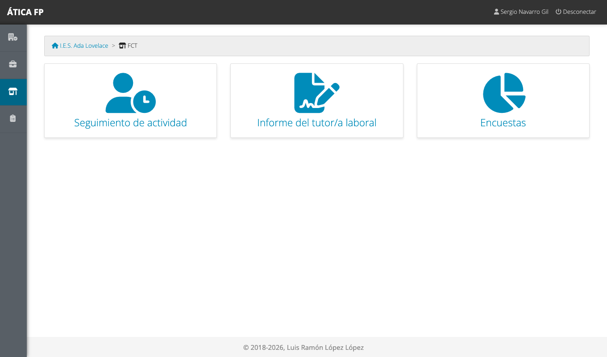
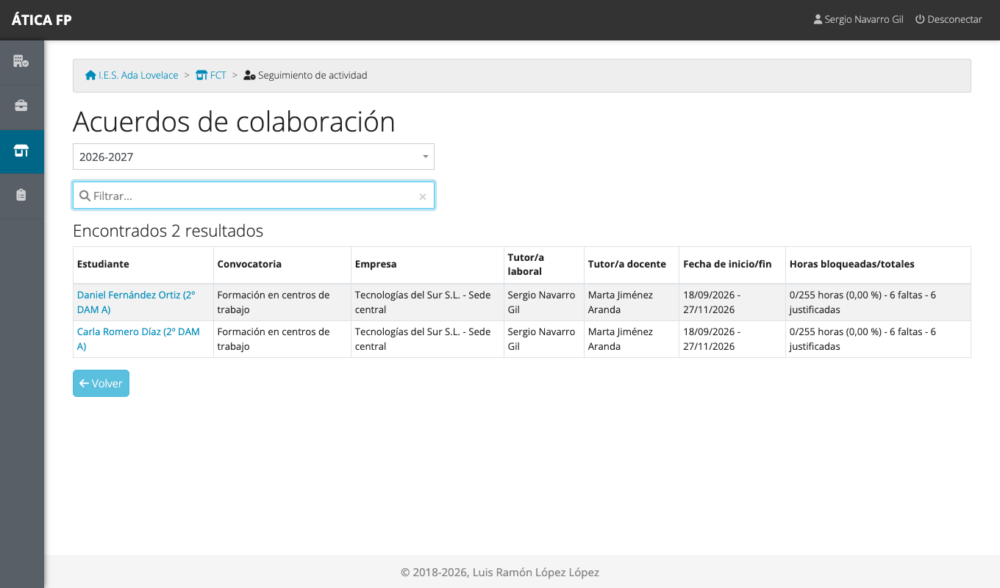
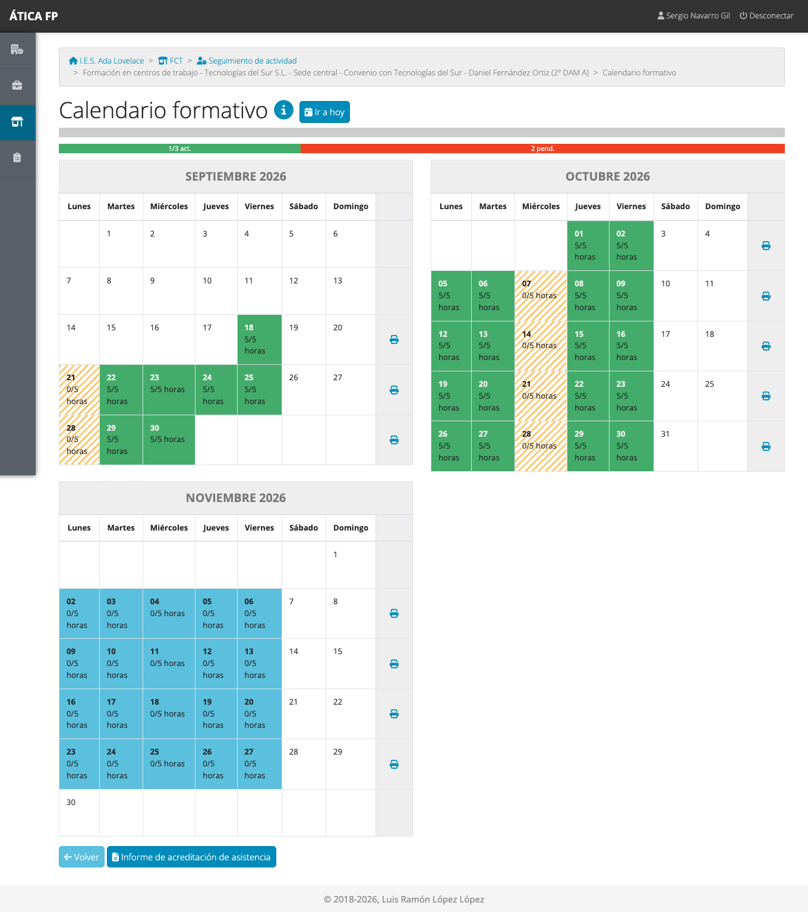
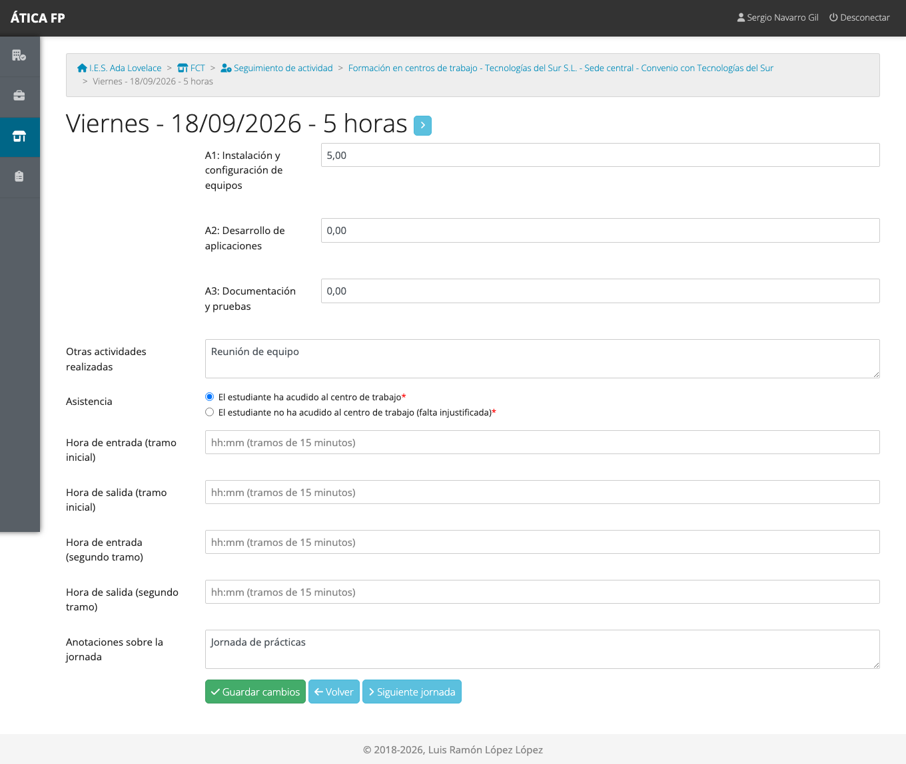
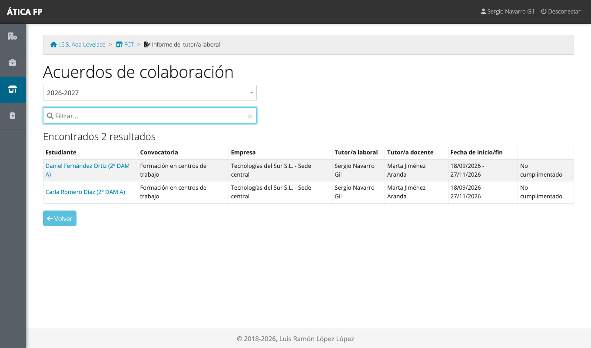
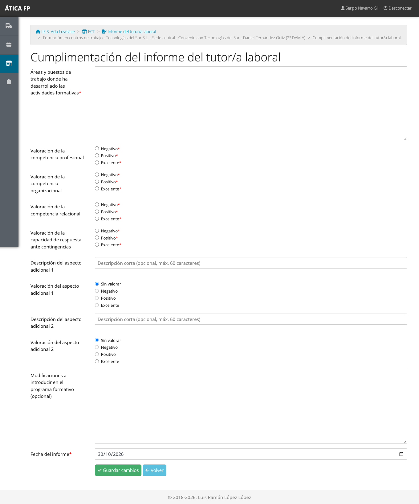
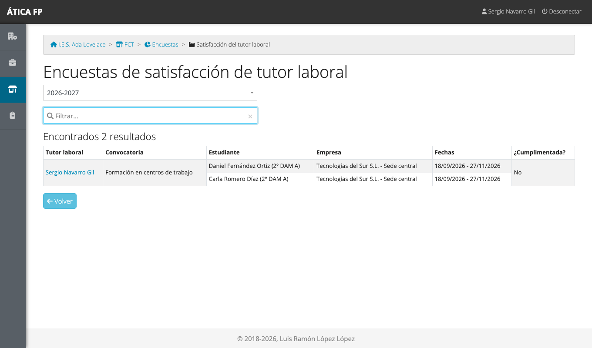
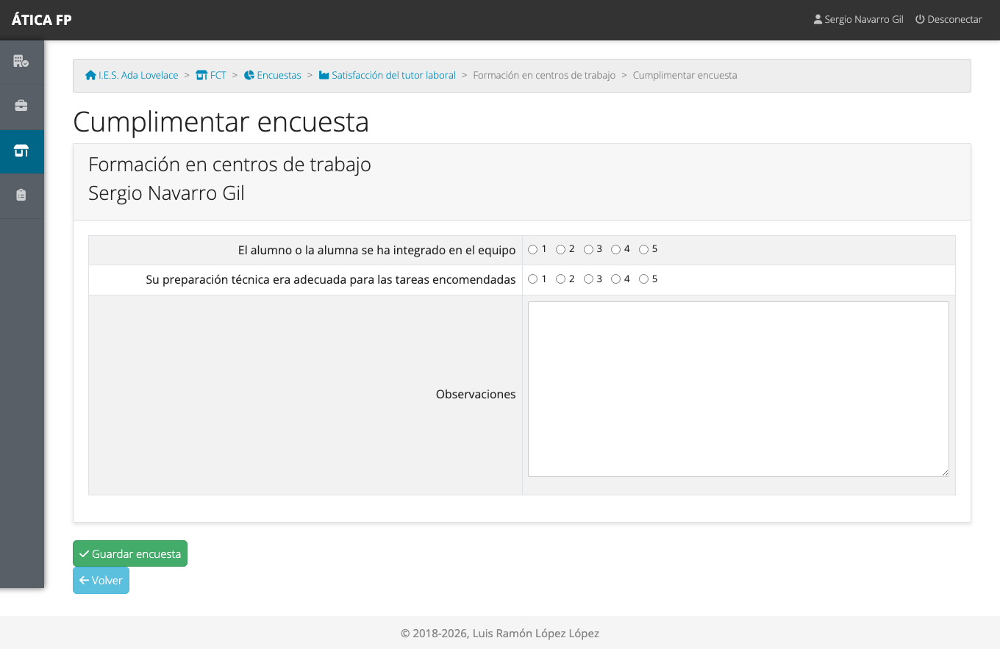

# FCT: tutoría laboral

Este capítulo es para la **persona de la empresa que tutoriza al alumnado** durante las prácticas (FCT): la
tutoría laboral. Explica lo que el centro educativo te pide en la aplicación: confirmar la asistencia y las
actividades del alumno, valorar su desempeño al final y contestar una encuesta sobre la colaboración.

Tu usuario lo crea el centro educativo cuando se registra el acuerdo con tu empresa. Te comunicará tu nombre de
usuario; la **contraseña inicial es el identificador** (normalmente tu DNI o NIE) con el que te dieron de alta, y
la aplicación te obliga a **cambiarla en el primer acceso** (ver
[Primeros pasos](02-primeros-pasos.md#cambiar-tu-contrasena)). Si te registraron sin identificador, usa
**¿Olvidó la contraseña?** con tu correo electrónico para elegir una.

## Qué puedes hacer

- **Consultar el calendario** de prácticas de tu alumnado y sus jornadas.
- **Revisar y completar** la asistencia y las actividades de cada jornada.
- Descargar la **hoja de asistencia**.
- Rellenar el **informe del tutor/a laboral**, la valoración final del alumno.
- Contestar la **encuesta de satisfacción de la empresa**.

Solo ves **tu alumnado**: el de los acuerdos en los que figuras como tutoría laboral. No ves otros acuerdos,
las visitas del profesorado, sus gastos ni los datos de otras empresas. La
[matriz de permisos](16-fct-permisos.md) lo resume.

## Dónde está

En el menú de **FCT** tienes tres tarjetas: **Seguimiento de actividad**, **Informe del tutor/a laboral** y
**Encuestas**.

## Seguimiento de tu alumnado

**Seguimiento de actividad** lista tus acuerdos, con el estudiante, la empresa, las fechas y las horas.

Pulsa el nombre del estudiante para abrir su **calendario formativo**.

Verde significa jornada con todas las horas registradas; naranja, registrada pero incompleta; rayado, falta;
azul, pendiente. El calendario es de **consulta**: para registrar o corregir una jornada, ábrela pulsando el
día.

### Revisar una jornada

La ficha de cada jornada muestra las horas dedicadas a cada actividad, las anotaciones y la asistencia.

Tú puedes:

- **Corregir o completar** las horas de las actividades y las anotaciones, si el alumno se ha olvidado o te
  parece que no corresponde.
- Indicar la **asistencia**: «ha acudido» o falta justificada o injustificada. Cuando marcas una falta, se
  borran las horas de actividades de esa jornada.

El centro educativo **bloquea** cada jornada cuando la da por revisada; a partir de ahí, ya no se puede
modificar.

### Hoja de asistencia

Debajo del calendario, **Informe de acreditación de asistencia** genera en PDF la hoja de asistencia del
alumno, que normalmente tendrás que firmar. También puedes imprimir cada semana con la impresora que hay a la
derecha de su fila.

## El informe final {#el-informe-final}

Al terminar las prácticas, el centro te pide una valoración del alumno. **FCT → Informe del tutor/a laboral**
lista tus acuerdos y su estado.

Pulsa el estudiante para rellenar su informe:

1. **Áreas y puestos de trabajo** donde ha desarrollado las actividades formativas (obligatorio).
2. **Valoración de cuatro competencias**, cada una como *negativo*, *positivo* o *excelente* (obligatorias):
   competencia profesional, organizacional, relacional y capacidad de respuesta ante contingencias.
3. **Dos aspectos adicionales** (opcionales): escribe una descripción corta (60 caracteres como máximo) y
   valóralo, si hay algo más que quieras destacar.
4. **Modificaciones a introducir en el programa formativo** (opcional): sugerencias para el próximo curso.
5. **Fecha del informe** (por defecto, hoy) y **Guardar cambios**.

Una vez guardado, el informe queda en el listado como cumplimentado y se puede **descargar en PDF** desde la
misma pantalla. La tutoría docente puede rellenarlo en tu nombre si no puedes hacerlo, pero la valoración es
tuya: conviene que lo hagas tú.

## La encuesta de satisfacción de la empresa {#la-encuesta-de-satisfaccion-de-la-empresa}

**FCT → Encuestas** te lleva a la **satisfacción del tutor laboral**: una encuesta sobre cómo ha ido la
colaboración con el centro y con el alumnado.

Pulsa el nombre del alumno para contestarla.

Contesta las preguntas (las obligatorias están marcadas) y pulsa **Guardar encuesta**. Solo se puede
contestar mientras la encuesta está abierta.

## Qué no puedes hacer y a quién pedirlo

- **Bloquear jornadas** o marcar faltas en bloque: lo hace la tutoría docente del centro.
- **Cambiar el calendario, el horario o las actividades del programa**: pídelo a la tutoría docente o a la
  jefatura de departamento.
- **Modificar una jornada bloqueada**: la tutoría docente tiene que desbloquearla antes.
- **No puedes entrar o has olvidado la contraseña**: usa **¿Olvidó la contraseña?** con el correo que el centro
  registró para ti, o pídele a la tutoría docente que te ayude.
