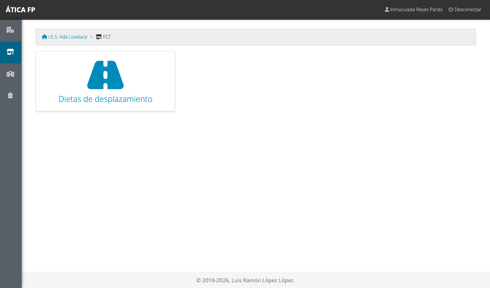
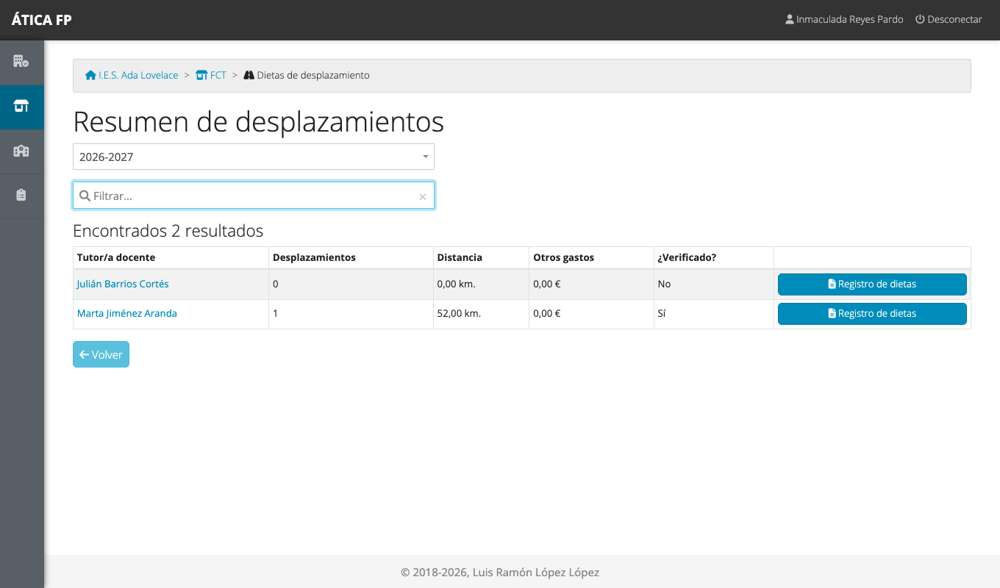
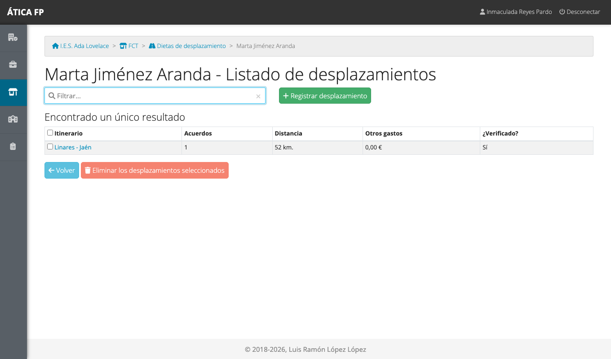
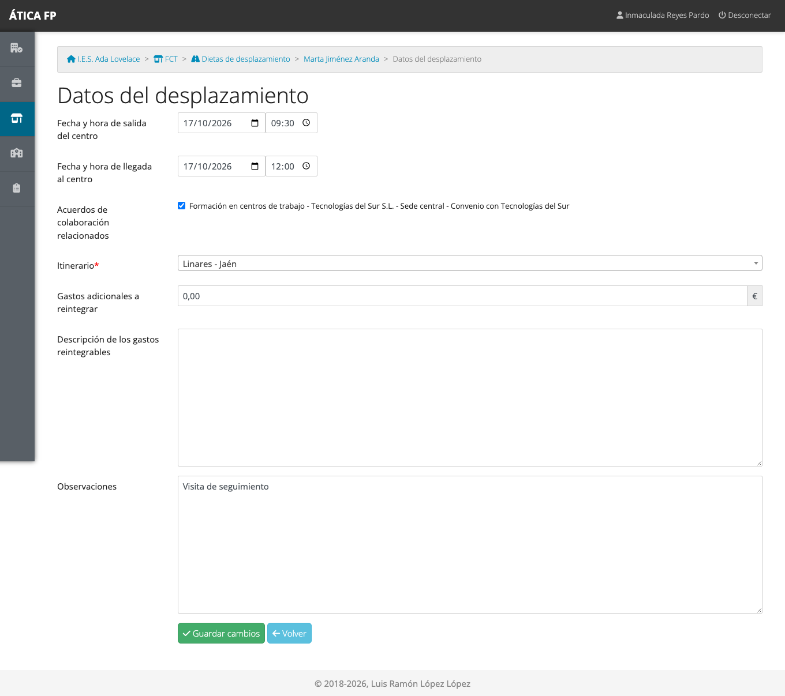
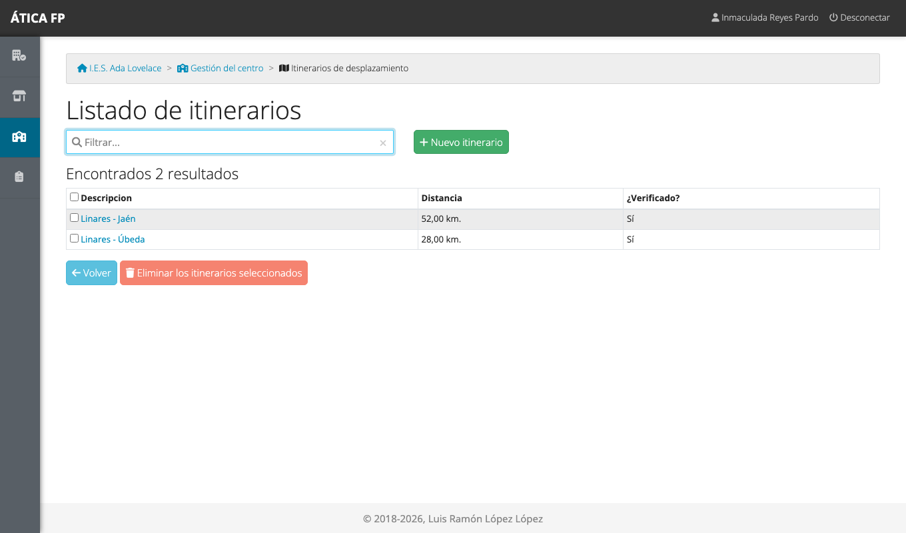

# FCT: responsable económico

Este capítulo es para el **responsable económico** del centro: la persona designada como **secretario o
secretaria** en los [datos del curso](03-preparar-el-curso-academico.md#los-datos-de-un-curso). En la FCT su
papel es de control del gasto: consulta los desplazamientos que ha hecho el profesorado para visitar a las
empresas, registra o corrige los que falten y comprueba que los kilómetros de cada trayecto son correctos.

## Qué puedes hacer

- Ver el **resumen de desplazamientos** de todo el profesorado.
- Consultar, **registrar**, **modificar** y **eliminar** los desplazamientos de cualquier docente.
- Descargar el **registro de dietas** (la relación de gastos) de cada docente en PDF.
- **Verificar los itinerarios** del catálogo del centro, comprobando sus kilómetros.

No ves el seguimiento del alumnado, las visitas, los informes ni las encuestas. La
[matriz de permisos](16-fct-permisos.md) lo resume.

## Dónde está

En **FCT** solo tienes la tarjeta **Dietas de desplazamiento**. Los itinerarios se verifican en **Gestión del
centro → Itinerarios de desplazamiento** (ver más abajo).

## Resumen de desplazamientos

**Dietas de desplazamiento** abre el resumen del curso con todo el profesorado que ha registrado
desplazamientos, o que es tutoría docente en alguna convocatoria.

Por cada docente ves:

- **Desplazamientos**: cuántos viajes ha registrado.
- **Distancia**: los kilómetros totales.
- **Otros gastos**: la suma de los gastos adicionales (peajes, aparcamiento...), en euros.
- **¿Verificado?**: «Sí» si tiene desplazamientos y **todos sus itinerarios** están verificados; «No» si alguno
  no lo está o si todavía no tiene ninguno.

El botón **Registro de dietas** descarga la relación de gastos de ese docente en PDF, con todos sus
desplazamientos del curso. Es el documento que se usa para tramitar el reintegro. En él, los itinerarios aún
sin verificar aparecen marcados.

## Los desplazamientos de un docente

Pulsa el nombre de un docente para ver su listado.

Para cada uno se muestra el itinerario, el número de acuerdos relacionados, la distancia, los otros gastos y si
el itinerario está verificado. Pulsa el itinerario para abrir el desplazamiento:

Puedes **corregir cualquier dato** (por ejemplo, el itinerario o el importe de un gasto adicional) y guardar. Con
**Registrar desplazamiento** añades uno nuevo en nombre del docente, y con **Eliminar los desplazamientos
seleccionados** quitas los marcados (con confirmación previa).

!!! note "Quien registra los viajes es cada docente"
    Lo normal es que cada docente registre los suyos
    ([capítulo 12](12-fct-tutoria-docente-y-de-grupo.md#gastos-de-desplazamiento)). Tú intervienes para completar
    o corregir.

## Verificar los itinerarios {#verificar-los-itinerarios}

Cuando un docente no encuentra su trayecto en el catálogo, **lo crea él mismo** con los kilómetros que él
calcula. Ese itinerario queda **sin verificar** hasta que tú, o la administración del centro, lo compruebas. Es la
garantía de que no se paga más de lo debido.

1. Entra en **Gestión del centro → Itinerarios de desplazamiento**.
2. Los itinerarios sin verificar figuran con «No» en la columna **¿Verificado?**. Pulsa el que quieras revisar.
3. Comprueba la **descripción** y la **distancia**, corrígelas si hace falta y elige **¿Verificado? Sí, el
   kilometraje es correcto**.
4. Guarda.

Los itinerarios verificados no vuelven a aparecer como pendientes en el registro de dietas. Detalles del
catálogo en [Administrar el centro](04-administrar-el-centro.md#itinerarios-de-desplazamiento).

## Qué no puedes hacer y a quién pedirlo

- **No ves el alumnado, las jornadas ni las visitas.** Si necesitas contrastar un viaje con una visita,
  pídeselo a la jefatura de departamento o a la administración del centro.
- **No gestionas el resto de «Gestión del centro»**: solo los itinerarios. Para lo demás, la administración
  del centro.
