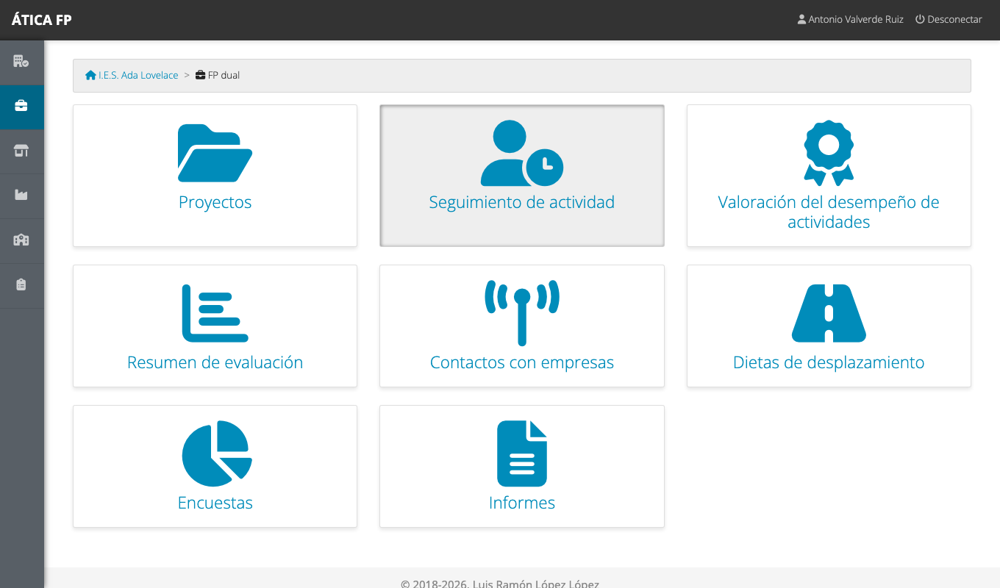

# FP dual: visión general

Este capítulo es para **todas las personas que intervienen en la FP dual**, sea cual sea su perfil. Explica
qué es el módulo, cómo se organiza un proyecto de principio a fin y quién hace qué. Después, cada perfil tiene
su capítulo con las tareas concretas.

## Qué es la FP dual

En la **formación profesional dual** el alumnado reparte su formación entre el centro educativo y la empresa
durante el curso (la llamada **alternancia**). A diferencia de la [FCT](10-fct-vision-general.md), que es un
módulo de prácticas al final del ciclo, en la FP dual lo que se hace en la empresa **forma parte del currículo**:
cada actividad que el alumnado realiza allí se vincula con los **resultados de aprendizaje** de los módulos
profesionales y se **valora**, y esa valoración llega a la evaluación del profesorado.

El módulo de FP dual de ÁTICA FP sirve para:

- **Definir el proyecto** de FP dual del centro: qué grupos participan, qué actividades se hacen y qué
  resultados de aprendizaje trabajan.
- **Planificar el programa formativo** de cada empresa colaboradora.
- **Firmar y seguir los convenios** de cada estudiante con su empresa.
- **Registrar el día a día**: asistencia y actividades realizadas en cada jornada de alternancia.
- **Valorar el desempeño** del alumnado en cada actividad, y trasladar esa valoración al profesorado de los
  módulos para su evaluación.
- **Documentar el seguimiento**: reuniones de tutorización, contactos con las empresas y gastos de
  desplazamiento.
- **Recoger la opinión** de todas las partes (encuestas) y generar los informes en PDF.

Se activa por curso académico en [los datos del curso](03-preparar-el-curso-academico.md#los-datos-de-un-curso).

## El vocabulario de la FP dual

Muchos conceptos son los mismos que en FCT, pero con otro nombre. Aquí se usa «convenio», «responsable de
seguimiento» y «responsable laboral», frente al «acuerdo», la «tutoría docente» y la «tutoría laboral» de la FCT.

| Término | Qué es |
| --- | --- |
| **Proyecto** | El proyecto de FP dual del centro para uno o más grupos: sus actividades, sus empresas, su alumnado, sus plantillas y encuestas. Tiene una persona que lo **coordina** |
| **Actividad formativo-productiva** | Una actividad general que el alumnado hace en las empresas («Desarrollo de un portal web»), con las **competencias** que trabaja |
| **Concreción de actividad** | Cada tarea concreta en que se divide una actividad («Tarea 1: maquetación»). Se asocia a los **resultados de aprendizaje** que trabaja. **Es lo que se valora** |
| **Programa formativo de una empresa** | Las concreciones de actividad que una empresa concreta se compromete a hacer realizar |
| **Convenio** | El acuerdo de un **estudiante** con una **sede** de una empresa, con su calendario de alternancia. Cada estudiante tiene el suyo |
| **Responsable de seguimiento** | La persona del profesorado que hace el seguimiento del convenio (la tutoría docente de la FCT) |
| **Responsable laboral** | La persona de la empresa que supervisa al estudiante (la tutoría laboral de la FCT) |
| **Escala de valoración** | Los niveles con que se valora cada concreción («Notable», «Suficiente»...), con su calificación numérica |
| **Contacto con empresas** | Una comunicación con una empresa (presencial, teléfono, correo) que queda registrada |

## El ciclo de un proyecto

1. **Preparación** (coordinación, jefatura o administración): se crea el [proyecto](21-dual-gestion.md#proyectos),
   con los grupos que participan, la escala de valoración y las encuestas. Se asocia el
   [alumnado adherido](21-dual-gestion.md#alumnado-adherido).
2. **Programa formativo**: se definen las [actividades y sus concreciones](21-dual-gestion.md#actividades-y-concreciones)
   y se incorporan las [empresas](21-dual-gestion.md#empresas-del-proyecto) con el conjunto de concreciones que
   cada una va a realizar.
3. **Convenios**: para cada estudiante, el [convenio](21-dual-gestion.md#convenios) con su empresa, su
   responsable de seguimiento y su responsable laboral, y su calendario de alternancia.
4. **Alternancia**: cada día se registra la [jornada](22-dual-tutoria-docente-y-de-grupo.md#el-calendario-de-seguimiento):
   quien participa marca las concreciones realizadas y la asistencia. La tutoría registra sus
   [contactos](22-dual-tutoria-docente-y-de-grupo.md#contactos-con-empresas) con las empresas y sus
   [desplazamientos](22-dual-tutoria-docente-y-de-grupo.md#gastos-de-desplazamiento).
5. **Valoración**: el responsable laboral, la tutoría y la coordinación
   [valoran](22-dual-tutoria-docente-y-de-grupo.md#valoracion-del-desempeno) cada concreción realizada.
6. **Evaluación**: el [profesorado](23-dual-profesorado-y-evaluacion.md) de cada módulo consulta el resumen de
   resultados de su alumnado para su evaluación.
7. **Informes y encuestas**: la coordinación o la jefatura obtienen los
   [informes](21-dual-gestion.md#informes) del proyecto.

## Quién hace qué

| Perfil | Qué hace en la FP dual | Capítulo |
| --- | --- | --- |
| **Administración del centro**, **coordinación del proyecto** y **jefatura de departamento** | Preparan el proyecto, el programa formativo y los convenios; ven todo el seguimiento, las valoraciones y los informes | [21](21-dual-gestion.md) |
| **Responsable de seguimiento** y **tutoría de grupo** | Seguimiento diario, valoración, contactos, desplazamientos y encuestas | [22](22-dual-tutoria-docente-y-de-grupo.md) |
| **Profesorado del grupo** | Consulta la valoración y el resumen de resultados del alumnado al que da clase | [23](23-dual-profesorado-y-evaluacion.md) |
| **Alumnado** | Registra su jornada y contesta la encuesta | [24](24-dual-alumnado.md) |
| **Responsable laboral** | Registra asistencia y actividades, y valora al alumnado | [25](25-dual-tutoria-laboral.md) |
| **Responsable económico** | Consulta y verifica los gastos de desplazamiento | [26](26-dual-responsable-economico.md) |

Igual que en la FCT, las tutorías no son un cargo del centro sino una **relación con un convenio concreto**, y
la **coordinación** es la persona designada en el proyecto. La [matriz de permisos](27-dual-permisos.md) detalla
cada pantalla.

## Qué ves en el menú

Las entradas del módulo, y quién las ve, son estas:

| Entrada | Para qué sirve | Quién la ve |
| --- | --- | --- |
| **Proyectos** | Proyectos, programa formativo y convenios | Administración, coordinación y jefatura |
| **Seguimiento de actividad** | Calendarios y asistencia | Todos los perfiles que participan en un convenio |
| **Valoración del desempeño de actividades** | Valorar cada concreción realizada | Administración, coordinación, jefatura, tutorías, profesorado del grupo (solo consulta) y responsable laboral |
| **Resumen de evaluación** | Resultados del alumnado por módulo | Administración, coordinación, jefatura, tutoría de grupo y profesorado del grupo |
| **Contactos con empresas** | Registro de contactos | Administración, coordinación, jefatura, tutorías y profesorado |
| **Dietas de desplazamiento** | Gastos de desplazamiento | Los anteriores y el responsable económico |
| **Encuestas** | Encuestas de alumnado, empresa y centro | Según la encuesta (ver el capítulo de cada perfil) |
| **Informes** | Informes de resultados y encuestas del proyecto | Administración, coordinación y jefatura |

