# FP dual: gestión del proyecto

Este capítulo es para la **administración del centro**, la **coordinación del proyecto** y las **jefaturas de
departamento**: las personas que preparan la FP dual de cada curso. Cubre el proyecto, su programa formativo (las
actividades y sus concreciones), las empresas, los convenios y sus calendarios, y los informes de resultados.

Tres personas pueden gestionar un proyecto, con matices:

- **La administración del centro** gestiona todos los proyectos del centro.
- **La coordinación del proyecto** es la persona designada en cada proyecto. Gestiona **sus** proyectos.
- **La jefatura de departamento** gestiona los proyectos de las enseñanzas de su departamento (por eso es
  importante que cada enseñanza esté enlazada con su
  [familia profesional](04-administrar-el-centro.md#departamentos)).

## Qué puedes hacer

- Crear y editar **proyectos** de FP dual, y asignar su **alumnado**.
- Definir las **actividades** y sus **concreciones**, y el **programa formativo de cada empresa**.
- Crear los **convenios** de cada estudiante y su **calendario** de alternancia.
- **Seguir** el estado de todos los convenios y **valorar** las actividades realizadas.
- Consultar los **contactos** y **desplazamientos** del profesorado.
- Obtener los **informes** del proyecto y de las encuestas.

La [matriz de permisos](27-dual-permisos.md) detalla cada acción.

## Dónde está

En el menú de **FP dual**, la tarjeta **Proyectos** reúne la preparación; el resto de tarjetas (seguimiento,
valoración, resumen de evaluación, contactos, dietas, encuestas e informes) son las mismas que ven las demás
personas, pero con acceso a todos los datos de tu ámbito.

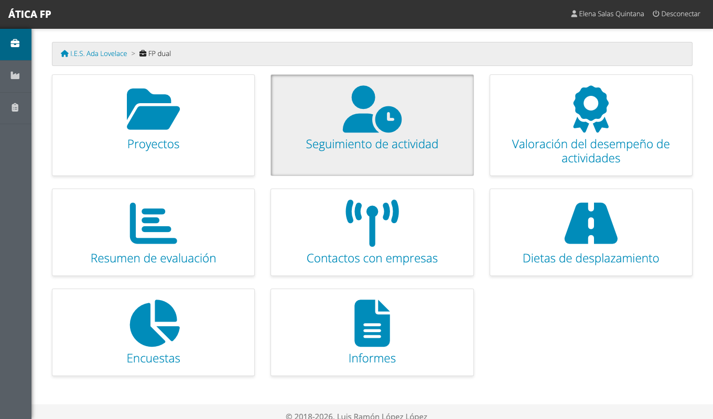

## Proyectos {#proyectos}

**FP dual → Proyectos** lista los proyectos del curso.

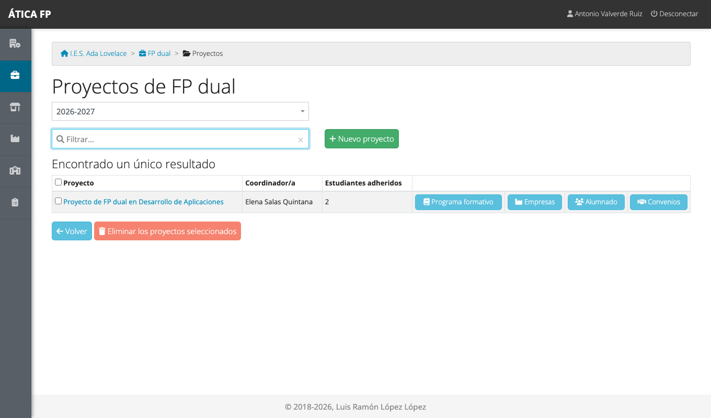

Cada fila muestra el proyecto, su coordinación y el número de estudiantes adheridos, y cuatro botones que
llevan a las partes del proyecto: **Programa formativo** (las actividades), **Empresas**, **Alumnado** y
**Convenios**.

### Crear un proyecto

1. Pulsa **Nuevo proyecto**.
2. Rellena la ficha y guarda.

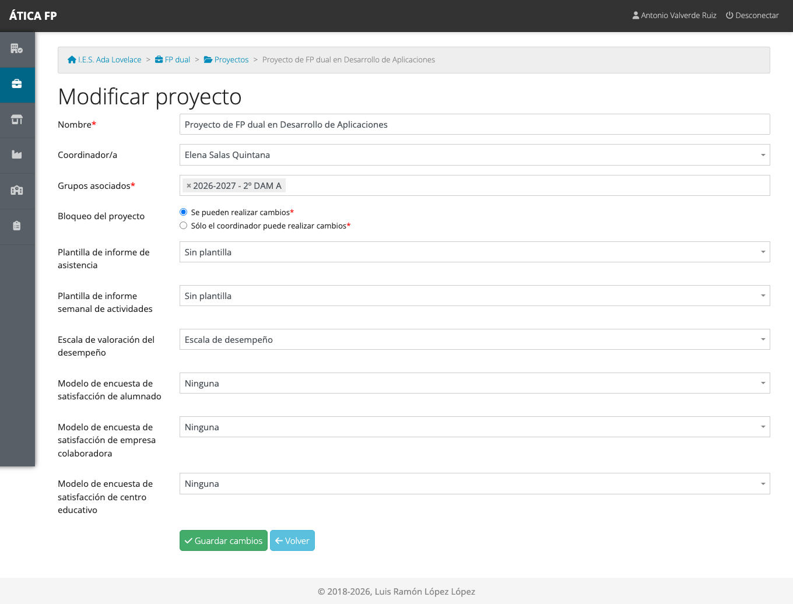

- **Nombre** del proyecto.
- **Coordinador/a**: la persona del profesorado responsable. Tendrá acceso a todo el proyecto.
- **Grupos asociados**: los grupos cuyo alumnado puede participar. Son obligatorios, y el proyecto solo ofrece a
  los estudiantes de esos grupos.
- **Bloqueo del proyecto**: con el bloqueo activado, el proyecto queda **cerrado**: los convenios, las jornadas,
  las valoraciones y las encuestas dejan de poder modificarse (también por la coordinación y las tutorías). Solo
  la administración del centro puede seguir cambiándolos. Úsalo cuando el proyecto ha terminado y está todo
  revisado.
- **Plantillas de informe** de asistencia y de informe semanal de actividades: el
  [papel con membrete](07-encuestas-y-plantillas-de-informe.md#plantillas-de-informe) de esos PDF.
- **Escala de valoración del desempeño**: los niveles con que se valorará cada concreción
  ([capítulo 4](04-administrar-el-centro.md#escalas-de-valoracion-del-desempeno)).
- **Modelos de encuesta** de satisfacción del alumnado, de la empresa colaboradora y del centro educativo
  ([capítulo 7](07-encuestas-y-plantillas-de-informe.md)). «Ninguna» desactiva esa encuesta.

!!! warning "Eliminar un proyecto"
    Para eliminar proyectos, márcalos y pulsa **Eliminar los proyectos seleccionados**. Se borran todos sus datos
    asociados: programa formativo, convenios, jornadas, valoraciones y encuestas. No se puede deshacer; en un
    proyecto terminado es preferible **bloquearlo**.

### Alumnado adherido {#alumnado-adherido}

El botón **Alumnado** indica qué estudiantes de los grupos del proyecto participan en la FP dual.

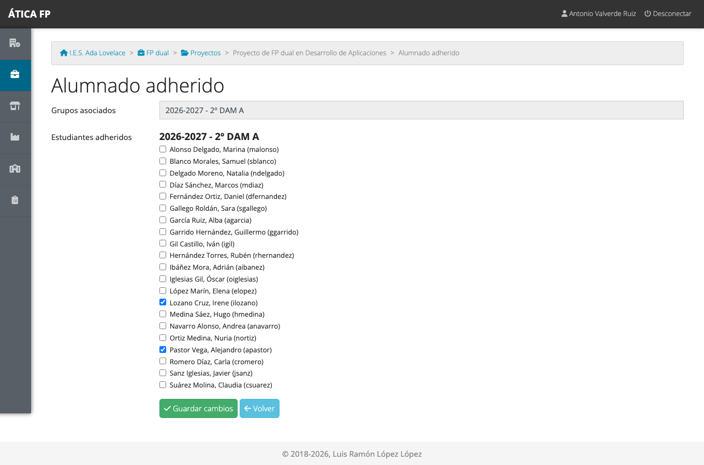

Marca los estudiantes y guarda. Solo el alumnado adherido puede tener un convenio.

## Actividades y concreciones {#actividades-y-concreciones}

El **programa formativo del proyecto** (botón **Programa formativo**) es el catálogo de actividades que el
alumnado puede hacer en las empresas.

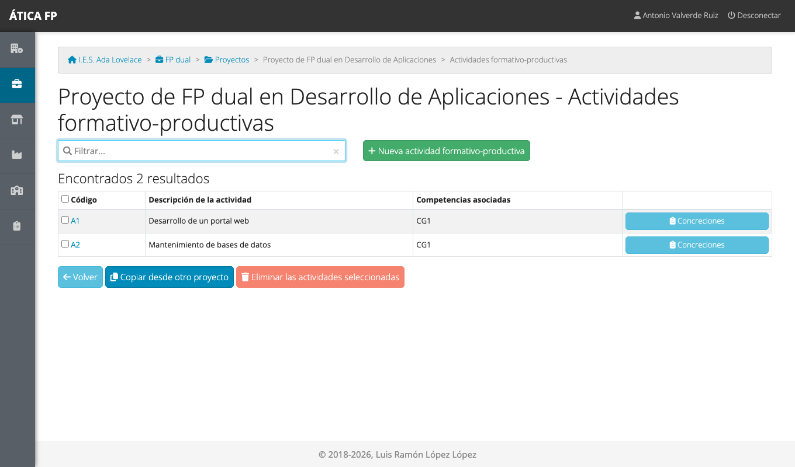

Una **actividad** es una tarea general. Cada una tiene un **código** (A1, A2...), una **descripción**, las
**competencias** de la enseñanza que trabaja y, opcionalmente, una **formación inicial** previa.

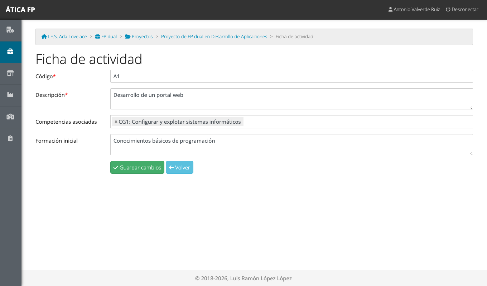

Las competencias se eligen entre las de la enseñanza
([capítulo 4](04-administrar-el-centro.md#ensenanzas-niveles-y-grupos)). Además de crearlas una a una, puedes
**copiar** el programa de otro proyecto de la misma enseñanza con **Copiar desde otro proyecto**:

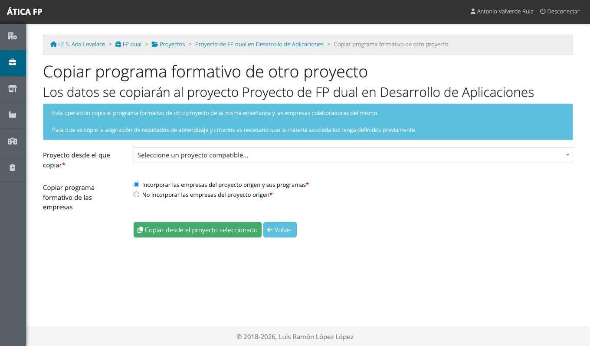

La copia puede incluir también las empresas del proyecto de origen y sus programas.

### Concreciones

Cada actividad se divide en **concreciones**: las tareas concretas que se valoran. Pulsa **Concreciones** en la
fila de la actividad.

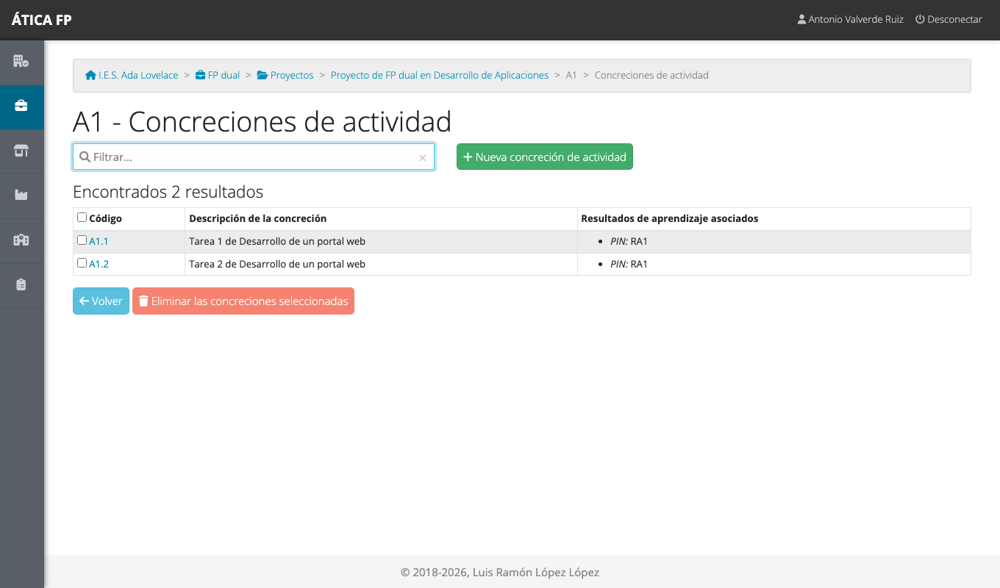

Cada concreción tiene un código (A1.1), una descripción y los **resultados de aprendizaje** de los módulos
profesionales que se trabajan con ella.

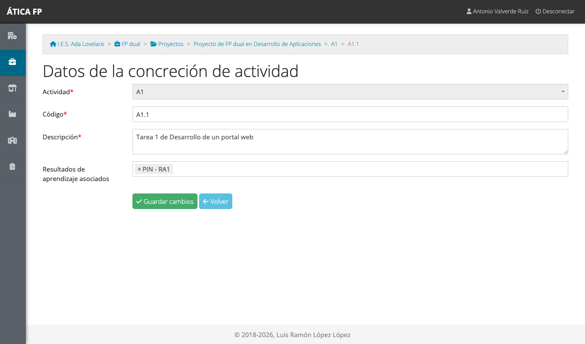

!!! note "Por qué importan los resultados de aprendizaje"
    Los resultados de aprendizaje que asocias a una concreción son los que verá el profesorado de cada módulo en
    el [resumen de evaluación](23-dual-profesorado-y-evaluacion.md). Para poder asociarlos, los módulos tienen que
    tener cargados sus resultados y criterios ([capítulo 4](04-administrar-el-centro.md#resultados-de-aprendizaje-y-criterios-de-evaluacion)).

## Empresas del proyecto {#empresas-del-proyecto}

El botón **Empresas** lista las empresas que participan, cada una con su **programa formativo**.

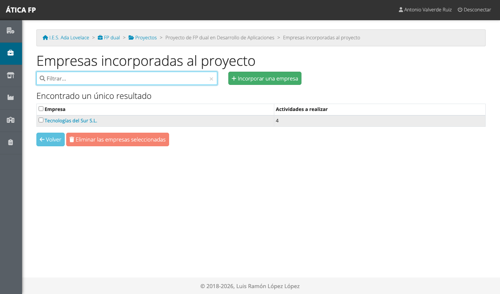

Con **Incorporar una empresa** eliges una empresa del [catálogo](06-empresas-y-centros-de-trabajo.md) y marcas
las concreciones que se compromete a hacer realizar.

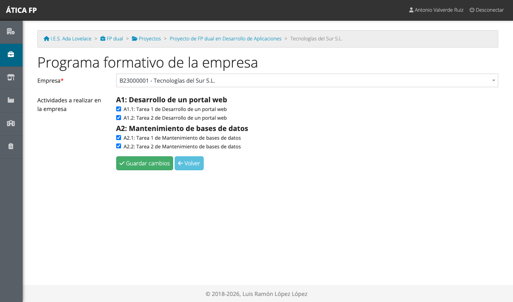

El programa de la empresa es el punto de partida de los convenios: cada estudiante parte de las concreciones de
su empresa. Para quitar una empresa, márcala y pulsa **Eliminar las empresas seleccionadas**.

## Convenios {#convenios}

Un **convenio** es el acuerdo de **un estudiante** con **una sede** de una empresa del proyecto. El botón
**Convenios** lista los del proyecto.

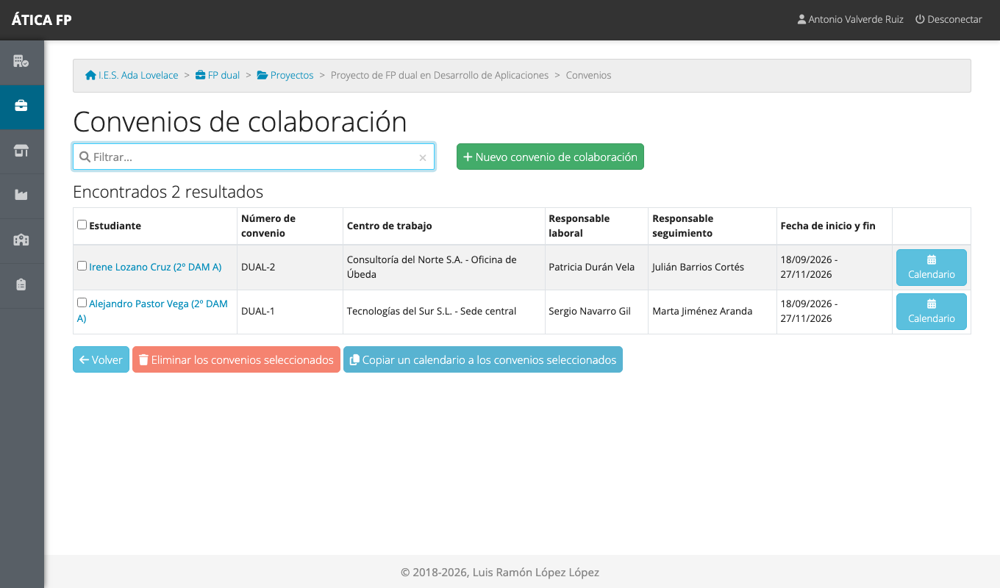

### Crear un convenio

Pulsa **Nuevo convenio de colaboración** y rellena la ficha.

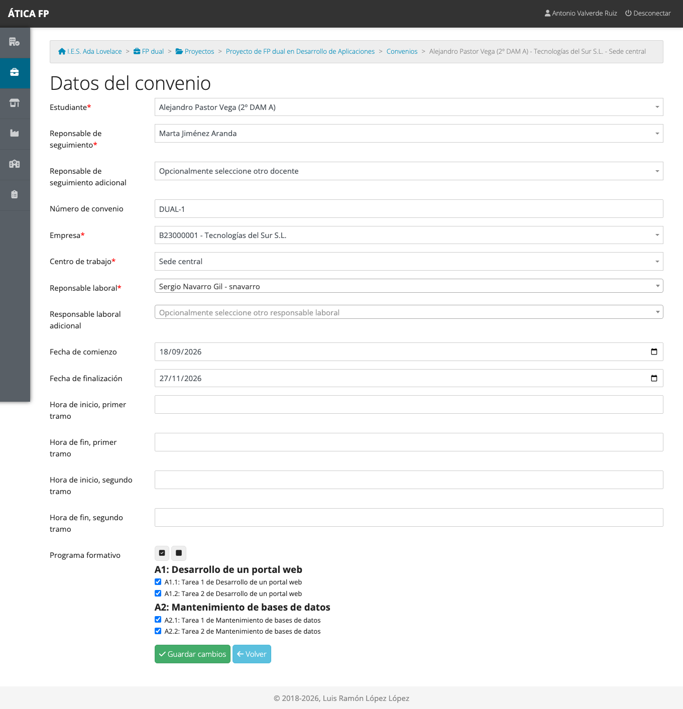

- **Estudiante**: uno de los adheridos al proyecto.
- **Responsable de seguimiento**: el docente que hará el seguimiento. Opcionalmente, un **adicional**, con los
  mismos permisos.
- **Número de convenio**: un código interno (por ejemplo, DUAL-1).
- **Empresa** y **centro de trabajo** (la sede), del catálogo.
- **Responsable laboral**: la persona de la empresa. Búscala por su identificador, usuario o correo; si no existe
  puedes registrarla desde la propia pantalla (recibirá como contraseña inicial su identificador y la aplicación
  le obligará a cambiarla; ver [capítulo 25](25-dual-tutoria-laboral.md)). También puede haber uno **adicional**.
- **Fechas de comienzo y finalización**, y el **horario** habitual en uno o dos tramos.
- **Programa formativo**: las concreciones que hará este estudiante, que parten del programa de su empresa.

### El calendario de un convenio

Pulsa **Calendario** en la fila del convenio. Funciona igual que en la FCT: se **añaden jornadas** indicando la
fecha de inicio, las horas totales y las horas de cada día de la semana (con vista previa, y saltando por defecto
los [días no lectivos](04-administrar-el-centro.md#dias-no-lectivos)), se eliminan las que sobren y se puede
**copiar el calendario** de un convenio a otros. Ver [FCT: gestión](11-fct-gestion.md#el-calendario-de-un-acuerdo).

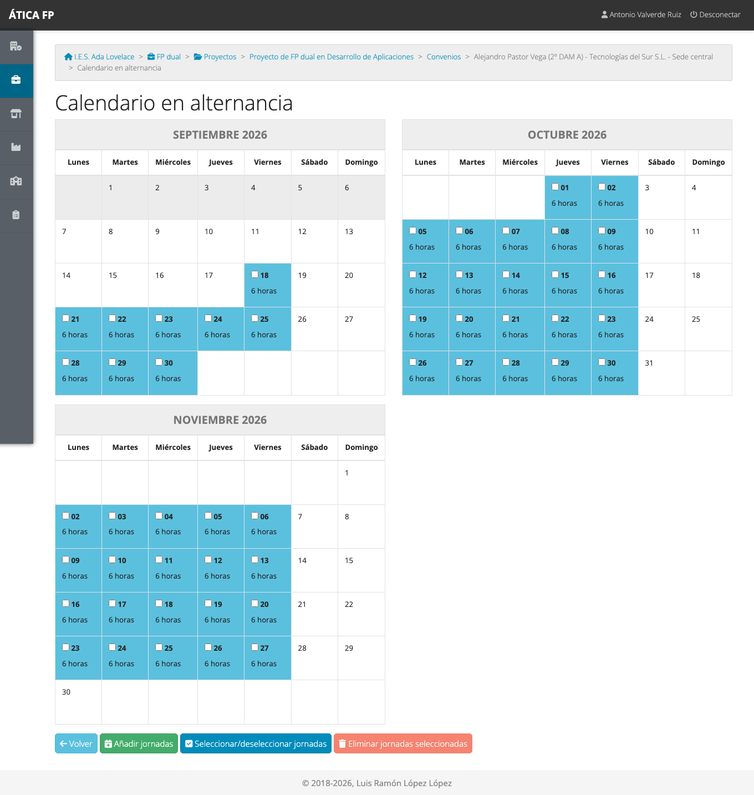

### Eliminar convenios

Marca los convenios y pulsa **Eliminar los convenios seleccionados**. Un convenio con datos asociados (jornadas
registradas, por ejemplo) no se elimina.

## Seguimiento y valoración

Como gestión puedes ver todo el trabajo diario del proyecto:

- **Seguimiento de actividad**: todos los convenios del curso, con el estudiante, la empresa, las fechas y las
  horas bloqueadas sobre las totales. Pulsa un estudiante para abrir su
  [calendario](22-dual-tutoria-docente-y-de-grupo.md#el-calendario-de-seguimiento).

  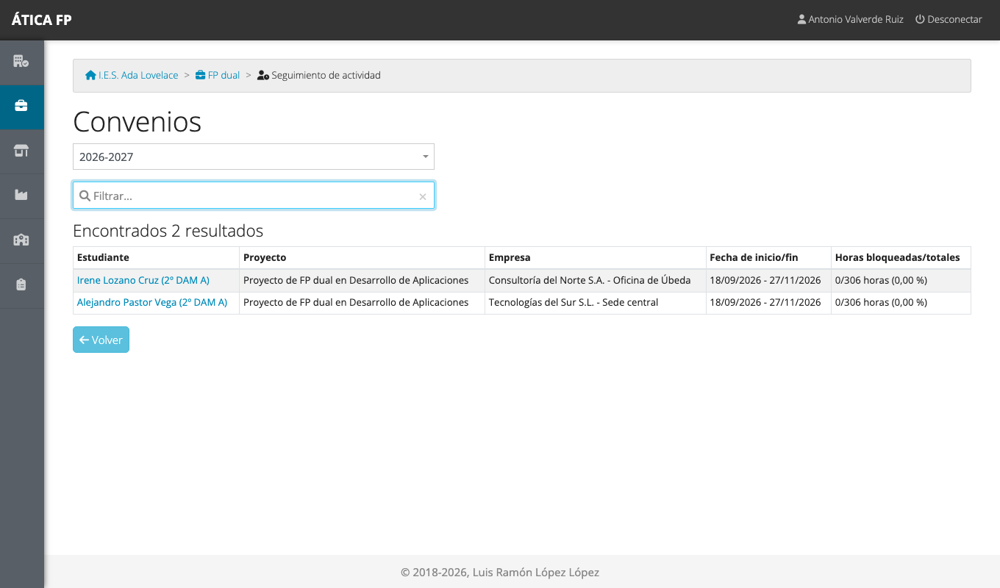

- **Valoración del desempeño de actividades**: la lista de convenios evaluables y, para cada uno, la valoración de
  sus concreciones ([capítulo 22](22-dual-tutoria-docente-y-de-grupo.md#valoracion-del-desempeno)).
- **Resumen de evaluación**: los resultados por estudiante y módulo ([capítulo 23](23-dual-profesorado-y-evaluacion.md)).

  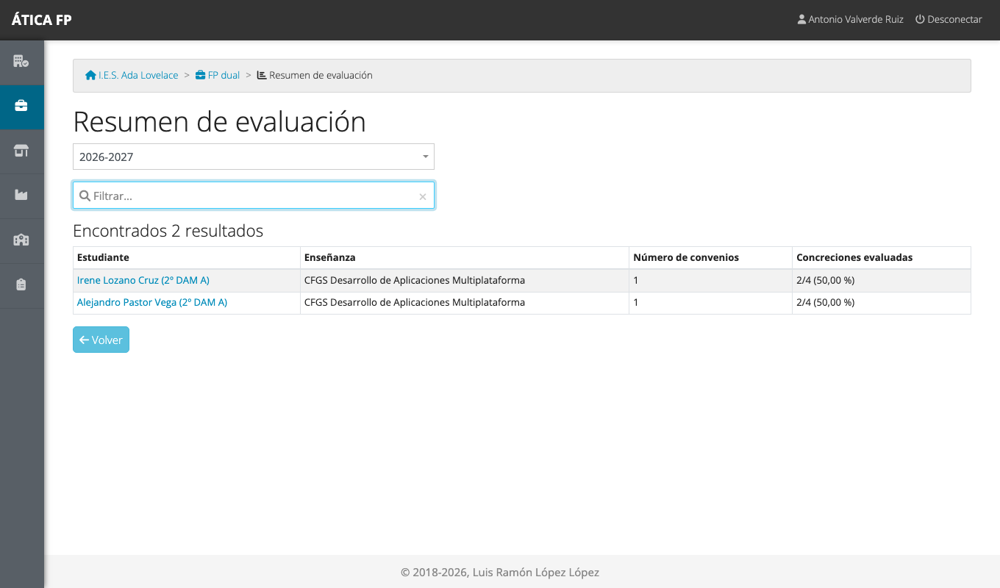

- **Contactos con empresas**: todos los contactos que ha registrado el profesorado, con filtros por tipo
  (presencial, correo electrónico, teléfono), y dos informes agregados: por **responsable de seguimiento** y por
  **centro de trabajo**.

  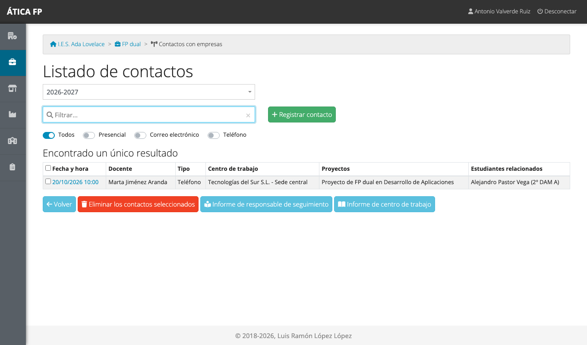

  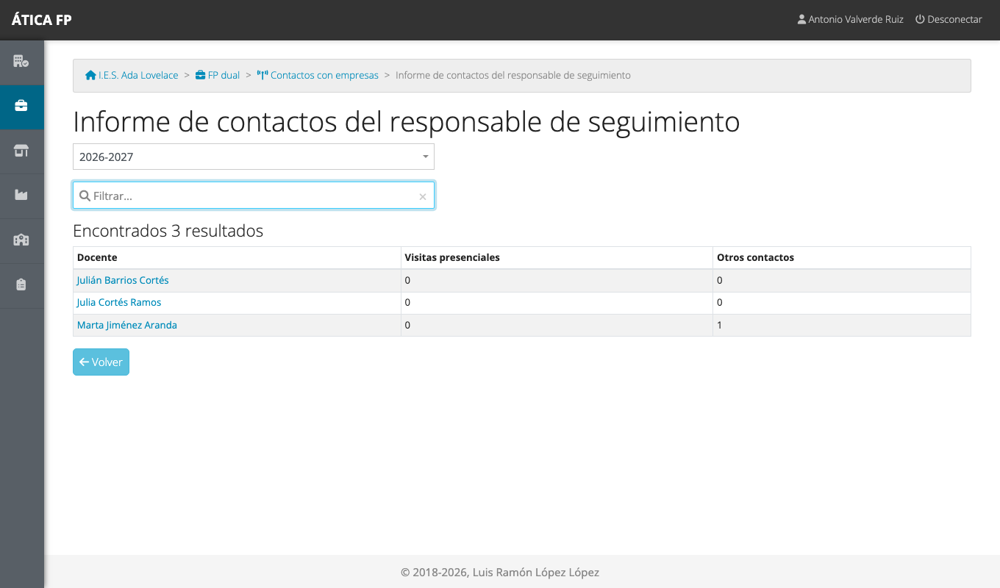

- **Dietas de desplazamiento**: el resumen de los gastos de desplazamiento del profesorado, igual que en la FCT
  ([FCT: tutoría docente](12-fct-tutoria-docente-y-de-grupo.md#gastos-de-desplazamiento)).

  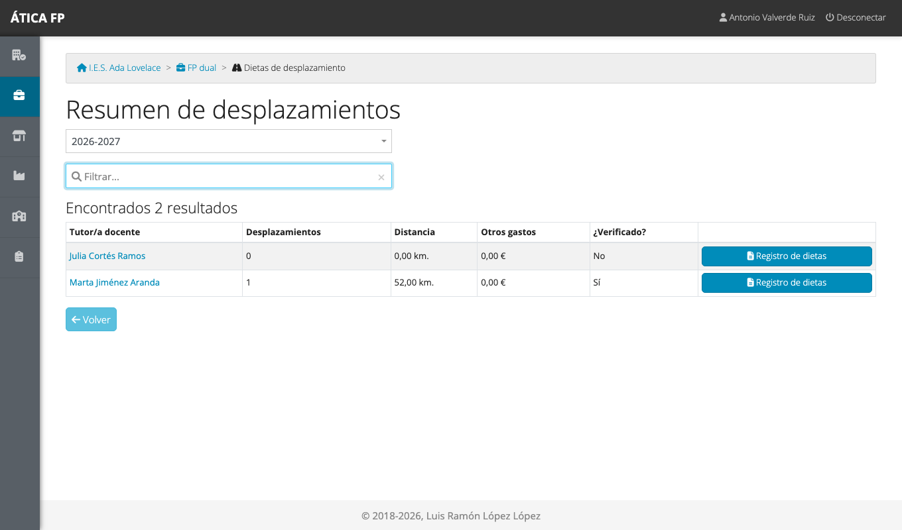

## Informes {#informes}

La tarjeta **Informes** (solo para administración, coordinación y jefatura) genera los documentos del proyecto en
PDF. Elige el informe, después el proyecto en el listado, y la aplicación lo genera.

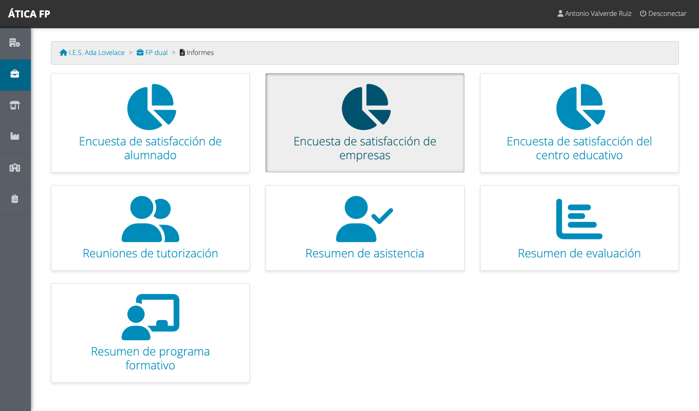

| Informe | Qué contiene |
| --- | --- |
| **Encuesta de satisfacción de alumnado**, **de empresas** y **del centro educativo** | El resultado de cada pregunta de las encuestas, con las respuestas recibidas |
| **Reuniones de tutorización** | Las reuniones de tutorización registradas del proyecto y un resumen por docente |
| **Resumen de asistencia** | Para cada convenio, las horas y jornadas realizadas, las faltas y las justificadas |
| **Resumen de evaluación** | La valoración de cada estudiante en cada concreción |
| **Resumen de programa formativo** | Las actividades, concreciones y empresas del proyecto |

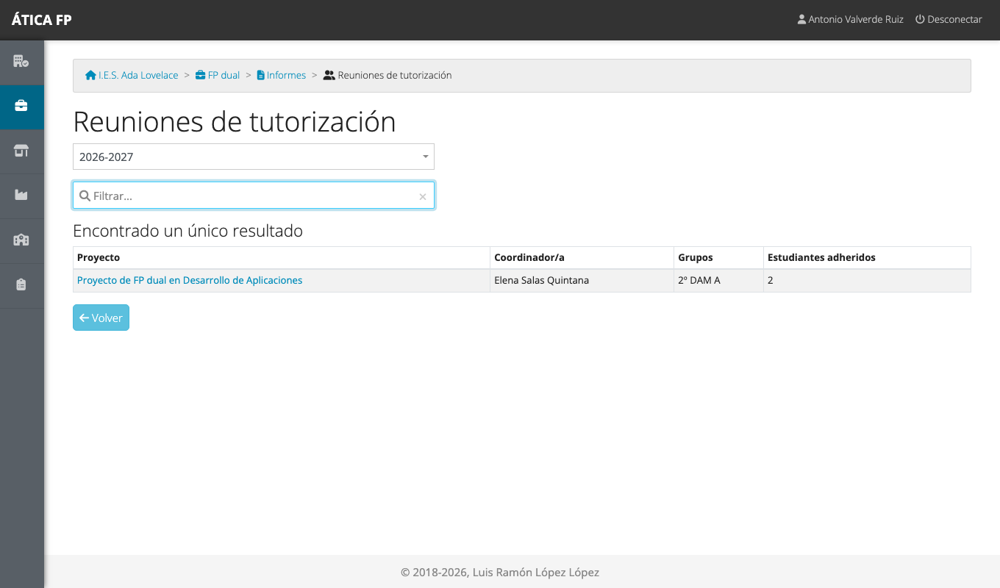

## Qué no puedes hacer y a quién pedirlo

- **La coordinación y la jefatura solo gestionan su ámbito.** Los proyectos de otras personas o de otras
  enseñanzas, a la administración del centro.
- **Registrar contactos y desplazamientos** requiere ser docente del curso: la administración del centro, si no
  está en el profesorado, puede consultarlos y modificarlos pero no registrarlos.
- **Los registros diarios** los hacen las tutorías, el alumnado y la empresa; como gestión puedes consultarlos y
  corregirlos.
- **Los usuarios del alumnado y del profesorado** se crean al [importarlos](05-importaciones.md).
