# FP dual: tutoría docente y de grupo

Este capítulo es para el **profesorado que hace el seguimiento del alumnado** de FP dual: el **responsable de
seguimiento** de un convenio (la tutoría docente) y la **tutoría de grupo** del alumnado del proyecto. Una misma
persona puede ser las dos cosas; lo que puedes hacer depende de tu relación con cada estudiante.

## Qué puedes hacer

| Tarea | Responsable de seguimiento | Tutoría de grupo |
| --- | :-: | :-: |
| Consultar el seguimiento y el calendario de tu alumnado | ✅ | ✅ |
| Registrar y revisar jornadas, bloquearlas y marcar faltas | ✅ | ✅ |
| **Valorar** las concreciones realizadas y comentarlas | ✅ | ✅ |
| Consultar el **resumen de evaluación** del alumnado | — | ✅ |
| Registrar **contactos** con las empresas | ✅ | ✅\* |
| Registrar **gastos de desplazamiento** | ✅ | ✅\* |
| Rellenar las encuestas del alumnado y de la empresa en su nombre | ✅ | ✅ |
| Rellenar tu **encuesta de satisfacción del centro** | ✅ | — |

\* Si además das clase a alguno de los grupos del proyecto, que es lo habitual. Los contactos y los
desplazamientos son una tarea de quien hace seguimiento o imparte docencia en la FP dual.

La [matriz de permisos](27-dual-permisos.md) lo detalla pantalla a pantalla. La administración, la coordinación y
la jefatura pueden hacer lo mismo con todo su ámbito ([capítulo 21](21-dual-gestion.md)).

## Dónde está

Tu menú de **FP dual** tiene las tarjetas **Seguimiento de actividad**, **Valoración del desempeño de
actividades**, **Resumen de evaluación** (si eres tutor o tutora de grupo), **Contactos con empresas**, **Dietas de
desplazamiento** y **Encuestas**.

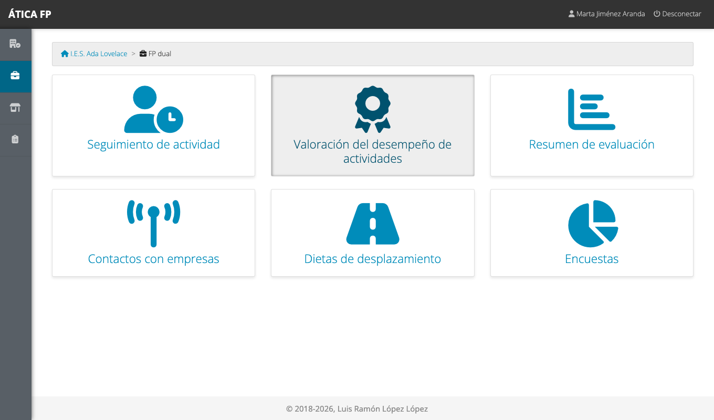

## Seguimiento diario

**FP dual → Seguimiento de actividad** lista los convenios de tu alumnado.

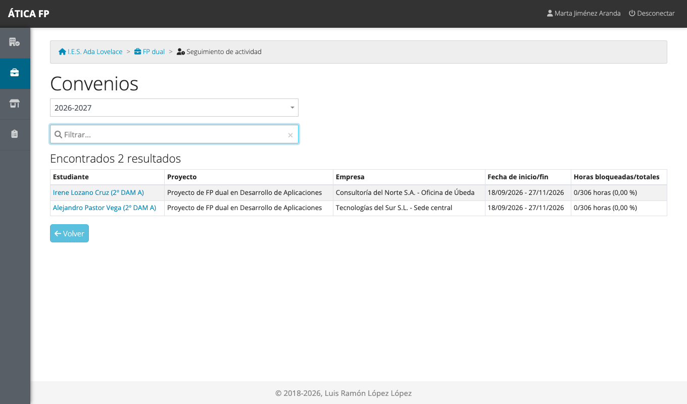

Pulsa el nombre de un estudiante para abrir su calendario.

### El calendario de seguimiento {#el-calendario-de-seguimiento}

El **calendario en alternancia** funciona igual que el de la FCT ([capítulo 12](12-fct-tutoria-docente-y-de-grupo.md#el-calendario-de-seguimiento)):
muestra las jornadas mes a mes con el mismo código de color (verde: registrada; naranja: incompleta; rayado:
falta; azul: pendiente), con una barra de progreso, el botón **Ir a hoy** y, por cada semana, un **candado** para
bloquearla y una **impresora** para su ficha semanal de actividades.

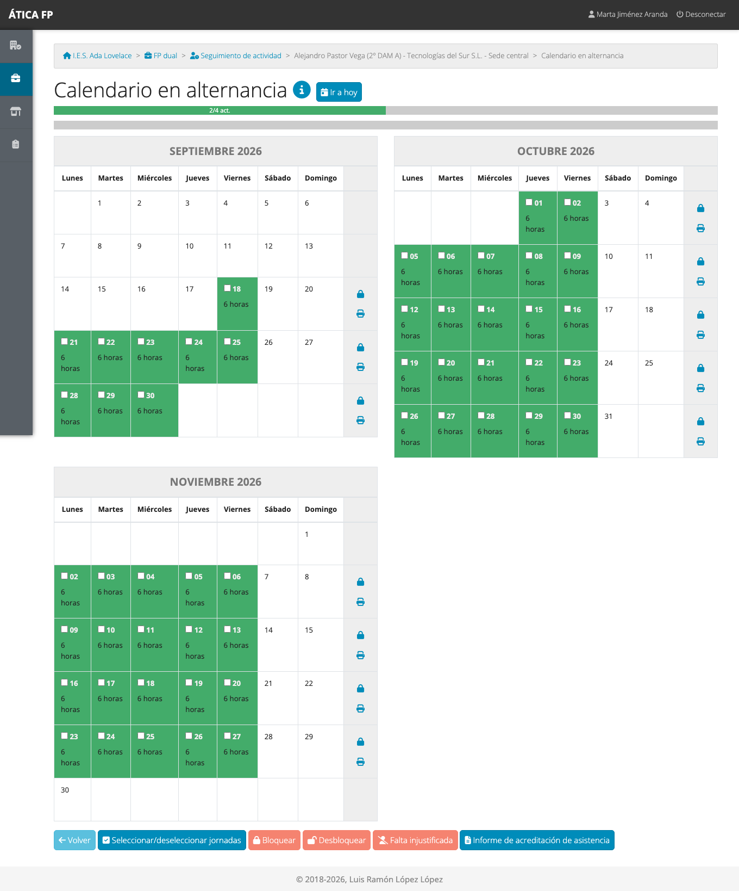

La barra de arriba no cuenta horas, sino **concreciones**: «2/4 act.» significa que se han realizado dos de las
cuatro concreciones del programa del estudiante.

Con las jornadas marcadas puedes **Bloquear** y **Desbloquear**, y marcar **Falta justificada** o
**Falta injustificada**. El botón **Informe de acreditación de asistencia** genera la hoja de asistencia en PDF.

### Registrar una jornada

Pulsa un día para abrir su ficha.

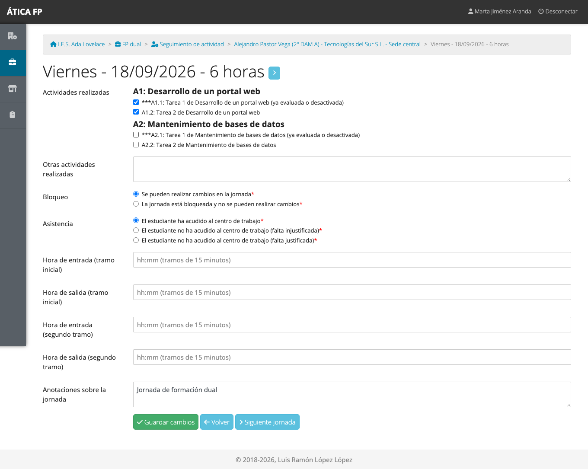

- **Actividades realizadas**: marca las **concreciones** que se han trabajado esa jornada. Aparecen agrupadas por
  actividad. A diferencia de la FCT, aquí no se reparten horas: se marca qué se ha hecho.
- Las concreciones que indican **«ya evaluada o desactivada»** ya están valoradas o deshabilitadas. A ti, como
  tutoría, la aplicación te las marca con *** para que las distingas, pero puedes cambiarlas; el alumnado y la
  empresa las ven en gris y **no pueden** marcarlas ni desmarcarlas.
- **Otras actividades realizadas**, **bloqueo**, **asistencia** (falta justificada o injustificada), **horas de
  entrada y salida** y **anotaciones**: como en la FCT. Una falta borra las actividades de la jornada y la bloquea.

Las concreciones que se marquen en alguna jornada son las que después se podrán **valorar**.

## Valoración del desempeño {#valoracion-del-desempeno}

**FP dual → Valoración del desempeño de actividades** lista los convenios evaluables, con el porcentaje de
concreciones ya valoradas.

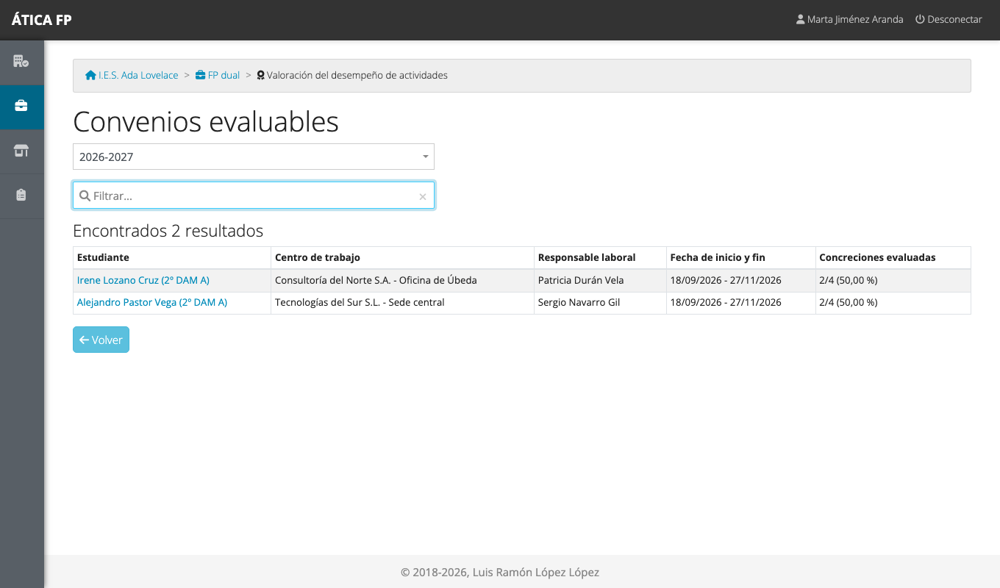

Pulsa el estudiante para valorar sus concreciones.

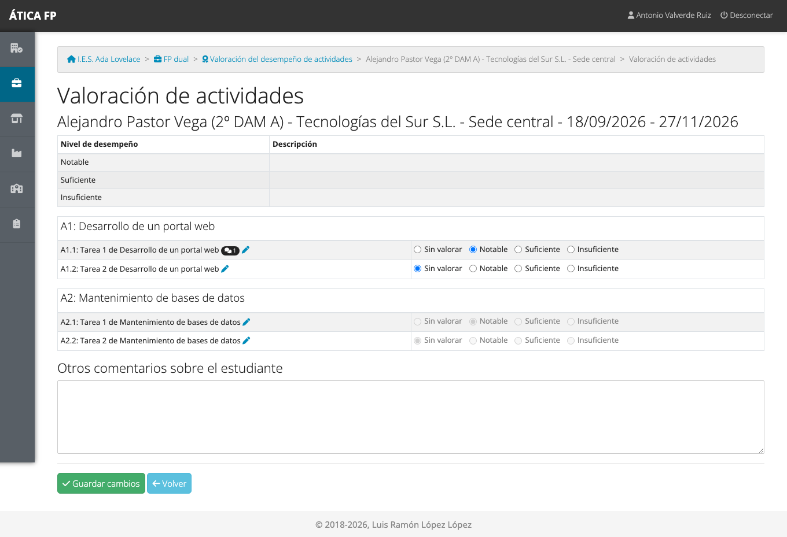

- Para cada concreción, elige el **nivel de desempeño** de la escala del proyecto («Notable», «Suficiente»,
  «Insuficiente»...) o déjala **sin valorar**.
- **Solo se pueden valorar las concreciones que se han marcado como realizadas** en alguna jornada. Las demás
  aparecen en gris, sin opciones, hasta que se realicen.
- El **lápiz** de cada concreción abre sus **comentarios** (ver abajo), y la burbuja indica cuántos hay.
- **Otros comentarios sobre el estudiante** es un texto libre que luego verá el profesorado en el resumen.
- Pulsa **Guardar cambios**.

### Comentarios de una concreción

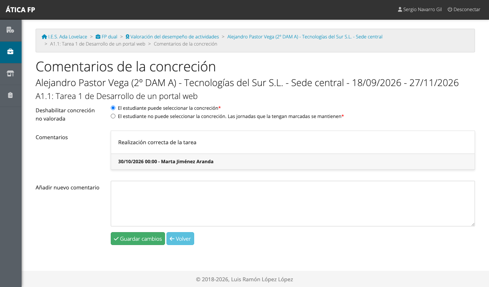

Aquí puedes **añadir comentarios** sobre cómo se ha realizado la concreción y ver los anteriores. También puedes
**deshabilitar la concreción no valorada**: así el estudiante ya no podrá seleccionarla en las jornadas (las
jornadas que ya la tengan marcada se mantienen).

!!! note "Quién valora"
    Valoran el **responsable laboral**, el **responsable de seguimiento**, la **tutoría de grupo**, la
    **coordinación** y la **jefatura**. El profesorado de los módulos consulta lo valorado (ver
    [capítulo 23](23-dual-profesorado-y-evaluacion.md)). Con el proyecto bloqueado o el convenio de un curso
    anterior, la valoración queda en solo lectura.

## Resumen de evaluación

Si eres **tutor o tutora de grupo**, **Resumen de evaluación** te permite consultar, de cada estudiante del grupo,
el resultado de todos los módulos. Cómo es el informe está explicado en el
[capítulo 23](23-dual-profesorado-y-evaluacion.md#el-informe-de-resultados-de-un-estudiante).

## Contactos con empresas {#contactos-con-empresas}

**FP dual → Contactos con empresas** guarda el registro de las comunicaciones del profesorado con las empresas.

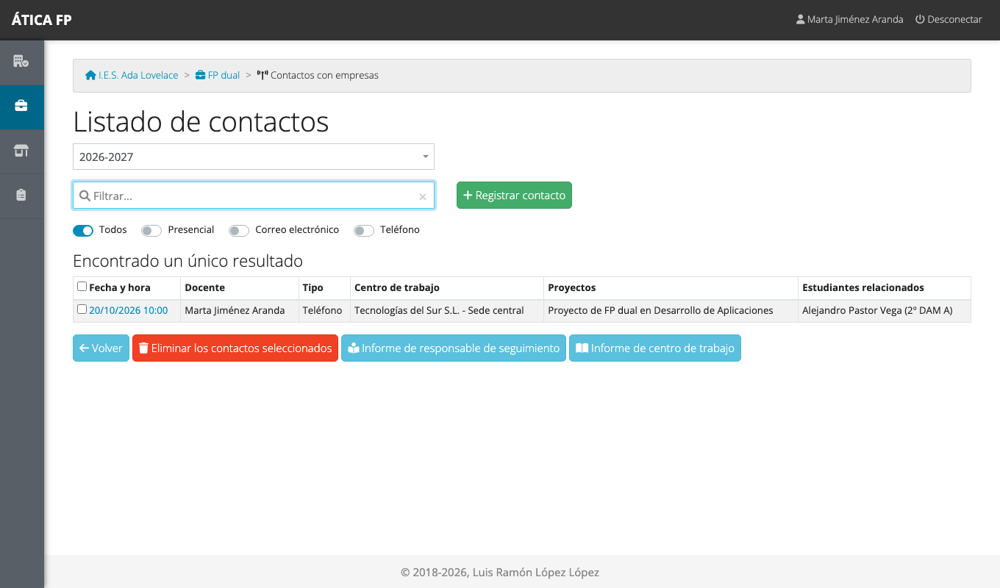

Los **filtros** de arriba (Todos, Presencial, Correo electrónico, Teléfono) muestran solo un tipo de contacto.
Para registrar uno nuevo pulsa **Registrar contacto**:

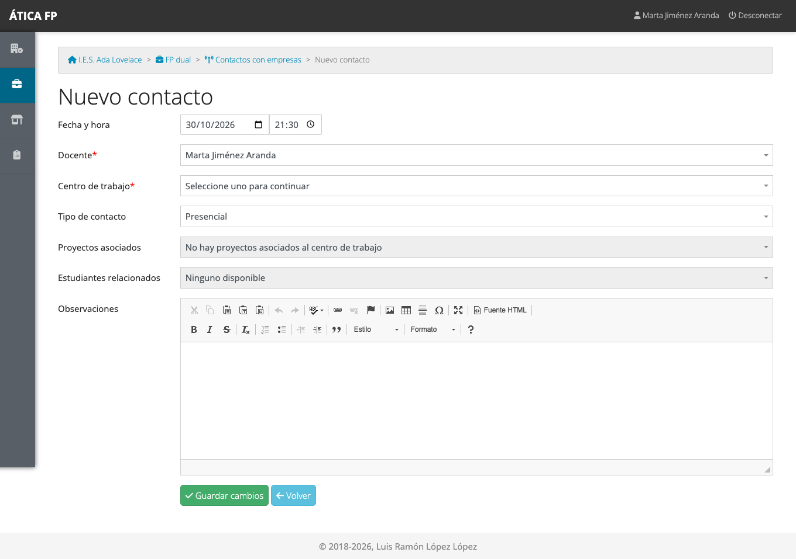

1. Indica la **fecha y la hora** y el **docente** (tú).
2. Elige el **centro de trabajo** (la sede de la empresa).
3. Elige el **tipo de contacto**: los tipos disponibles son los del
   [catálogo del centro](04-administrar-el-centro.md#tipos-de-contacto-con-empresas).
4. Marca los **proyectos** y los **estudiantes relacionados**: las listas se rellenan según la sede.
5. Escribe las **observaciones** y guarda.

Un contacto solo lo modifica o elimina quien lo registró (y la administración). La coordinación, la jefatura y las
tutorías con acceso al convenio pueden consultarlo. Con **Informe de responsable de seguimiento** y **Informe de
centro de trabajo** obtienes el recuento de visitas presenciales y otros contactos por docente y por sede.

## Gastos de desplazamiento {#gastos-de-desplazamiento}

**FP dual → Dietas de desplazamiento** funciona exactamente igual que en la FCT: registras los viajes con su
itinerario, otros gastos y los convenios relacionados, y el responsable económico los verifica. Todo está explicado
en [FCT: tutoría docente y de grupo](12-fct-tutoria-docente-y-de-grupo.md#gastos-de-desplazamiento).

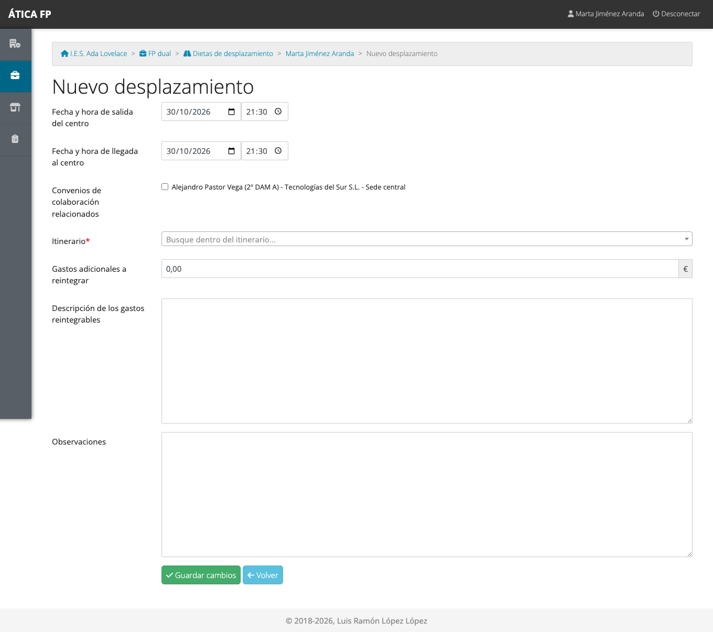

## Encuestas

**FP dual → Encuestas** reúne tres encuestas de satisfacción:

- **Alumnado**: la contesta el propio estudiante ([capítulo 24](24-dual-alumnado.md#la-encuesta-de-satisfaccion)); puedes
  rellenarla en su nombre.
- **Empresa**: la contesta el responsable laboral ([capítulo 25](25-dual-tutoria-laboral.md#la-encuesta-de-satisfaccion-de-la-empresa));
  puedes rellenarla en su nombre.
- **Centro educativo**: la contestas **tú**, como responsable de seguimiento, una vez por proyecto.

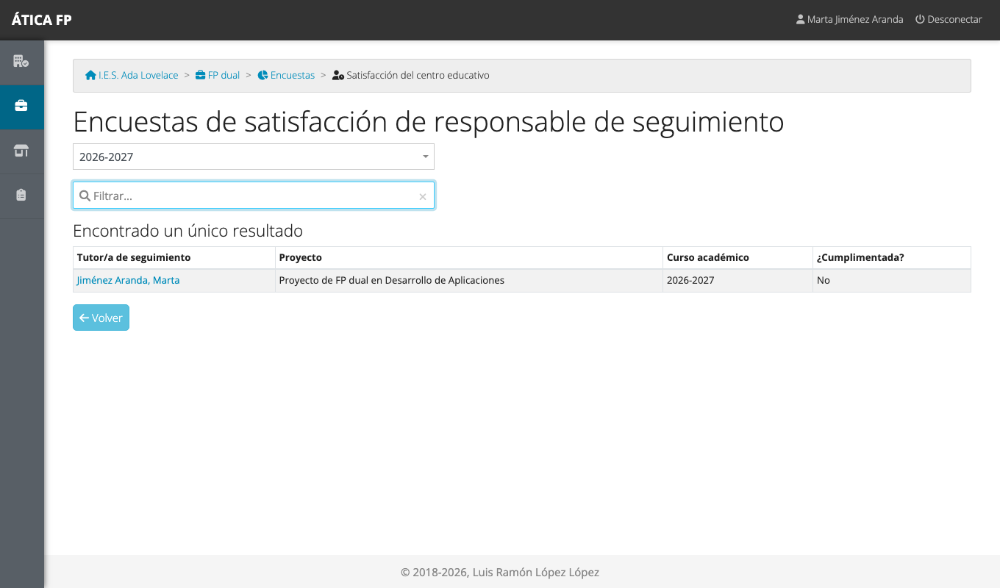

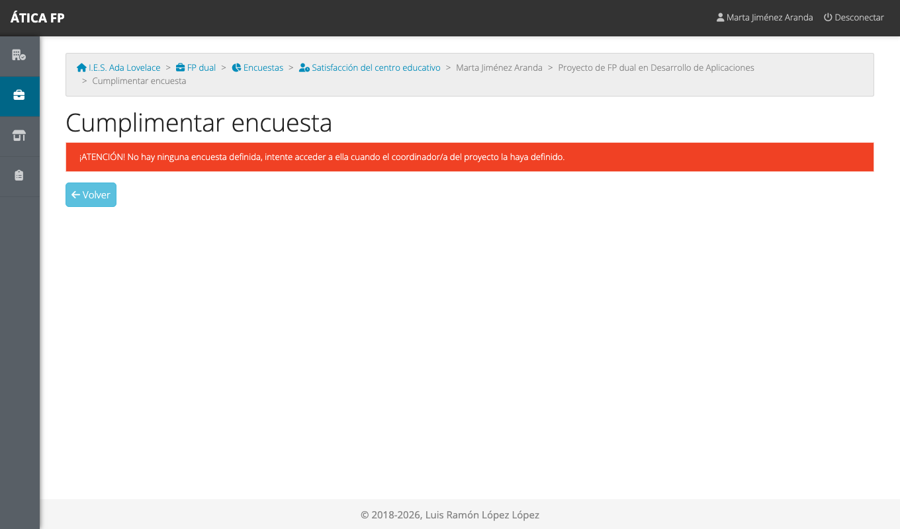

Una encuesta solo se puede contestar mientras está abierta (entre su fecha de comienzo y de finalización) y con el
proyecto sin bloquear.

## Qué no puedes hacer y a quién pedirlo

- **Crear convenios, calendarios, actividades ni programas formativos**: es de la coordinación, la jefatura y la
  administración ([capítulo 21](21-dual-gestion.md)).
- **Ver el seguimiento de convenios ajenos.** Como responsable de seguimiento de un convenio, ves el de tu alumnado,
  no el de otras tutorías; los listados solo muestran lo que te corresponde.
- **Verificar itinerarios**: es tarea del [responsable económico](26-dual-responsable-economico.md).
- **Modificar un proyecto bloqueado o un convenio de un curso anterior**: pide a la administración que lo
  desbloquee.
