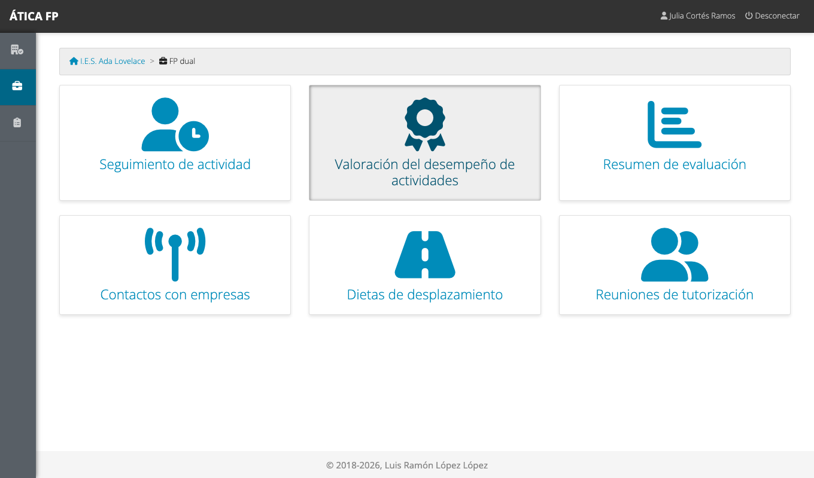
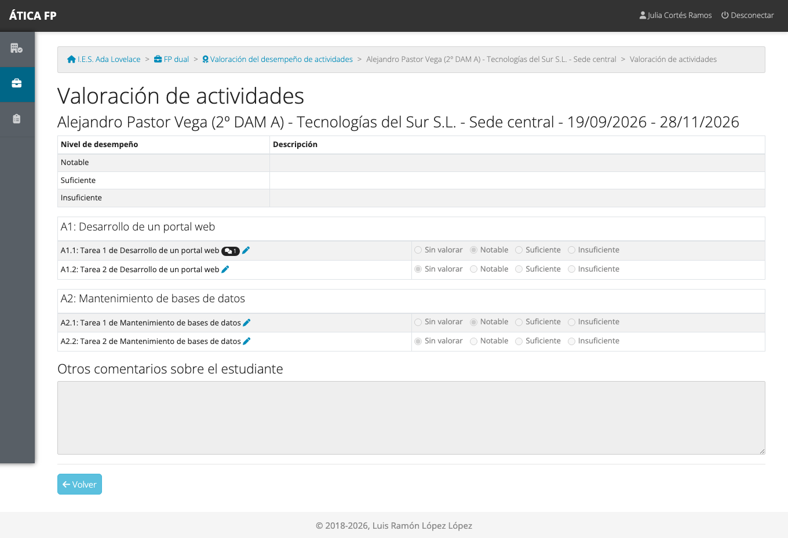
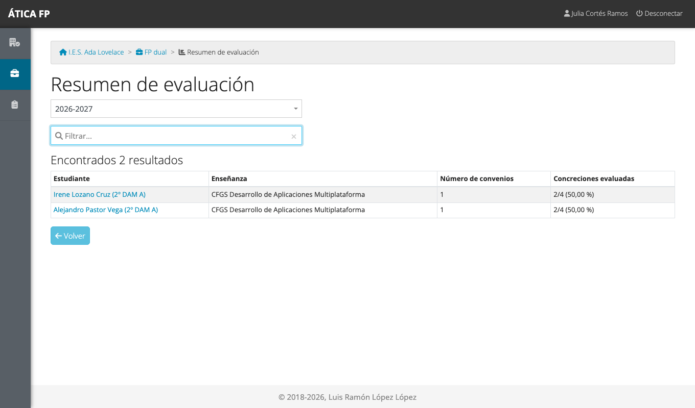
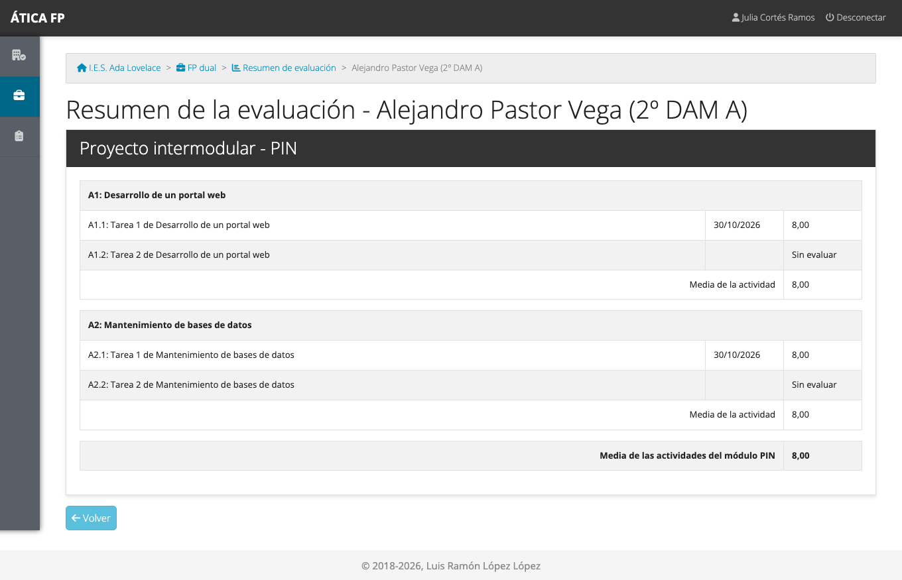

# FP dual: profesorado y evaluación

Este capítulo es para el **profesorado que da clase** a alumnado que hace FP dual y **no tiene otro cargo** en el
proyecto (no es responsable de seguimiento de ese estudiante, ni tutoría de su grupo, ni coordinación). Tu papel
es **consultar** cómo ha ido el alumnado en las empresas y **usarlo en la evaluación** de tu módulo: lo que cada
estudiante ha hecho en la empresa se vincula con los resultados de aprendizaje de tu materia.

!!! note "Quien valora no eres tú"
    La **valoración** de cada actividad en la empresa la hacen el responsable laboral, el responsable de
    seguimiento, la tutoría de grupo y la coordinación ([capítulo 22](22-dual-tutoria-docente-y-de-grupo.md#valoracion-del-desempeno)).
    Tú ves el resultado y lo incorporas a tu evaluación.

## Qué puedes hacer

- Ver el **seguimiento** y el **calendario** de tu alumnado en las empresas, en solo lectura.
- **Consultar la valoración** de las concreciones de cada estudiante.
- Ver el **resumen de evaluación** y el **informe de resultados** del alumnado al que das clase, limitados a tus
  módulos.
- Ver los **contactos** con empresas y el **resumen de gastos**, y registrar los tuyos.
- Registrar tus **reuniones de tutorización** con el alumnado.

Solo ves a los estudiantes **de los grupos a los que das clase**. La [matriz de permisos](27-dual-permisos.md) lo
resume.

## Dónde está

Tu menú de **FP dual** tiene **Seguimiento de actividad**, **Valoración del desempeño de actividades**, **Resumen de
evaluación**, **Contactos con empresas**, **Dietas de desplazamiento** y **Reuniones de tutorización**. No tienes
encuestas: en la FP dual solo las contestan el alumnado, la empresa y quien hace el seguimiento.

## Consultar la valoración

**Valoración del desempeño de actividades** lista los convenios de tu alumnado, y al abrir uno ves, por cada
concreción, el nivel con que la han valorado, los comentarios y los comentarios generales sobre el estudiante. La
pantalla es de **solo lectura**: las opciones están desactivadas y no hay botón de guardar.

Las concreciones sin valorar todavía aparecen como «Sin valorar»: o aún no se han realizado, o falta que la empresa
o la tutoría las valore.

## Resumen de evaluación

**Resumen de evaluación** es el listado de tu alumnado de FP dual, con la enseñanza, el número de convenios y el
porcentaje de concreciones ya evaluadas.

### El informe de resultados de un estudiante {#el-informe-de-resultados-de-un-estudiante}

Pulsa un estudiante para ver su **informe de resultados**.

El informe se organiza **por módulo profesional** (materia). Para cada módulo muestra las **actividades**, las
**concreciones** de cada una con la fecha de su valoración y su **calificación numérica**, la **media de cada
actividad** y la **media del módulo**. Las concreciones que aún no se han valorado aparecen como «Sin evaluar» y no
cuentan en la media. Debajo, si las hay, aparecen los **comentarios de las empresas** sobre el estudiante.

Dos reglas limitan lo que ves:

- **Solo ves a tu alumnado.** Si no das clase al grupo del estudiante, la aplicación te niega el acceso al
  informe.
- **Solo ves tus módulos.** Si das clase de un módulo a ese grupo, el informe incluye únicamente ese módulo; la
  tutoría de grupo, la coordinación y la jefatura ven todos los módulos del estudiante.

La calificación numérica de cada concreción sale de la **escala de valoración** del proyecto: cada nivel
(«Notable», «Suficiente»...) tiene asociada una nota
([capítulo 4](04-administrar-el-centro.md#escalas-de-valoracion-del-desempeno)). La nota de tu módulo en la
evaluación es una decisión tuya: el informe te da los datos de partida.

!!! tip "Resultados de aprendizaje en la enseñanza"
    Para que una concreción cuente en tu módulo, el centro tiene que haberla asociado a resultados de aprendizaje de
    ese módulo ([capítulo 21](21-dual-gestion.md#actividades-y-concreciones)). Si echas en falta una actividad en el
    informe de tu módulo, avisa a la coordinación del proyecto.

## Seguimiento y contactos

- **Seguimiento de actividad**: puedes abrir el calendario de tus estudiantes y descargar su hoja de asistencia, pero
  **no modificar** las jornadas (eso lo hacen el alumnado, la empresa y las tutorías).
- **Contactos con empresas**: puedes ver los contactos que registra el profesorado y registrar los tuyos
  ([capítulo 22](22-dual-tutoria-docente-y-de-grupo.md#contactos-con-empresas)).
- **Dietas de desplazamiento**: ves el resumen del profesorado y registras tus propios desplazamientos
  ([FCT: gastos](12-fct-tutoria-docente-y-de-grupo.md#gastos-de-desplazamiento)).
- **Reuniones de tutorización**: registras las reuniones que mantienes con el alumnado de los proyectos en los que
  das clase ([capítulo 22](22-dual-tutoria-docente-y-de-grupo.md#reuniones-de-tutorizacion)). Solo ves las que has
  registrado tú.

## Qué no puedes hacer y a quién pedirlo

- **Valorar actividades o modificar jornadas**: lo hacen la empresa y las tutorías. Si hay un error en una
  valoración, pídelo a la tutoría de grupo o al responsable de seguimiento.
- **Ver estudiantes de grupos a los que no das clase**: pídelo a la coordinación o a la jefatura de departamento.
- **Ver módulos que no impartes** en el informe de un estudiante: pídelo a la tutoría de grupo.
