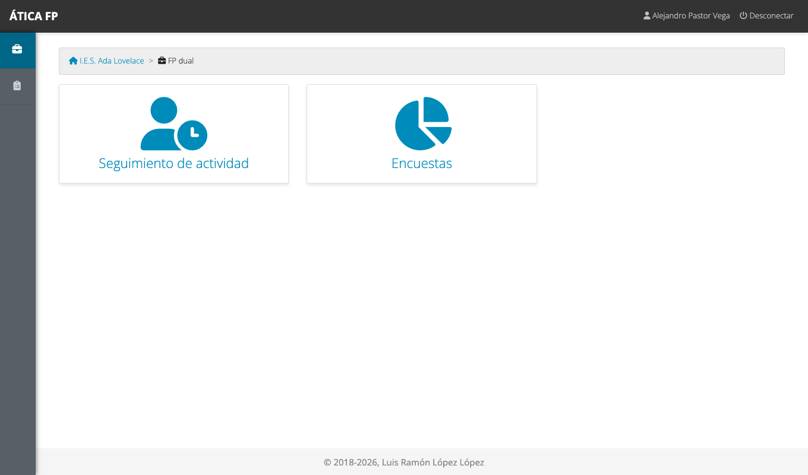
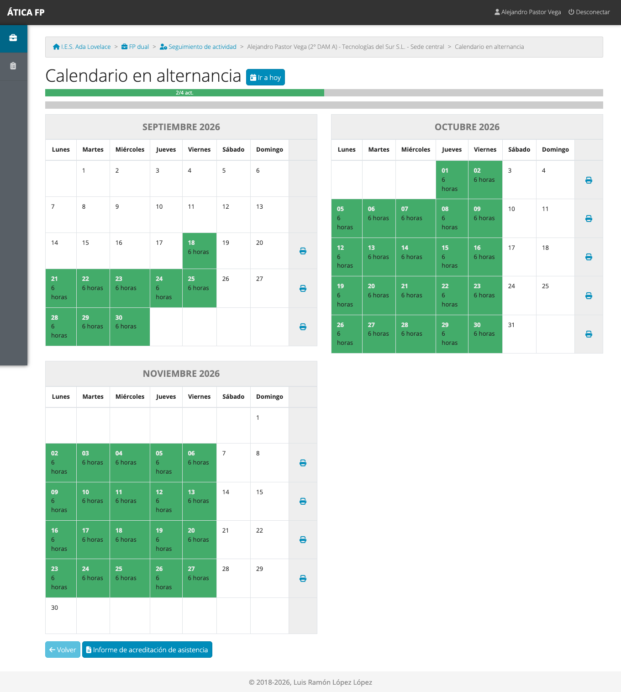
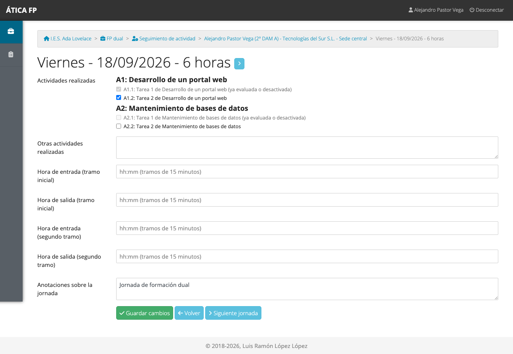
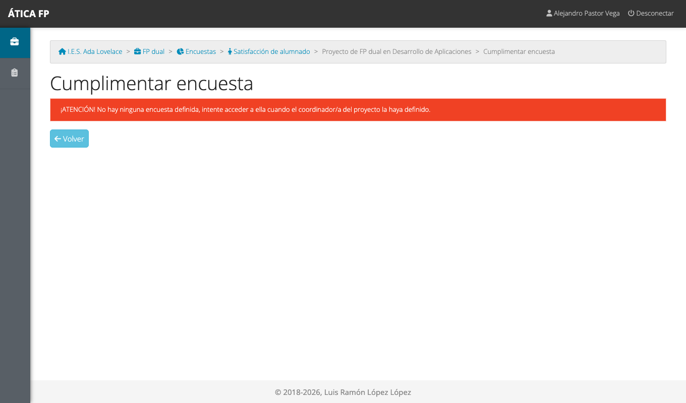

# FP dual: alumnado

Este capítulo es para el **alumnado de FP dual**. Explica qué tienes que hacer cada jornada en la aplicación y qué
documentos puedes descargar. Lo que registres lo usan tu responsable de seguimiento y tu responsable laboral para
valorarte, y esa valoración llega después a la evaluación de tus módulos, así que merece la pena hacerlo bien.

## Qué puedes hacer

- **Registrar cada jornada**: qué concreciones de actividad has trabajado.
- **Consultar tu calendario** en alternancia y ver cómo vas.
- **Descargar tu informe de asistencia** y la **ficha semanal de actividades**.
- **Contestar la encuesta de satisfacción** al terminar.

No ves el resto del alumnado, ni la valoración que hace de ti la empresa, ni puedes cambiar el calendario o tu
programa formativo. La [matriz de permisos](27-dual-permisos.md) lo resume.

## Dónde está

Tu menú de **FP dual** tiene dos tarjetas: **Seguimiento de actividad** y **Encuestas**. Solo ves el módulo si
tienes un convenio en el curso activo.

## Tu calendario

**Seguimiento de actividad** te lleva a tu **calendario en alternancia**: todas las jornadas de tu convenio, mes a
mes.

Los colores son los mismos que en la FCT ([capítulo 13](13-fct-alumnado.md#tu-calendario)): verde para una jornada
registrada, azul para una pendiente y rayado para una falta (la marca tu tutoría). La barra de arriba muestra
cuántas **concreciones** de tu programa formativo has trabajado ya («2/4 act.» son dos de cuatro).

## Registrar una jornada

Pulsa el día que quieres rellenar.

1. **Actividades realizadas**: marca las **concreciones** que has trabajado hoy. Están agrupadas por actividad
   (A1, A2...). No se reparten horas: solo marcas lo que has hecho.
2. **Otras actividades realizadas**: si has hecho algo que no está en tu programa, descríbelo aquí.
3. **Hora de entrada y de salida** (opcional): en tramos de 15 minutos, con un segundo tramo por si tu horario es
   partido.
4. **Anotaciones sobre la jornada** (opcional).
5. Pulsa **Guardar cambios**.

Las flechas junto al título y los botones **Jornada anterior** y **Siguiente jornada** te permiten rellenar varios
días seguidos.

!!! note "Concreciones en gris"
    Una concreción en gris, con el aviso «ya evaluada o desactivada», ya no se puede marcar ni desmarcar. O bien tu
    tutoría o la empresa ya la han **valorado**, o bien la han **deshabilitado**. Lo que ya tienes marcado en
    jornadas anteriores se mantiene.

!!! warning "Una jornada bloqueada ya no se puede cambiar"
    Cuando tu tutoría bloquea una jornada, **ya no puedes modificarla**. Lo mismo ocurre si el proyecto se ha
    cerrado. Si hay un error, pídele que la desbloquee.

## Documentos

- **Informe de acreditación de asistencia**: el botón de debajo del calendario genera un PDF con tu asistencia.
- **Ficha semanal de actividades**: la impresora que hay a la derecha de cada semana genera el PDF con las
  actividades de esa semana.

## La encuesta de satisfacción {#la-encuesta-de-satisfaccion}

Cuando tu centro lo indica, tienes que contestar una encuesta sobre cómo ha ido la formación en la empresa. Está en
**FP dual → Encuestas**. Pulsa tu nombre en el listado, contesta las preguntas y pulsa **Guardar encuesta**.

Las preguntas obligatorias hay que contestarlas para guardar, y solo se puede contestar mientras la encuesta está
abierta. Si la vuelves a abrir, aparece con lo que ya habías contestado. Tus respuestas las ve el centro
agrupadas con las del resto del alumnado.

## Qué no puedes hacer y a quién pedirlo

- **Cambiar jornadas bloqueadas**: pídeselo a tu responsable de seguimiento.
- **Marcar faltas** o cambiar tu calendario, tu empresa o tu programa formativo: es cosa de tu tutoría o de la
  coordinación del proyecto.
- **Ver tu valoración**: la hace tu responsable laboral y tu tutoría; el profesorado de tus módulos la consulta para
  evaluarte. Si quieres saber cómo vas, pregunta a tu responsable de seguimiento.
