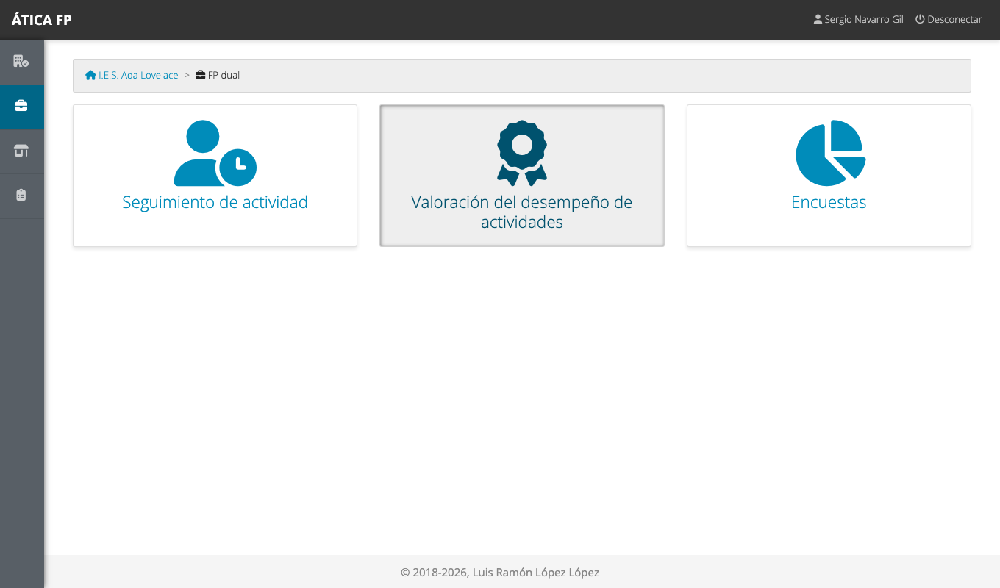
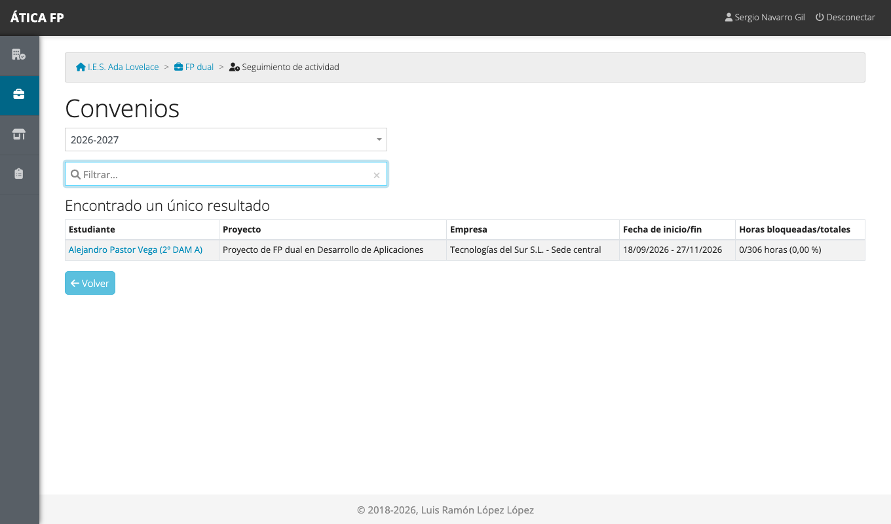
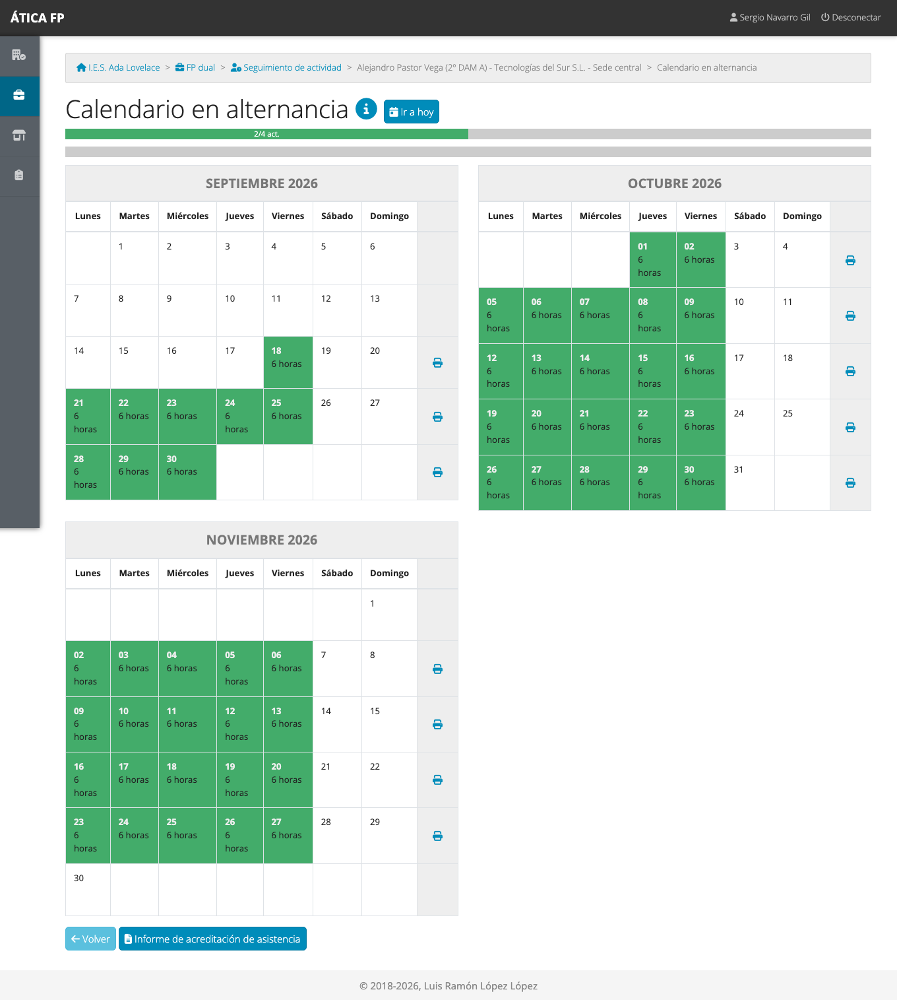
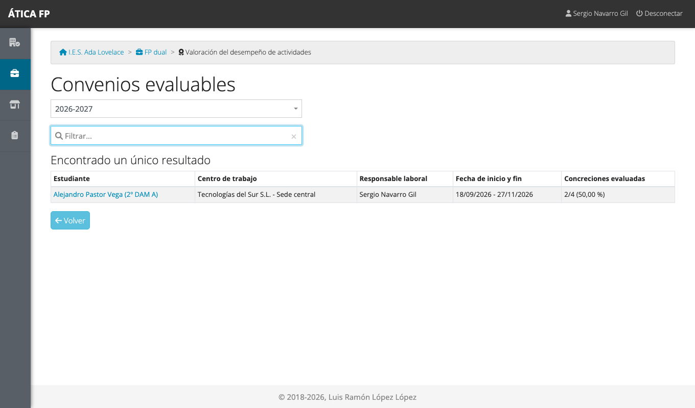
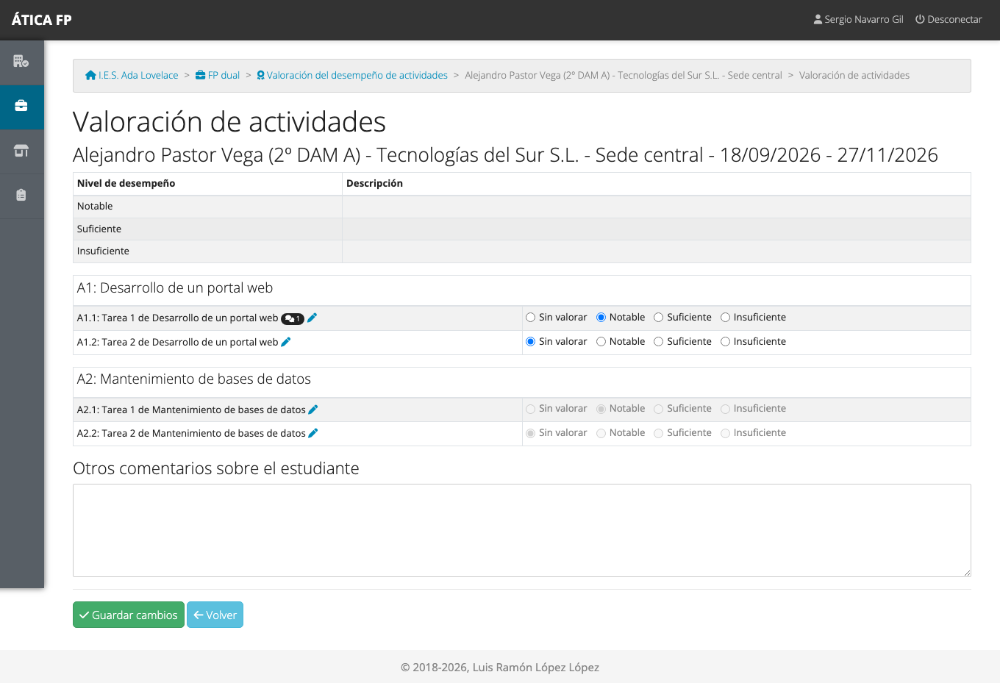
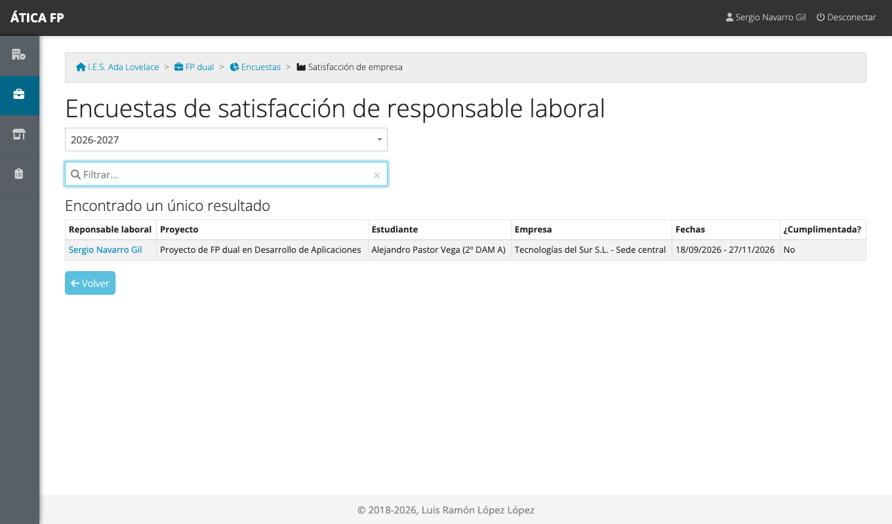
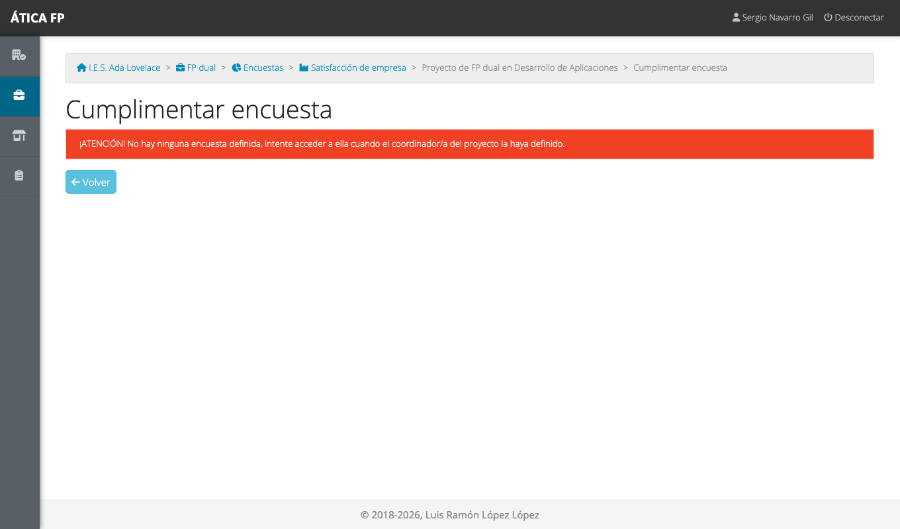

# FP dual: responsable laboral

Este capítulo es para la **persona de la empresa que tutoriza al alumnado** de FP dual: el **responsable laboral**
del convenio. Explica lo que el centro educativo te pide en la aplicación: confirmar la asistencia y las actividades
del estudiante, **valorar su desempeño** en cada actividad y contestar una encuesta sobre la colaboración.

Tu usuario lo crea el centro educativo cuando se registra el convenio con tu empresa. Te comunicará tu nombre de
usuario; la **contraseña inicial es el identificador** (normalmente tu DNI o NIE) con el que te dieron de alta, y la
aplicación te obliga a **cambiarla en el primer acceso** (ver
[Primeros pasos](02-primeros-pasos.md#cambiar-tu-contrasena)). Si te registraron sin identificador, usa
**¿Olvidó la contraseña?** con tu correo electrónico para elegir una.

## Qué puedes hacer

- **Consultar el calendario** de tu alumnado y revisar sus jornadas.
- **Completar o corregir** las actividades y la asistencia de cada jornada.
- Descargar la **hoja de asistencia**.
- **Valorar** cada concreción de actividad realizada, y comentarla.
- Contestar la **encuesta de satisfacción de la empresa**.

Solo ves **tu alumnado**: el de los convenios en los que figuras como responsable laboral (principal o adicional). No
ves otros convenios, los contactos ni los gastos del profesorado. La [matriz de permisos](27-dual-permisos.md) lo
resume.

## Dónde está

En el menú de **FP dual** tienes tres tarjetas: **Seguimiento de actividad**, **Valoración del desempeño de
actividades** y **Encuestas**.

## Seguimiento de tu alumnado

**Seguimiento de actividad** lista tus convenios.

Pulsa el nombre del estudiante para abrir su **calendario en alternancia**.

Verde significa jornada registrada; azul, pendiente. Pulsa un día para ver o completar su ficha. En ella puedes
marcar las **concreciones** que ha trabajado el estudiante, añadir otras actividades y las anotaciones, e
indicar la **asistencia** (ha acudido, o falta justificada o injustificada; con una falta se borran las actividades
de esa jornada). El centro educativo **bloquea** cada jornada cuando la da por revisada; a partir de ahí no se puede
modificar. Debajo del calendario, **Informe de acreditación de asistencia** genera la hoja de asistencia en PDF,
que normalmente tendrás que firmar.

## Valorar al alumnado {#valorar-al-alumnado}

Tu tarea principal en la aplicación es **valorar el desempeño**. **Valoración del desempeño de actividades** lista
tus convenios.

Pulsa el estudiante para valorar sus concreciones.

1. Para cada **concreción realizada**, elige el **nivel de desempeño** que corresponde («Notable», «Suficiente»,
   «Insuficiente»...). La tabla de arriba explica cada nivel.
2. **Solo puedes valorar las concreciones que el estudiante ha marcado como realizadas** en alguna jornada. Las
   demás aparecen en gris hasta que las trabaje.
3. Si quieres razonar una valoración, pulsa el **lápiz** de la concreción y añade un **comentario**
   ([capítulo 22](22-dual-tutoria-docente-y-de-grupo.md#valoracion-del-desempeno)).
4. En **Otros comentarios sobre el estudiante** puedes escribir una valoración general, que verá el profesorado.
5. Pulsa **Guardar cambios**.

Puedes volver a valorar mientras el proyecto siga abierto. Lo que valores se convierte, a través de los resultados
de aprendizaje, en información para la evaluación de los módulos del estudiante, así que conviene que sea justo y
que lo hagas a medida que las concreciones se vayan realizando.

## La encuesta de satisfacción de la empresa {#la-encuesta-de-satisfaccion-de-la-empresa}

**FP dual → Encuestas** te lleva a la encuesta de satisfacción de la empresa: sobre cómo ha ido la colaboración con
el centro y con el alumnado.

Pulsa el nombre del estudiante para contestarla.

Contesta las preguntas (las obligatorias están marcadas) y pulsa **Guardar encuesta**. Solo se puede contestar
mientras la encuesta está abierta.

## Qué no puedes hacer y a quién pedirlo

- **Bloquear jornadas** o marcar faltas en bloque: lo hace la tutoría del centro.
- **Cambiar el calendario, el horario o las concreciones del programa formativo**: pídelo al responsable de
  seguimiento o a la coordinación del proyecto.
- **Modificar una jornada bloqueada, o con el proyecto cerrado**: la tutoría tiene que desbloquearla.
- **No puedes entrar o has olvidado la contraseña**: usa **¿Olvidó la contraseña?** con el correo que el centro
  registró para ti, o pídele ayuda al responsable de seguimiento.
