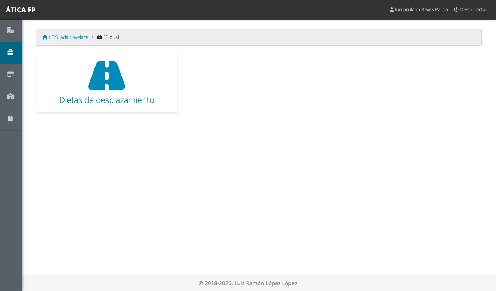
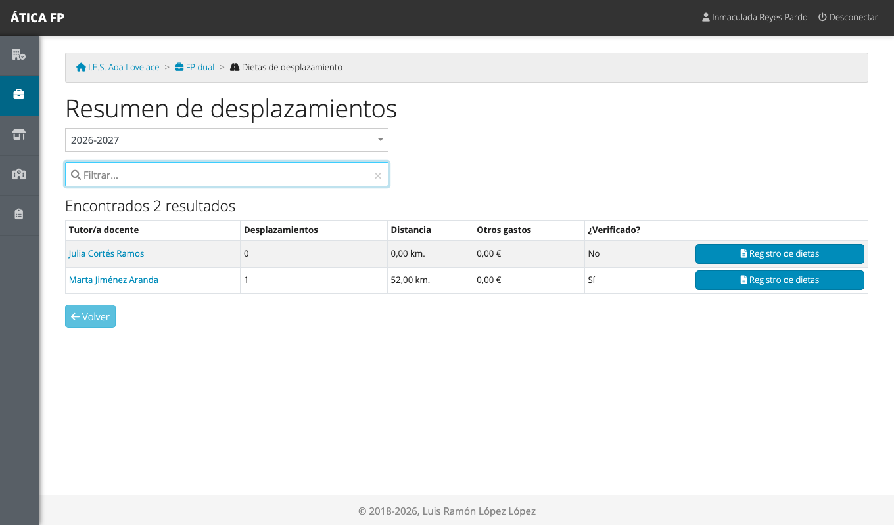
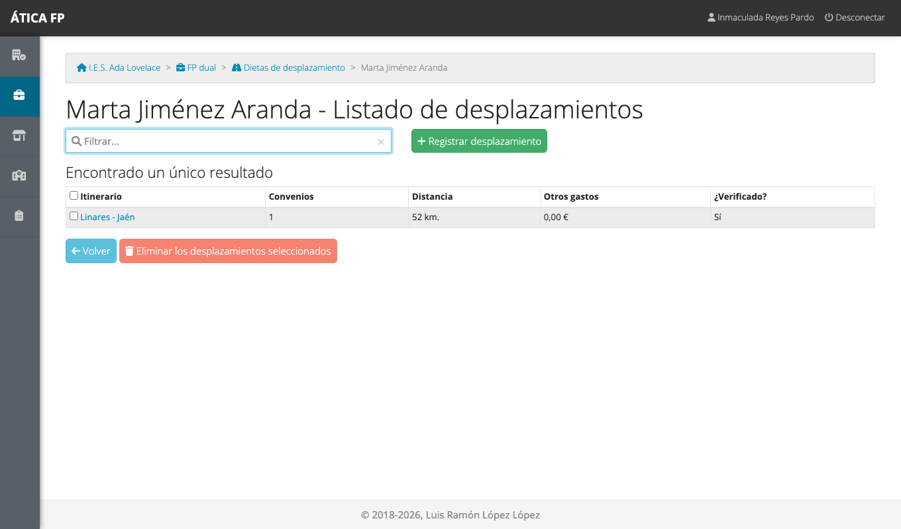
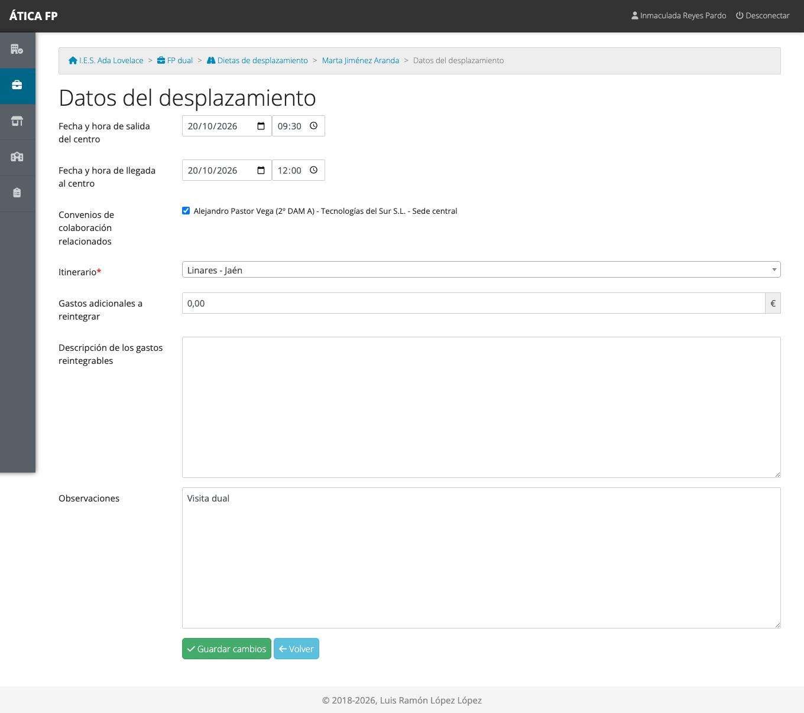

# FP dual: responsable económico

Este capítulo es para el **responsable económico** del centro: la persona designada como **secretario o
secretaria** en los [datos del curso](03-preparar-el-curso-academico.md#los-datos-de-un-curso). En la FP dual tienes
el mismo papel que en la FCT: consultar, registrar y corregir los **desplazamientos** que hace el profesorado para
visitar a las empresas, y comprobar sus kilómetros. Los gastos de los tres módulos funcionan de la misma manera; este
capítulo recoge solo lo que cambia. El procedimiento completo, con todas las pantallas, está en
[FCT: responsable económico](15-fct-responsable-economico.md).

## Qué puedes hacer

- Ver el **resumen de desplazamientos** del profesorado de FP dual.
- Consultar, **registrar**, **modificar** y **eliminar** los desplazamientos de cualquier docente.
- Descargar el **registro de dietas** de cada docente en PDF.
- **Verificar los itinerarios** del catálogo del centro (son los mismos para los tres módulos).

No ves el seguimiento del alumnado, las valoraciones, los contactos ni las encuestas. La
[matriz de permisos](27-dual-permisos.md) lo resume.

## Dónde está

En **FP dual** solo tienes la tarjeta **Dietas de desplazamiento**.

## Desplazamientos de FP dual

**Dietas de desplazamiento** abre el resumen del curso con el profesorado de FP dual.

Cada fila muestra los desplazamientos de un docente, sus kilómetros, los otros gastos y si todos sus itinerarios están
verificados. El botón **Registro de dietas** descarga la relación de gastos en PDF. Pulsa el nombre de un docente para
ver su listado y abrir cada desplazamiento.

Puedes **corregir cualquier dato**, **registrar** un desplazamiento en nombre del docente y **eliminar** los que
marques (con confirmación). A diferencia de la FCT, aquí el desplazamiento se relaciona con **convenios** de FP dual.

## Verificar los itinerarios

El catálogo de itinerarios es **único para los tres módulos**: un trayecto que se verifica en uno se considera
verificado en los demás. Se gestiona en **Gestión del centro → Itinerarios de desplazamiento**, como se explica en
[FCT: responsable económico](15-fct-responsable-economico.md#verificar-los-itinerarios).

## Qué no puedes hacer y a quién pedirlo

- **No ves el alumnado, las jornadas ni los contactos con empresas.** Si necesitas contrastar un viaje con un
  contacto, pídeselo a la coordinación del proyecto.
- **No gestionas el resto de «Gestión del centro»**: solo los itinerarios.
