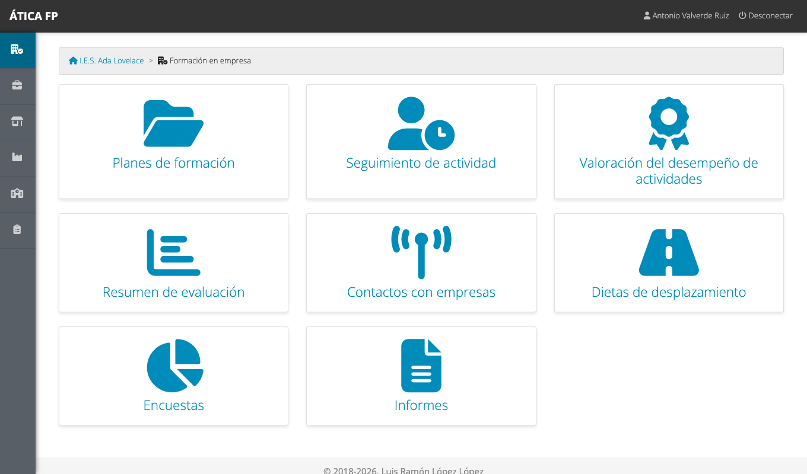

# FFE: visión general

Este capítulo es para **todas las personas que intervienen en la formación en empresa (FFE)**, sea cual sea su
perfil. Explica qué es el módulo, cómo se organiza un plan de formación de principio a fin y quién hace qué.
Después, cada perfil tiene su capítulo con las tareas concretas.

## Qué es la FFE

La **formación en empresa** es la fase del currículo en la que el alumnado hace **estancias** en empresas u
organismos equiparables para trabajar actividades formativas **vinculadas a los resultados de aprendizaje** de
los módulos profesionales. Se parece a la [FP dual](20-dual-vision-general.md) en cómo se registra y se valora, y
a la [FCT](10-fct-vision-general.md) en que es una fase concreta del ciclo, pero tiene su propia forma de
organizarse: el centro define un **plan de formación** para un curso, con sus actividades, sus empresas
colaboradoras y sus grupos, y cada estudiante tiene una o más **estancias** dentro de ese plan.

El módulo de FFE de ÁTICA FP sirve para:

- **Definir el plan de formación** de un curso: las actividades formativas, con los resultados de aprendizaje y los
  criterios de evaluación que trabajan, y las empresas que colaboran.
- **Incorporar al alumnado** al plan y registrar sus **estancias**: empresa, centro de trabajo, responsables y
  fechas, con su calendario de jornadas.
- **Registrar el día a día**: la asistencia y las actividades realizadas en cada jornada.
- **Valorar el desempeño** del alumnado en cada actividad, y trasladar esa valoración al **resumen de
  evaluación** del profesorado, con la nota media de cada criterio, resultado de aprendizaje y módulo.
- **Documentar el seguimiento**: visitas a las empresas y gastos de desplazamiento.
- **Recoger la opinión** de todas las partes (encuestas) y generar los informes.

Se activa por curso académico en [los datos del curso](03-preparar-el-curso-academico.md#los-datos-de-un-curso).

## El vocabulario de la FFE

Muchos conceptos son los mismos que en las otras modalidades, con nombres propios. En la aplicación verás los
términos de la columna de la izquierda.

| Término | Qué es |
| --- | --- |
| **Plan de formación** | La planificación de la FFE de un curso: sus cursos, grupos, actividades, empresas, plantillas de informe y encuestas. Se organiza por **cursos** (niveles) de una enseñanza y por **grupos** |
| **Actividad formativa** | Una tarea que el alumnado hace en las empresas («Soporte técnico»). Se asocia a los **resultados de aprendizaje** (RA) y a los **criterios de evaluación** (CE) de los módulos profesionales que trabaja. **Es lo que se valora** |
| **Plan de formación inicial** | El conjunto de actividades formativas de un curso con sus RA y CE. Se puede importar de Séneca y descargar en PDF |
| **Empresa del plan** | Una empresa u organismo equiparable que colabora en el plan, con su **número de convenio de colaboración**, sus mecanismos de seguimiento y las actividades que ofrece |
| **Tutoría dual de grupo** | El profesorado que gestiona el plan en un grupo (la **gestión de la FFE**) |
| **Plan de formación individualizado** | El alumno o la alumna incorporados al plan, con sus autorizaciones y adaptaciones especiales |
| **Estancia** | El periodo de un estudiante en un **centro de trabajo** de una empresa, con su calendario. Un estudiante puede tener varias |
| **Docente responsable del seguimiento** | La persona del profesorado que hace el seguimiento de la estancia (la tutoría docente de la FCT). Puede haber una adicional |
| **Tutor/a dual de empresa** | La persona de la empresa que supervisa al estudiante (la tutoría laboral de la FCT). Puede haber una adicional |
| **Escala de valoración** | Los niveles con que se valora cada actividad («Notable», «Suficiente»...) |

En este manual, para nombrar a las personas se usan los mismos términos que en los otros módulos cuando no hay
diferencia: **responsable de seguimiento** (docente responsable del seguimiento), **tutoría laboral** (tutor/a dual de
empresa) y **tutoría de grupo** (la del grupo del alumno, que es otra figura distinta de la tutoría dual de grupo).

## El ciclo de un plan de formación

1. **Preparación** (administración, jefatura o gestión de la FFE): se crea el
   [plan de formación](31-ffe-gestion.md#planes-de-formacion) del curso con su escala de valoración, sus plantillas
   y sus encuestas, y se definen sus [cursos y grupos](31-ffe-gestion.md#cursos-y-grupos).
2. **Actividades y empresas**: se definen las [actividades formativas](31-ffe-gestion.md#actividades-formativas) y se
   incorporan las [empresas colaboradoras](31-ffe-gestion.md#empresas-del-plan) con las actividades que ofrece cada una.
3. **Alumnado y estancias**: se [incorpora al alumnado](31-ffe-gestion.md#alumnado-del-plan) y se registran sus
   [estancias](31-ffe-gestion.md#estancias) con su calendario de jornadas.
4. **Seguimiento**: cada día se registra la [jornada](32-ffe-tutoria-docente-y-de-grupo.md#el-calendario-de-seguimiento):
   asistencia y actividades realizadas. El profesorado registra sus
   [visitas](32-ffe-tutoria-docente-y-de-grupo.md#visitas-a-las-empresas) y sus
   [desplazamientos](32-ffe-tutoria-docente-y-de-grupo.md#gastos-de-desplazamiento).
5. **Valoración**: la tutoría laboral, el responsable de seguimiento y la tutoría de grupo
   [valoran](32-ffe-tutoria-docente-y-de-grupo.md#valoracion-del-desempeno) cada actividad realizada.
6. **Evaluación**: el [profesorado](33-ffe-profesorado-y-evaluacion.md) consulta el resumen de evaluación de su
   alumnado.
7. **Informes y encuestas**: la administración, la jefatura o la gestión obtienen los
   [informes](31-ffe-gestion.md#informes) de las encuestas.

## Quién hace qué

| Perfil | Qué hace en la FFE | Capítulo |
| --- | --- | --- |
| **Administración del centro**, **jefatura de departamento** y **gestión de la FFE** | Preparan el plan, las actividades, las empresas, el alumnado y las estancias; ven todo el seguimiento, las valoraciones y los informes | [31](31-ffe-gestion.md) |
| **Responsable de seguimiento** y **tutoría de grupo** | Seguimiento diario, valoración, visitas, desplazamientos y encuestas | [32](32-ffe-tutoria-docente-y-de-grupo.md) |
| **Profesorado del grupo** | Consulta el resumen de evaluación del alumnado al que da clase | [33](33-ffe-profesorado-y-evaluacion.md) |
| **Alumnado** | Registra su jornada y contesta la encuesta | [34](34-ffe-alumnado.md) |
| **Tutoría laboral** | Registra asistencia y actividades, y valora al alumnado | [35](35-ffe-tutoria-laboral.md) |
| **Responsable económico** | Consulta y verifica los gastos de desplazamiento | [36](36-ffe-responsable-economico.md) |

Igual que en las otras modalidades, las tutorías no son un cargo del centro sino una **relación con una estancia
concreta**. La [matriz de permisos](37-ffe-permisos.md) detalla cada pantalla.

## Qué ves en el menú

Las entradas del módulo, y quién las ve, son estas:

| Entrada | Para qué sirve | Quién la ve |
| --- | --- | --- |
| **Planes de formación** | Plan, cursos, grupos, actividades, empresas, alumnado y estancias | Administración, jefatura y gestión de la FFE |
| **Seguimiento de actividad** | Calendarios y asistencia | Quien participa en alguna estancia: administración, jefatura, gestión, tutoría de grupo, responsable de seguimiento, alumnado y tutoría laboral |
| **Valoración del desempeño de actividades** | Valorar cada actividad realizada | Administración, jefatura, gestión, tutoría de grupo, responsable de seguimiento y tutoría laboral |
| **Resumen de evaluación** | Resultado del alumnado por actividad, criterio, resultado de aprendizaje y módulo | Administración, jefatura, gestión, tutoría de grupo, responsable de seguimiento y profesorado del grupo |
| **Contactos con empresas** | Registro de visitas y contactos | Administración, jefatura, gestión y responsables de seguimiento |
| **Dietas de desplazamiento** | Gastos de desplazamiento | Los anteriores y el responsable económico |
| **Encuestas** | Encuestas de alumnado, empresa y responsable de seguimiento | Administración, jefatura, gestión, tutoría de grupo, responsable de seguimiento, alumnado y tutoría laboral (cada uno solo ve lo suyo) |
| **Informes** | Informes de las encuestas del plan | Administración, jefatura y gestión de la FFE |

!!! note "Quien no tiene nada que hacer en el módulo, no lo ve"
    El módulo aparece en el menú solo a quien interviene en él: si no eres administración, jefatura ni gestión de la
    FFE y no tienes ninguna estancia ni das clase al alumnado del plan, no verás **Formación en empresa**.
