# FFEOE: gestión del plan de formación

Este capítulo es para la **administración del centro**, las **jefaturas de departamento** y la **gestión de la FFEOE**:
las personas que preparan la formación en empresa de cada curso. Cubre el plan de formación, sus cursos y grupos,
las actividades formativas, las empresas colaboradoras, el alumnado, las estancias con sus calendarios y los
informes.

Tres figuras pueden gestionar un plan, con matices:

- **La administración del centro** gestiona todos los planes del centro.
- **La jefatura de departamento** gestiona los planes de las enseñanzas de su departamento (por eso es importante
  que cada enseñanza esté enlazada con su [familia profesional](04-administrar-el-centro.md#departamentos)).
- **La gestión de la FFEOE** es el profesorado designado como **tutoría dual de grupo** en algún grupo del plan. Gestiona
  los planes de los grupos que tiene a su cargo.

## Qué puedes hacer

- Crear y editar **planes de formación**, con sus **cursos** y **grupos**.
- Definir las **actividades formativas** (con sus resultados de aprendizaje y criterios) e **importarlas de Séneca**.
- Incorporar las **empresas colaboradoras** con su convenio y las actividades que ofrecen.
- **Incorporar al alumnado** y registrar sus **estancias**, una a una o en lote, con su **calendario** de jornadas.
- **Seguir** todas las estancias, **valorar** las actividades y consultar el **resumen de evaluación**, las **visitas**
  y los **desplazamientos** del profesorado.
- Obtener los **informes** de las encuestas.

La [matriz de permisos](37-ffe-permisos.md) detalla cada acción.

## Dónde está

En el menú de **Formación en empresa**, la tarjeta **Planes de formación** reúne la preparación; el resto de
tarjetas (seguimiento, valoración, resumen de evaluación, contactos, dietas, encuestas e informes) son las mismas que
ven las demás personas, pero con acceso a todos los datos de tu ámbito.

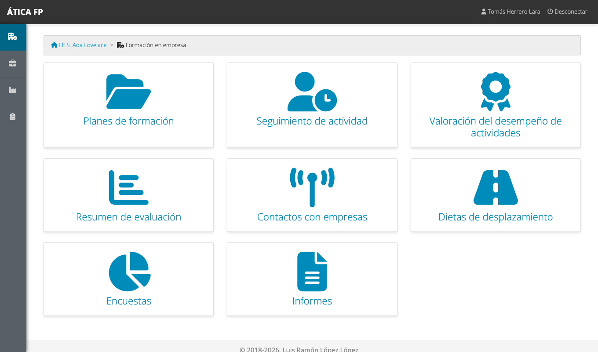

## Planes de formación {#planes-de-formacion}

**Formación en empresa → Planes de formación** lista los planes del curso. Con el selector de arriba consultas los
de otros cursos.

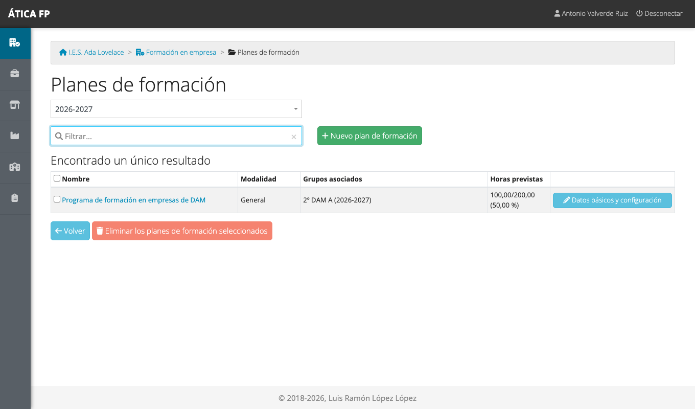

Cada fila muestra el nombre, la modalidad, los grupos asociados y las horas previstas sobre las totales de la
enseñanza. El nombre del plan lleva a sus [cursos](#cursos-y-grupos), y **Datos básicos y configuración** abre su
ficha.

### Crear un plan

1. Pulsa **Nuevo plan de formación**.
2. Rellena la ficha y guarda.

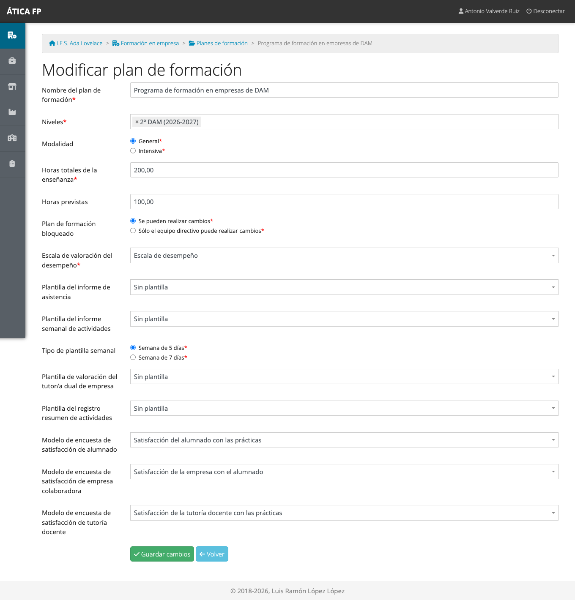

- **Nombre** del plan.
- **Niveles**: los cursos de la enseñanza que participan (por ejemplo, 2º DAM). Son obligatorios.
- **Modalidad**: **General** o **Intensiva**. Los grupos la heredan, aunque cada estancia puede indicar la suya.
- **Horas totales de la enseñanza** y **horas previstas**: las horas que el currículo dedica a la FFEOE y las que el plan
  prevé realizar.
- **Plan de formación bloqueado**: «Sólo el equipo directivo puede realizar cambios». Con el bloqueo, el plan aparece con
  un candado en los listados y **solo la administración del centro** puede modificarlo: la jefatura y la gestión de la
  FFEOE siguen consultando sus pantallas (plan, cursos, grupos, actividades, empresas, alumnado, estancias y
  calendarios), pero **en solo lectura**: los campos aparecen desactivados y no hay botones de guardar, añadir,
  importar, copiar ni eliminar. El seguimiento, la valoración y las encuestas de las estancias siguen igual.
- **Escala de valoración del desempeño**: los niveles con que se valorará cada actividad
  ([capítulo 4](04-administrar-el-centro.md#escalas-de-valoracion-del-desempeno)).
- **Plantillas de informe**: el [papel con membrete](07-encuestas-y-plantillas-de-informe.md#plantillas-de-informe) de
  los PDF de asistencia, de informe semanal (con semana de 5 o de 7 días), de valoración de la tutoría laboral y de
  registro resumen de actividades.
- **Modelos de encuesta** de satisfacción del alumnado, de la empresa colaboradora y de la tutoría docente
  ([capítulo 7](07-encuestas-y-plantillas-de-informe.md)). «Ninguna» desactiva esa encuesta.

!!! warning "Eliminar un plan"
    Para eliminar planes, márcalos y pulsa **Eliminar los planes de formación seleccionados**. Se borran todos sus
    datos asociados: actividades, empresas, alumnado, estancias, calendarios, valoraciones y encuestas. No se puede
    deshacer.

## Cursos y grupos {#cursos-y-grupos}

Al pulsar el nombre de un plan se abre su **plan de formación inicial**: una fila por curso.

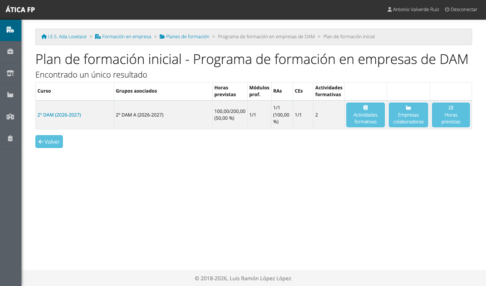

La fila resume las horas previstas, los módulos profesionales, los resultados de aprendizaje (RA) y criterios de
evaluación (CE) que cubren las actividades y cuántas actividades hay. Tres botones llevan a las partes del curso:
**Actividades formativas**, **Empresas colaboradoras** y **Horas previstas**. Este último abre una ficha con las horas
que el plan dedica a ese curso:

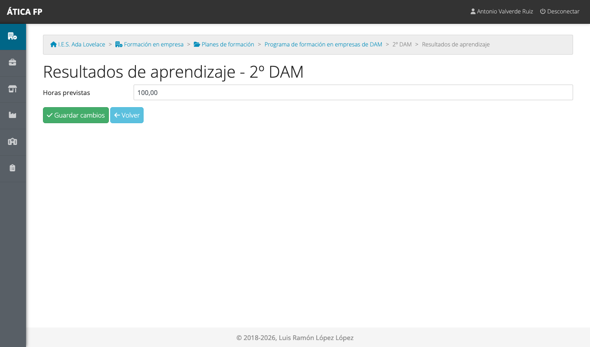

El nombre del curso lleva a sus **grupos**.

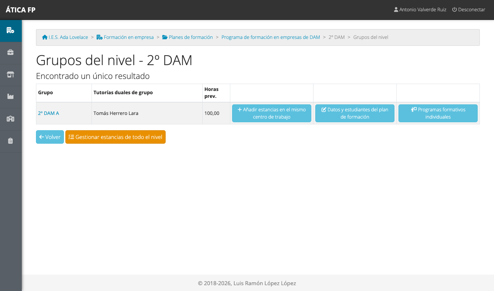

Cada grupo tiene tres botones: **Añadir estancias en el mismo centro de trabajo** (el alta [en lote](#estancias-en-lote)),
**Datos y estudiantes del plan de formación** y **Programas formativos individuales** (el [alumnado](#alumnado-del-plan)).
**Gestionar estancias de todo el nivel** abre la [lista de todas las estancias](#estancias-del-nivel) del curso.

### La ficha del grupo

**Datos y estudiantes del plan de formación** abre la ficha del grupo.

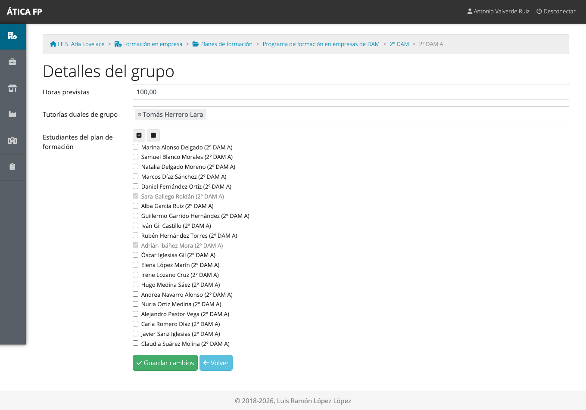

- **Horas previstas** del grupo.
- **Tutorías duales de grupo**: las personas que gestionan el plan en este grupo (la **gestión de la FFEOE**). Solo se
  ofrece el profesorado que **da clase en el grupo**.
- **Estudiantes del plan de formación**: marca el alumnado del grupo que participa. Quien ya tiene estancias aparece
  marcado y **no se puede desmarcar** mientras las conserve. **Seleccionar todos** y **Deseleccionar todos** agilizan
  la marcha.

## Actividades formativas {#actividades-formativas}

El botón **Actividades formativas** del curso abre el catálogo de actividades que el alumnado puede hacer en las
empresas.

Una **actividad formativa** tiene un **código** (FFE1...), un **nombre** y una **descripción**, y se asocia a los
**módulos profesionales**, **resultados de aprendizaje** y **criterios de evaluación** que se trabajan con ella.

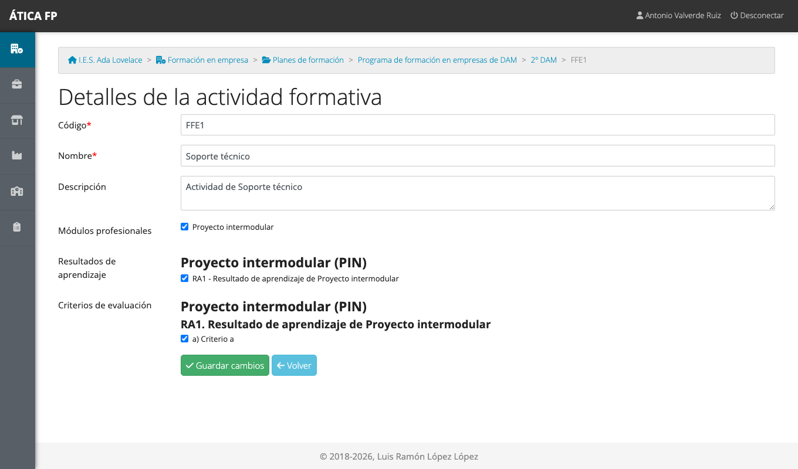

Al marcar los módulos aparecen sus resultados de aprendizaje, y al marcar estos, sus criterios. **Los criterios que
elijas son los que luego se evalúan**: en el
[resumen de evaluación](33-ffe-profesorado-y-evaluacion.md#el-informe-de-evaluacion), la nota de cada criterio es la
media de las valoraciones de las actividades que lo incluyen.

!!! tip "Importar las actividades desde Séneca"
    En lugar de crearlas una a una, **Importar desde Séneca** carga un **fichero CSV** exportado de Séneca, con las
    columnas de actividad, módulo, resultado de aprendizaje y criterio de evaluación. La propia pantalla indica la ruta
    de Séneca desde la que exportarlo. Al terminar, la aplicación informa de las actividades nuevas, de las que ya
    existían (se actualizan) y de los criterios desconocidos que ha ignorado.

    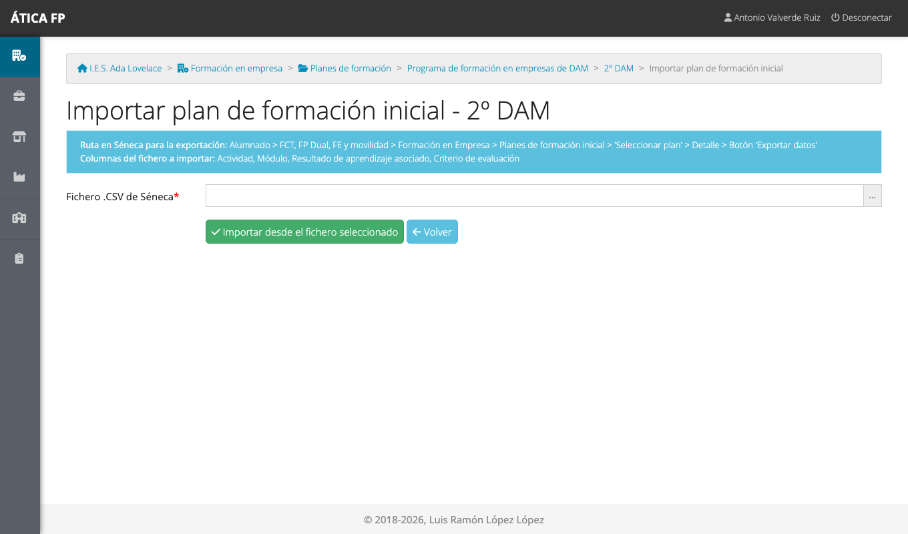

**Generar plan de formación inicial** descarga en PDF el plan de formación inicial del curso, con cada actividad y sus
resultados de aprendizaje y criterios, listo para firmar por el profesorado responsable, la jefatura y la empresa.

## Empresas del plan {#empresas-del-plan}

El botón **Empresas colaboradoras** del curso lista las empresas u organismos equiparables que participan.

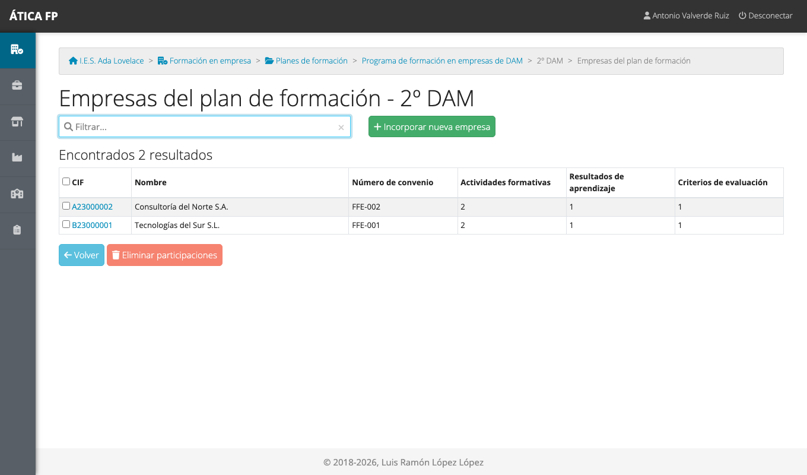

Para incorporar una, pulsa **Incorporar nueva empresa**. La empresa debe existir antes en el
[catálogo de empresas](06-empresas-y-centros-de-trabajo.md).

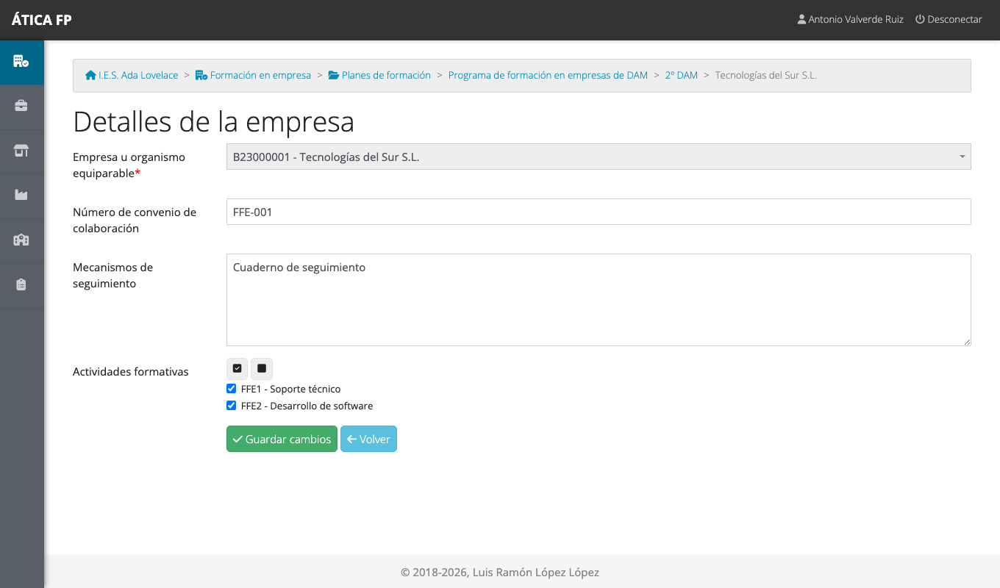

- **Número de convenio de colaboración**, que identifica el convenio con la empresa.
- **Mecanismos de seguimiento**: cómo se hará el seguimiento en esa empresa.
- **Actividades formativas**: las del plan que esa empresa ofrece (al menos una). **Seleccionar todas** y **Ninguna**
  marcan y desmarcan todas. Las actividades de una **estancia** solo pueden elegirse entre las de su empresa.

Para quitar empresas, márcalas y pulsa **Eliminar participaciones**.

## Alumnado del plan {#alumnado-del-plan}

El botón **Programas formativos individuales** del grupo (o el nombre del grupo) lista el alumnado incorporado, con
sus planes individualizados.

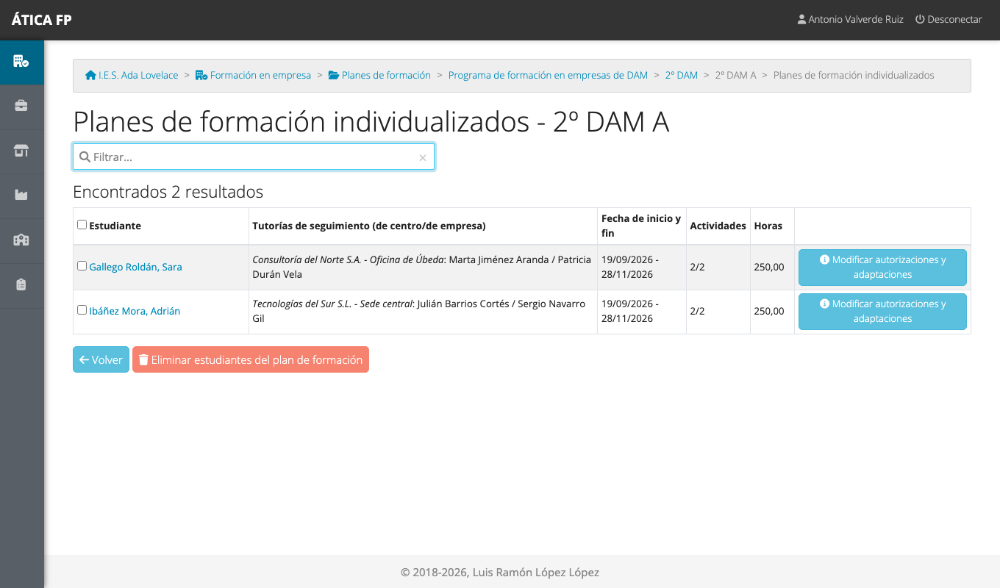

Cada fila muestra las tutorías de seguimiento (de centro y de empresa), las fechas, las actividades y las horas de
las estancias del estudiante. Para incorporar a más, márcalos en la [ficha del grupo](#cursos-y-grupos). Pulsa
**Modificar autorizaciones y adaptaciones** para indicar si el estudiante **necesita autorización** (por ejemplo, de
sus tutores legales, por ser menor) o **adaptaciones y medidas especiales**, y describirlas:

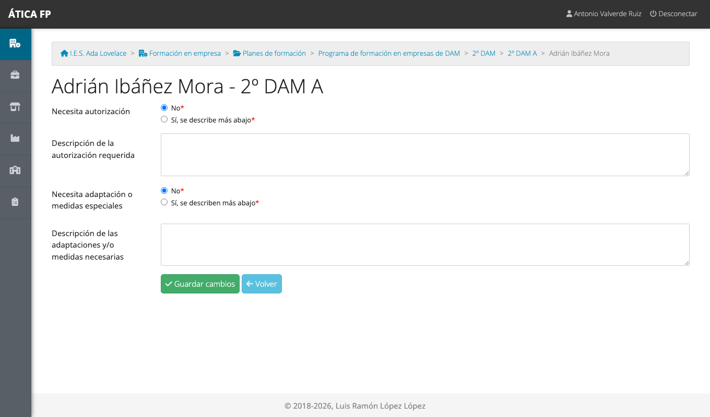

!!! warning "Eliminar alumnado del plan"
    Para eliminar estudiantes del plan, márcalos y pulsa **Eliminar estudiantes del plan de formación**. Se borran
    sus estancias, calendarios y seguimiento. No se puede deshacer.

## Estancias {#estancias}

El nombre del estudiante lleva a sus **estancias**: los periodos que pasa en cada centro de trabajo.

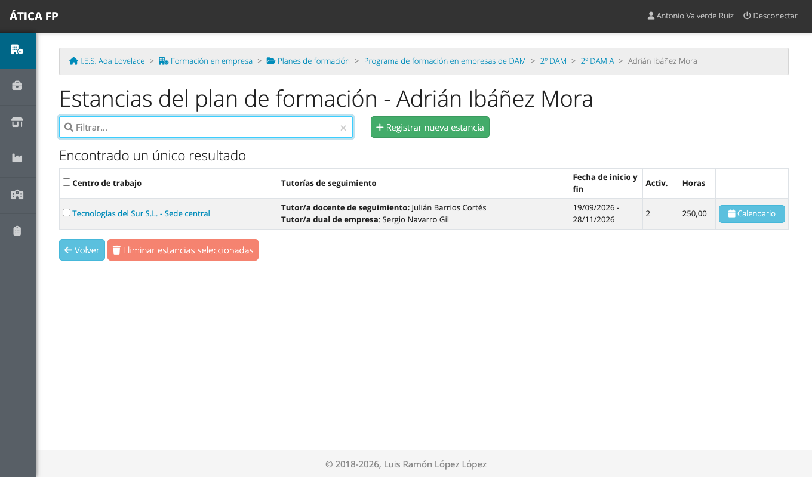

Hay **dos maneras** de registrar estancias:

- **Una a una**, desde las estancias de un estudiante.
- **En lote**, para varios estudiantes que van a la misma empresa (ver [más abajo](#estancias-en-lote)).

### Registrar una estancia

1. En las estancias del estudiante, pulsa **Registrar nueva estancia**.
2. Rellena la ficha y guarda.

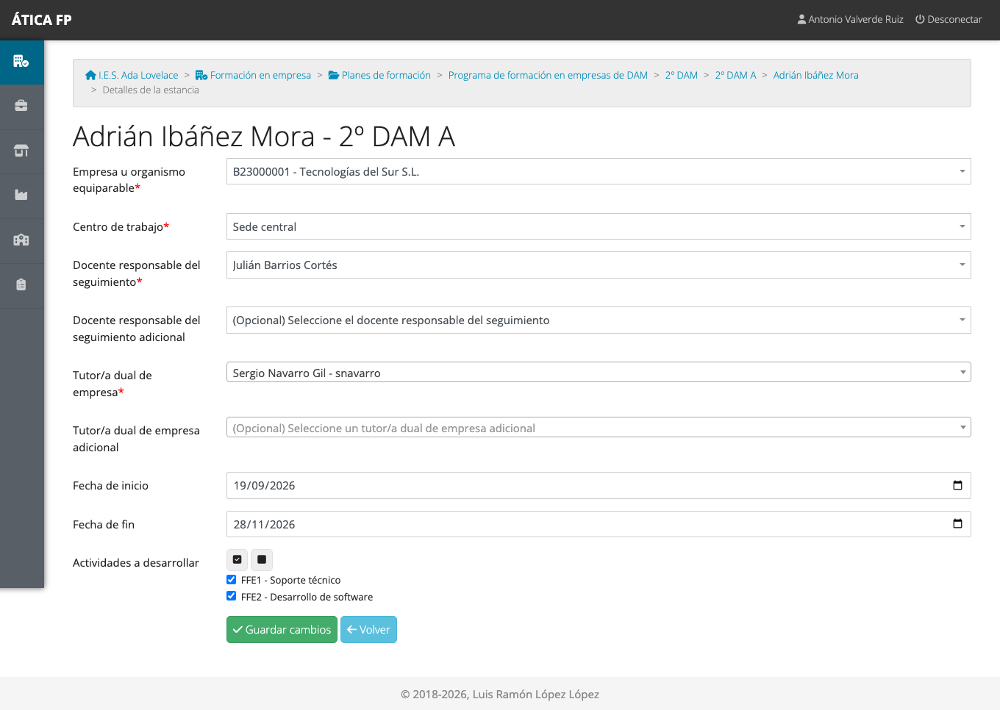

- **Empresa u organismo equiparable** y **Centro de trabajo**: solo se ofrecen las empresas
  [incorporadas al plan](#empresas-del-plan). Al elegir la empresa, se cargan sus centros de trabajo.
- **Docente responsable del seguimiento**: solo se ofrece el profesorado que **da clase en el grupo** del estudiante.
  Puedes añadir uno **adicional**.
- **Tutor/a dual de empresa**: la persona de la empresa que supervisa al estudiante. Si todavía no está dada de alta,
  **Registrar persona** crea su usuario ahora (identificador, nombre de usuario, nombre, apellidos, sexo y correo); su
  **contraseña inicial es el identificador** y la aplicación le exige cambiarla en el primer acceso. Puedes añadir
  una persona **adicional**.
- **Fecha de inicio** y **fecha de fin** de la estancia.
- **Actividades a desarrollar**: las actividades de la empresa que el estudiante realizará. Solo esas se podrán
  marcar en el calendario y valorar. Si la empresa no tiene actividades, hay que
  [asociárselas antes](#empresas-del-plan).

### Estancias en lote {#estancias-en-lote}

Cuando varios estudiantes van a la misma empresa, el botón **Añadir estancias en el mismo centro de trabajo** de la
lista de grupos crea todas las estancias de una vez.

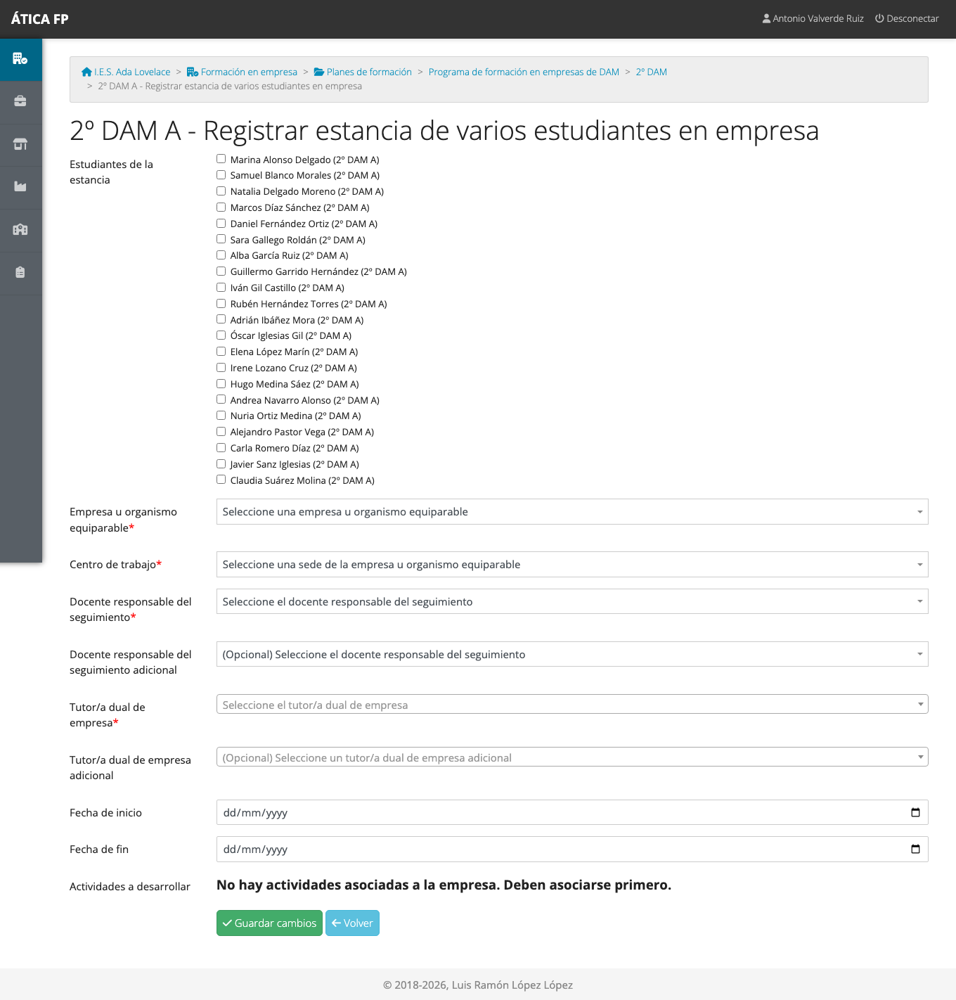

Marca los estudiantes y rellena los mismos datos que en una estancia suelta; se crea **una estancia por
estudiante** con los mismos responsables, fechas y actividades. Después puedes cambiar los datos de cada una por
separado. Las estancias nuevas **no tienen jornadas** (aparecen con 0 horas): prepara su
[calendario](#calendario-de-una-estancia) y, si es el mismo para todas, cópialo.

### Estancias de todo el nivel {#estancias-del-nivel}

**Gestionar estancias de todo el nivel** lista las estancias de todos los grupos de un curso, para trabajar con
varias a la vez.

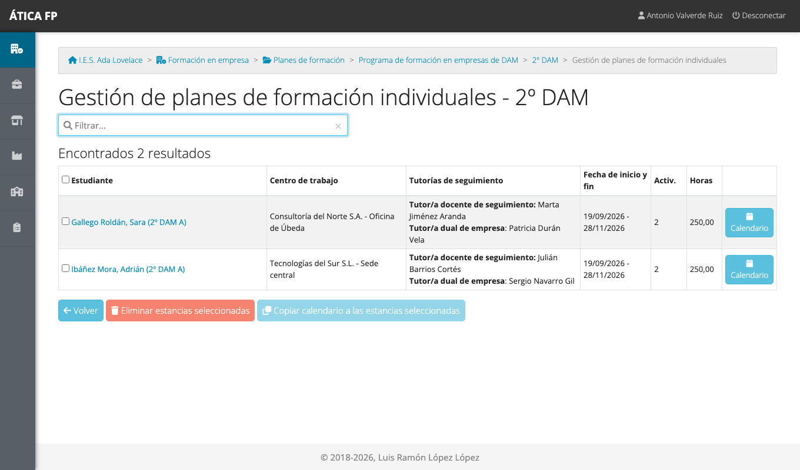

Desde aquí puedes **eliminar** las estancias marcadas, abrir el **Calendario** de cada una y **copiar un calendario**
a otras estancias (ver [más abajo](#calendario-de-una-estancia)).

## El calendario de una estancia {#calendario-de-una-estancia}

Cada estancia tiene un **calendario** de jornadas con sus horas previstas. Lo preparas desde el botón
**Calendario** de la lista de estancias.

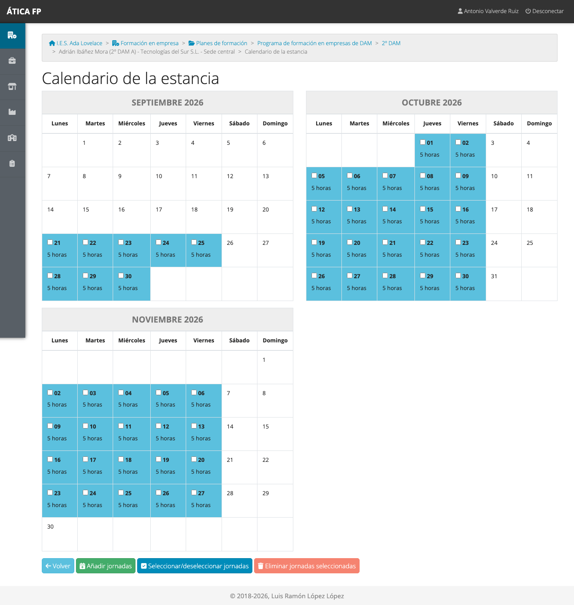

- Pulsa un día para **cambiar sus horas**.
- **Seleccionar/deseleccionar jornadas** marca todas las jornadas de un golpe; **Eliminar jornadas seleccionadas**
  borra las marcadas y los datos de seguimiento que tuvieran.
- **Añadir jornadas** abre el asistente que las crea por periodos:

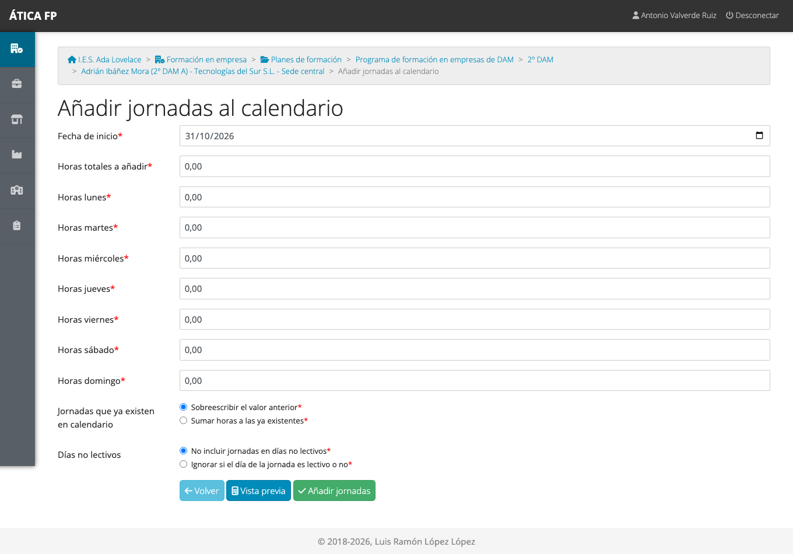

1. Indica la **fecha de inicio** y las **horas totales a añadir**.
2. Reparte las horas en los **días de la semana** (lunes a domingo). La aplicación añade jornadas desde la fecha de
   inicio hasta agotar las horas.
3. Elige qué hacer con las **jornadas que ya existen** en ese periodo: **sobrescribir** su valor o **sumar** las horas.
4. Elige qué hacer con los **días no lectivos** del [calendario del centro](04-administrar-el-centro.md#dias-no-lectivos):
   **no incluirlos** o **ignorarlos** (incluir la jornada aunque el día sea no lectivo).
5. **Vista previa** muestra las jornadas que se crearían; **Añadir jornadas** las crea.

### Copiar un calendario a otras estancias

Si varias estancias tienen el mismo calendario, prepáralo en una y cópialo: en la
[lista de estancias del nivel](#estancias-del-nivel), marca las estancias de **destino** y pulsa **Copiar calendario a
las estancias seleccionadas**.

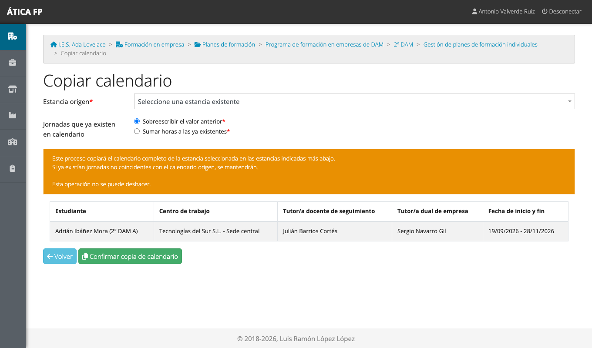

Elige la **estancia de origen** y qué hacer con las jornadas que ya existen (sobrescribir o sumar horas) y pulsa
**Confirmar copia de calendario**. Las jornadas de destino que no coincidan con el calendario de origen se mantienen. La
lista de estancias pasa a mostrar las fechas y las horas del calendario copiado.

## Seguimiento, valoración y evaluación

Con acceso a todo el plan, ves los mismos listados que el profesorado, con todas las estancias:

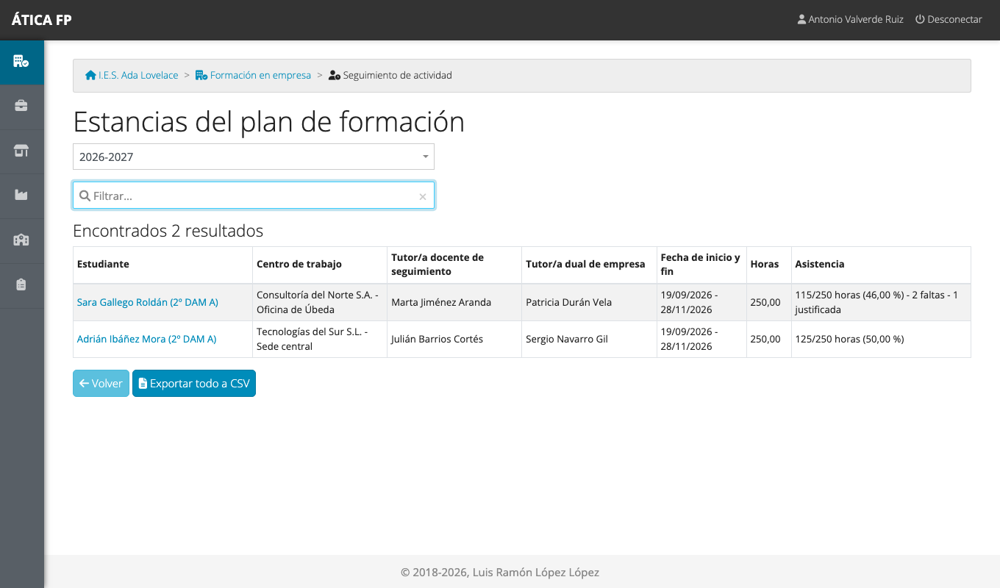

- El **seguimiento diario**, la **valoración** de actividades, las **visitas**, los **desplazamientos** y las
  **encuestas** funcionan como se explica en el [capítulo 32](32-ffe-tutoria-docente-y-de-grupo.md).
- El **resumen de evaluación** está explicado en el [capítulo 33](33-ffe-profesorado-y-evaluacion.md).
- Con **Exportar todo a CSV** del seguimiento descargas el estado de todas las estancias en una hoja de cálculo.

## Informes {#informes}

**Formación en empresa → Informes** genera los informes de las tres encuestas del plan.

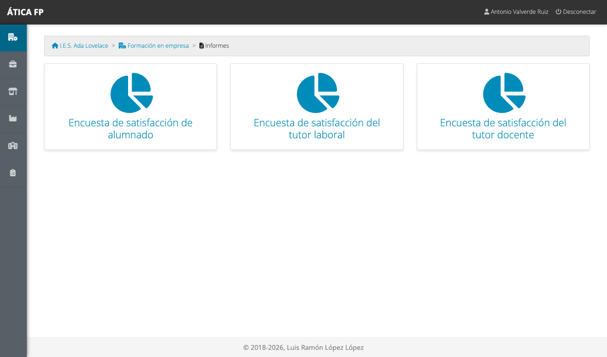

Cada uno lista los planes del curso:

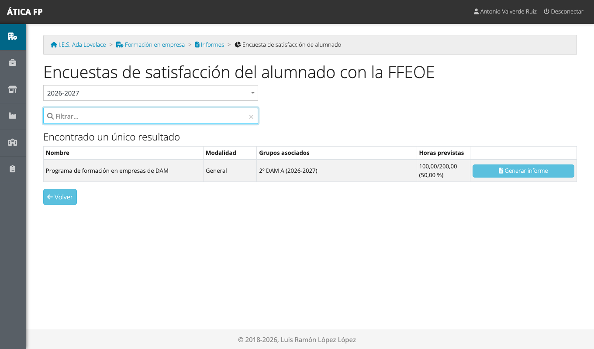

**Generar informe** produce un **PDF** con el resultado de cada pregunta de las respuestas recibidas. Puede
obtenerse en cualquier momento, aunque todavía falten respuestas: refleja las que haya. Las encuestas
están explicadas en el [capítulo 7](07-encuestas-y-plantillas-de-informe.md).

## Qué no puedes hacer y a quién pedirlo

- **Crear usuarios del profesorado o del alumnado**: se importan o se dan de alta en la
  [gestión del centro](04-administrar-el-centro.md). El único usuario que se crea desde aquí es la **tutoría
  laboral**, al registrar una estancia.
- **Gestionar planes ajenos**: la jefatura y la gestión de la FFEOE solo ven los planes de su departamento o de los
  grupos que tienen a su cargo; la administración del centro, todos.
- **Registrar visitas** si no eres profesorado del curso: la administración del centro puede consultarlas y corregirlas,
  pero no registrarlas ([capítulo 32](32-ffe-tutoria-docente-y-de-grupo.md#visitas-a-las-empresas)).
