# FFE: tutoría docente y de grupo

Este capítulo es para el **profesorado que hace el seguimiento del alumnado** de la formación en empresa: el
**responsable de seguimiento** de una estancia (la tutoría docente) y la **tutoría de grupo** del alumnado del plan.
Una misma persona puede ser las dos cosas; lo que puedes hacer depende de tu relación con cada estudiante.

!!! note "Dos figuras que se parecen"
    La **tutoría de grupo** es la persona que tutoriza al grupo del alumno (la del centro, la de siempre). La
    **tutoría dual de grupo** es la figura de la FFE que gestiona el plan en ese grupo ([capítulo 31](31-ffe-gestion.md)).
    No son la misma, aunque puede recaer en la misma persona.

## Qué puedes hacer

| Tarea | Responsable de seguimiento | Tutoría de grupo |
| --- | :-: | :-: |
| Consultar el seguimiento y el calendario de tu alumnado | ✅ | ✅ |
| Registrar y revisar jornadas, bloquearlas y marcar faltas | ✅ | ✅ |
| **Valorar** las actividades realizadas y comentarlas | ✅ | ✅ |
| Consultar el **resumen de evaluación** del alumnado | ✅ | ✅ |
| Registrar **visitas y contactos** con las empresas | ✅ | — |
| Registrar **gastos de desplazamiento** | ✅ | — |
| Rellenar las encuestas del alumnado y de la empresa en su nombre | ✅ | ✅ |
| Rellenar tu **encuesta de satisfacción** como responsable de seguimiento | ✅ | — |

La [matriz de permisos](37-ffe-permisos.md) lo detalla pantalla a pantalla. La administración, la jefatura y la gestión
de la FFE pueden hacer lo mismo con todo su ámbito ([capítulo 31](31-ffe-gestion.md)).

## Dónde está

Tu menú de **Formación en empresa** tiene las tarjetas **Seguimiento de actividad**, **Valoración del desempeño de
actividades**, **Resumen de evaluación**, **Contactos con empresas**, **Dietas de desplazamiento** y **Encuestas**.

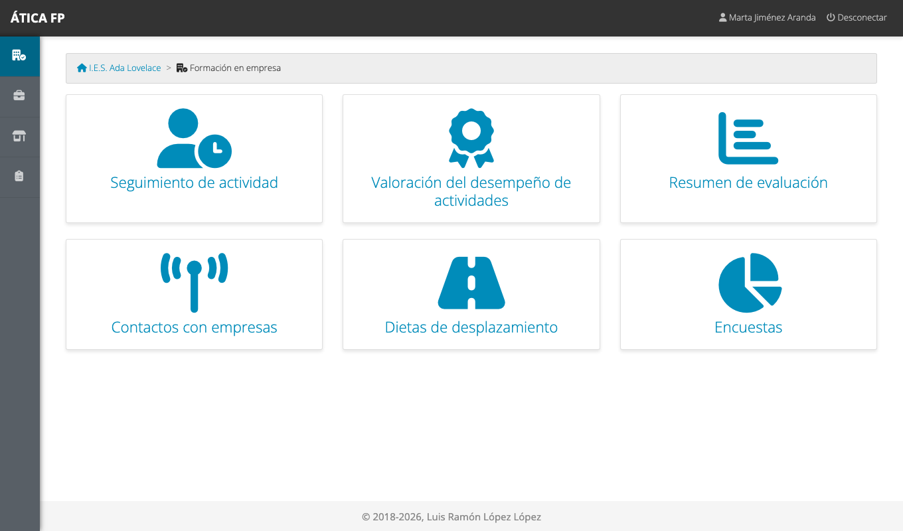

## Seguimiento diario

**Formación en empresa → Seguimiento de actividad** lista las estancias de tu alumnado.

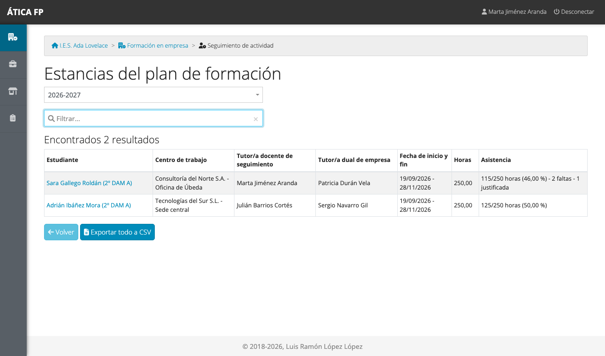

La columna **Asistencia** cuenta las horas **confirmadas** (jornadas bloqueadas) sobre las totales de la estancia, y
las faltas. Pulsa el nombre de un estudiante para abrir su calendario. **Exportar todo a CSV** descarga el estado de tus
estancias en una hoja de cálculo.

### El calendario de seguimiento {#el-calendario-de-seguimiento}

El calendario muestra las jornadas de la estancia mes a mes con el mismo código de color que en las otras
modalidades ([capítulo 12](12-fct-tutoria-docente-y-de-grupo.md#el-calendario-de-seguimiento)): verde, jornada
registrada; azul, pendiente; rayado, falta. Por cada semana, un **candado** la bloquea y una **impresora** genera su
ficha semanal de actividades.

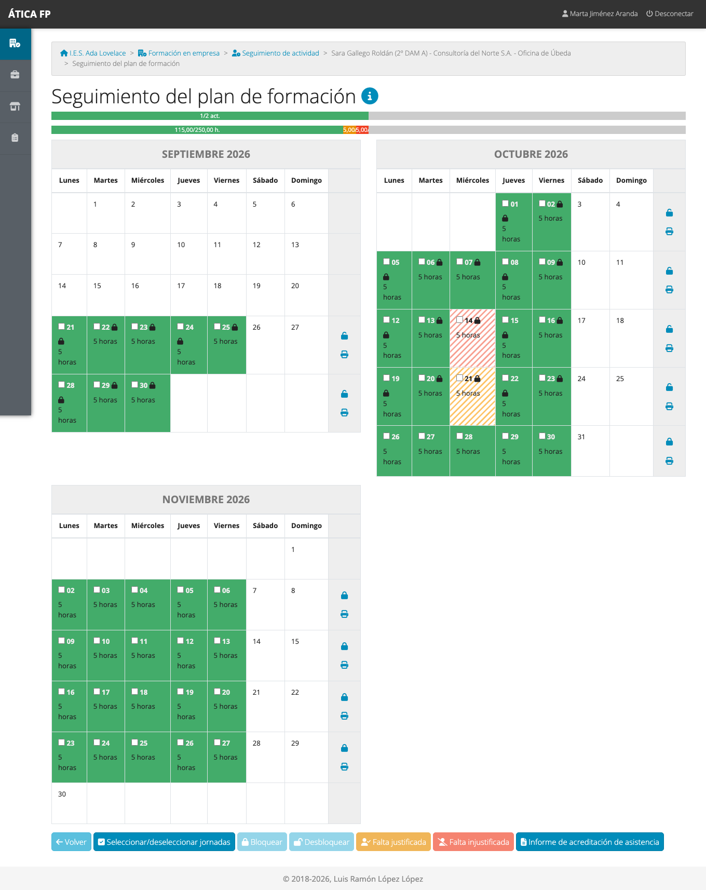

Arriba hay **dos barras de progreso**: la de **actividades** cuenta las actividades de la estancia que se han
realizado y valorado («1/2 act.»), y la de **horas** reparte las horas de la estancia entre las **confirmadas**
(jornadas bloqueadas), las **no confirmadas**, las ausencias y las ausencias justificadas; el icono de información
explica cada color.

Con las jornadas marcadas puedes **Bloquear** y **Desbloquear**, y marcar **Falta justificada** o **Falta
injustificada**. **Informe de acreditación de asistencia** genera la hoja de asistencia en PDF.

!!! tip "Qué significa bloquear"
    Una jornada **bloqueada** queda **confirmada**: cuenta como asistencia en el seguimiento y el estudiante y la
    empresa ya no pueden cambiarla (tú sí). Se bloquea cuando la das por revisada.

### Registrar una jornada

Pulsa un día para abrir su ficha.

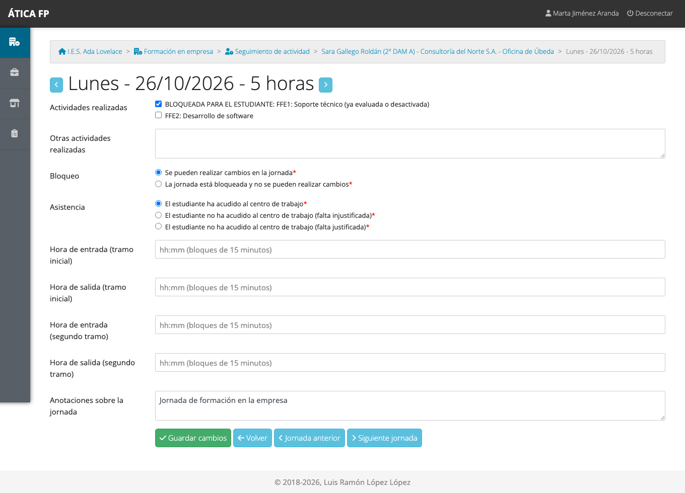

- **Actividades realizadas**: marca las actividades del plan que se han trabajado esa jornada. A diferencia de la
  FCT, no se reparten horas: se marca qué se ha hecho. Solo aparecen las actividades que el estudiante tiene en su
  estancia.
- Las que indican **«ya evaluada o desactivada»** ya están valoradas o deshabilitadas: el estudiante y la empresa las ven
  en gris y **no pueden** marcarlas ni desmarcarlas. A ti, como tutoría, la aplicación te las señala con «BLOQUEADA PARA EL
  ESTUDIANTE» pero puedes cambiarlas.
- **Otras actividades realizadas**: lo que no esté en la lista.
- **Bloqueo** y **Asistencia** (acudió, falta injustificada o justificada). **Una falta borra las actividades de la
  jornada y la bloquea.**
- **Horas de entrada y de salida** (en tramos de 15 minutos, con un segundo tramo para el horario partido) y
  **anotaciones**.

Las flechas junto al título y los botones **Jornada anterior** y **Siguiente jornada** permiten recorrer varios días
seguidos.

Una jornada **bloqueada** muestra un aviso y puedes seguir viéndola y, si hay una incidencia, desbloquearla:

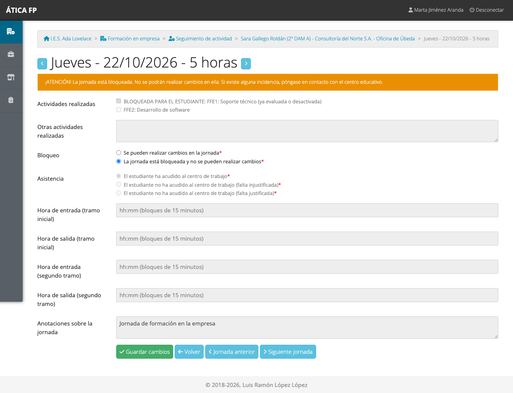

Una jornada con **falta** queda sin actividades y bloqueada:

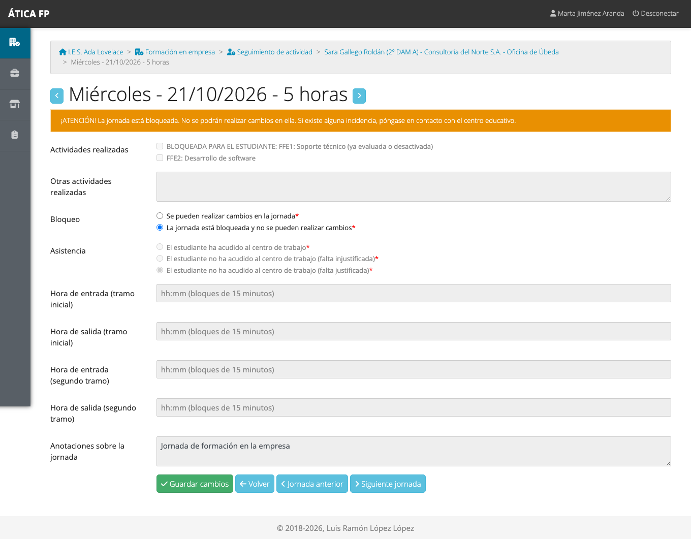

Las actividades que se marquen en alguna jornada son las que después se podrán **valorar**.

## Valoración del desempeño {#valoracion-del-desempeno}

**Formación en empresa → Valoración del desempeño de actividades** lista las estancias evaluables, con el porcentaje
de actividades ya valoradas.

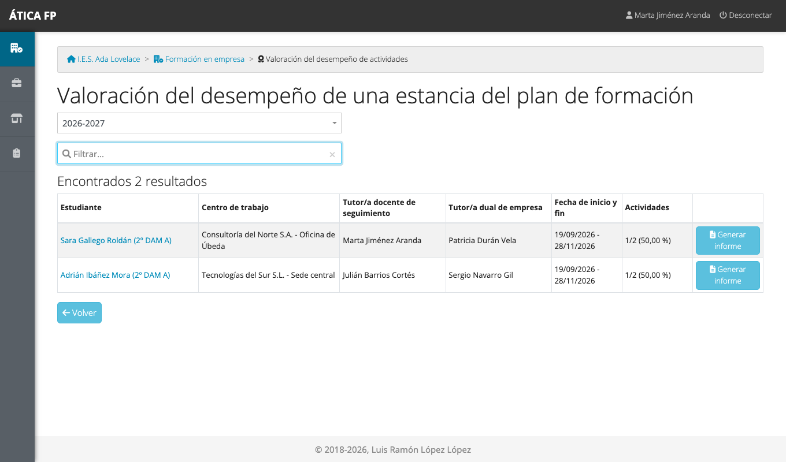

**Generar informe** descarga en PDF la valoración de la estancia. Pulsa el estudiante para valorar sus actividades.

- Para cada actividad, elige el **nivel de desempeño** de la escala del plan o déjala **sin valorar**.
- **Solo se pueden valorar las actividades que el estudiante ha marcado como realizadas** en alguna jornada. Las demás
  aparecen en gris, sin opciones. **Una vez valorada, el estudiante ya no puede marcarla** en otras jornadas.
- El **lápiz** de cada actividad abre sus **comentarios** (ver abajo), y la burbuja indica cuántos hay.
- **Otros comentarios sobre el estudiante** es un texto libre que luego aparece en el resumen.
- Pulsa **Guardar cambios**.

### Comentarios de una actividad

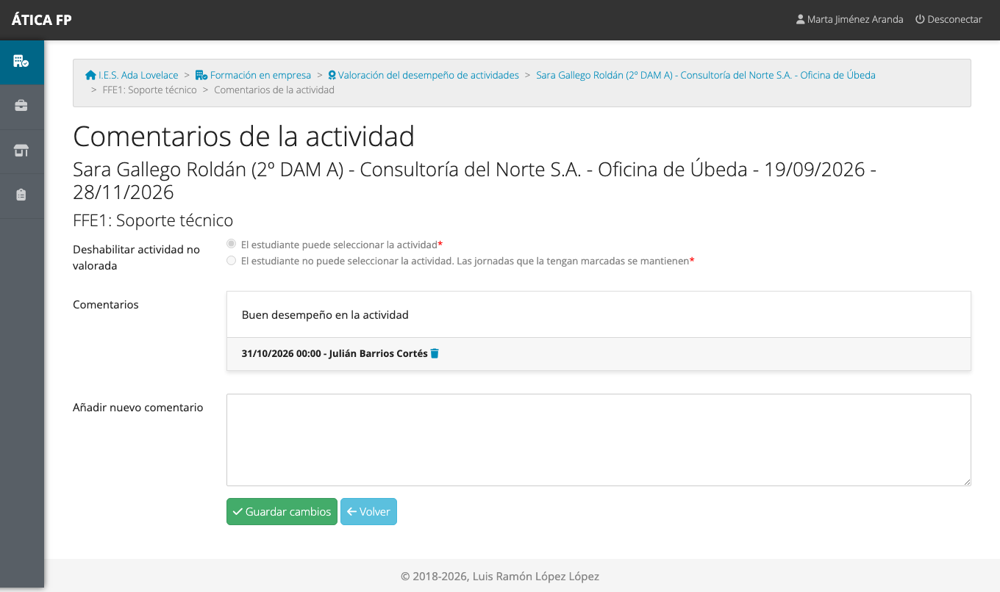

Aquí puedes **añadir comentarios** sobre cómo se ha realizado la actividad, **eliminar** los tuyos y ver los
anteriores. También puedes **deshabilitar la actividad no valorada**: así el estudiante ya no podrá seleccionarla en
las jornadas (las que ya la tengan marcada se mantienen).

!!! note "Quién valora"
    Valoran la **tutoría laboral**, el **responsable de seguimiento**, la **tutoría de grupo**, la **gestión de la FFE**,
    la **jefatura** y la **administración**. El profesorado de los módulos consulta el resultado en el
    [resumen de evaluación](33-ffe-profesorado-y-evaluacion.md).

## Resumen de evaluación

**Resumen de evaluación** te permite consultar, de cada estudiante de tu grupo o de tus estancias, el resultado de
las actividades valoradas por criterio, resultado de aprendizaje y módulo. Cómo es el informe está explicado en el
[capítulo 33](33-ffe-profesorado-y-evaluacion.md#el-informe-de-evaluacion).

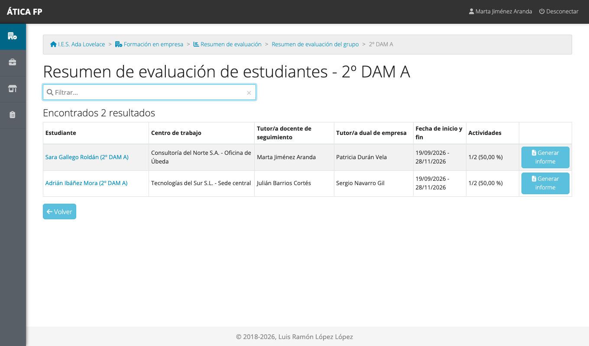

## Visitas a las empresas {#visitas-a-las-empresas}

**Formación en empresa → Contactos con empresas** guarda el registro de las visitas y comunicaciones del
profesorado con las empresas.

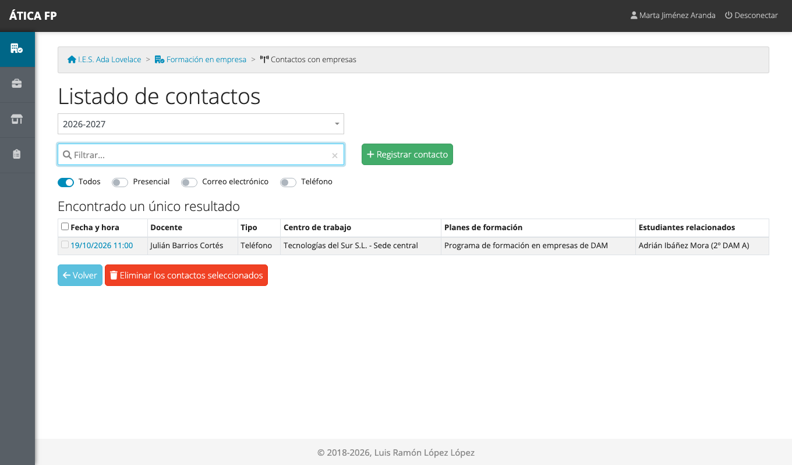

Los **filtros** de arriba (Todos, Presencial, Correo electrónico, Teléfono) muestran solo un tipo de contacto. Para
registrar uno nuevo pulsa **Registrar contacto**:

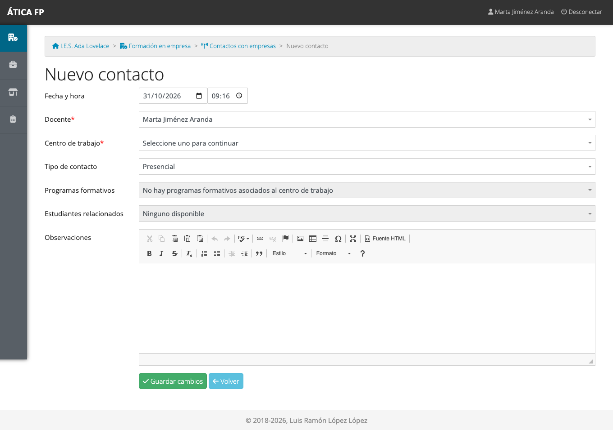

1. Indica la **fecha y la hora** y el **docente** (tú).
2. Elige el **centro de trabajo** (la sede de la empresa).
3. Elige el **tipo de contacto**: los tipos disponibles son los del
   [catálogo del centro](04-administrar-el-centro.md#tipos-de-contacto-con-empresas).
4. Marca los **programas formativos** (los planes de formación con estancias en ese centro de trabajo) y los
   **estudiantes relacionados**: las listas se rellenan al elegir el centro de trabajo y, hasta entonces, indican que no
   hay ninguno disponible.
5. Escribe las **observaciones** y guarda.

Un contacto solo lo modifica o elimina quien lo registró (y la administración del centro). La gestión de la FFE y la
jefatura pueden consultarlo y corregirlo, pero no eliminarlo si no es suyo.

!!! warning "La administración del centro no puede registrar visitas"
    Para registrar una visita o un desplazamiento hace falta ser **profesorado del curso**: el contacto queda a nombre de
    un docente. La administración del centro, si no es docente, puede consultar y corregir lo que registran los demás,
    pero no registrar uno propio.

## Gastos de desplazamiento {#gastos-de-desplazamiento}

**Formación en empresa → Dietas de desplazamiento** funciona exactamente igual que en la FCT: registras los viajes con
su itinerario, otros gastos y los planes de formación relacionados, y el responsable económico los verifica. Todo está
explicado en [FCT: tutoría docente y de grupo](12-fct-tutoria-docente-y-de-grupo.md#gastos-de-desplazamiento).

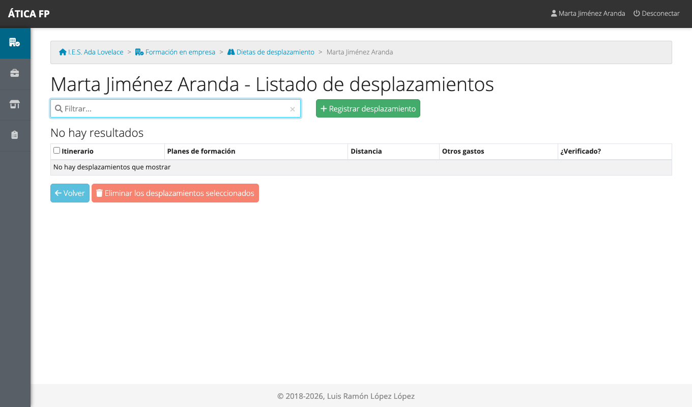

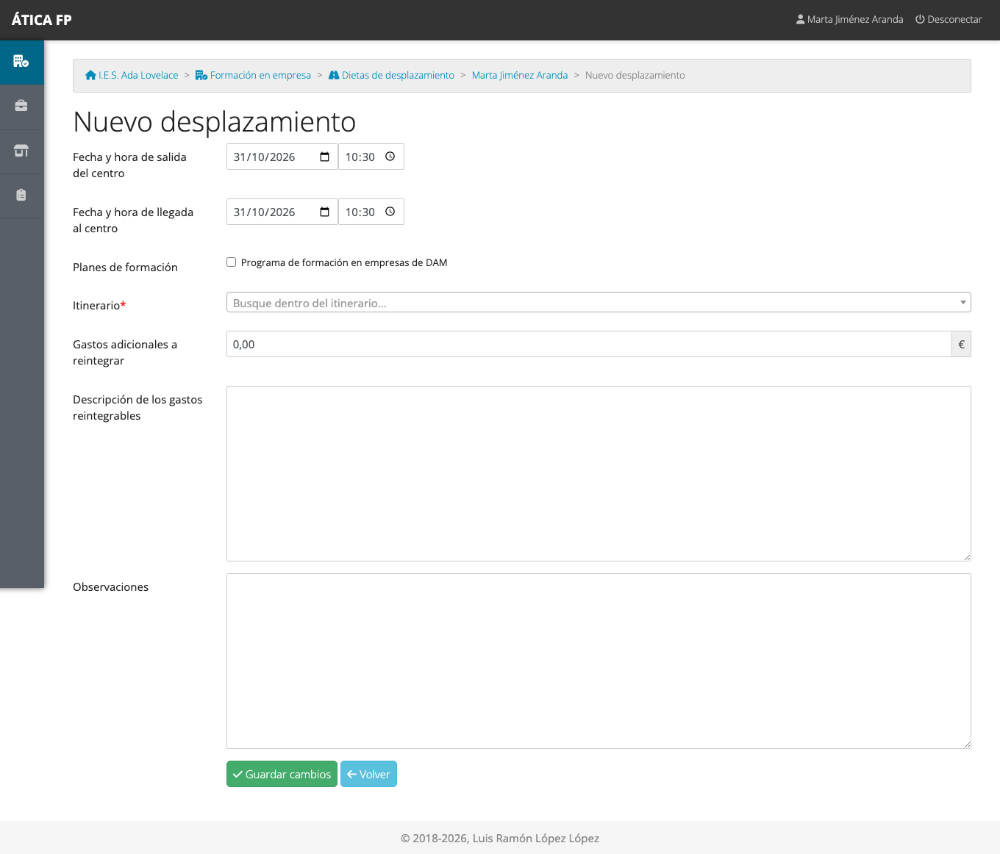

## Encuestas

**Formación en empresa → Encuestas** reúne tres encuestas de satisfacción:

- **Alumnado**: la contesta el propio estudiante ([capítulo 34](34-ffe-alumnado.md#la-encuesta-de-satisfaccion)); puedes
  rellenarla en su nombre.
- **Tutor laboral**: la contesta la tutoría laboral ([capítulo 35](35-ffe-tutoria-laboral.md#la-encuesta-de-la-empresa));
  puedes rellenarla en su nombre.
- **Responsable de seguimiento**: la contestas **tú**, como responsable de seguimiento, una vez por estancia.

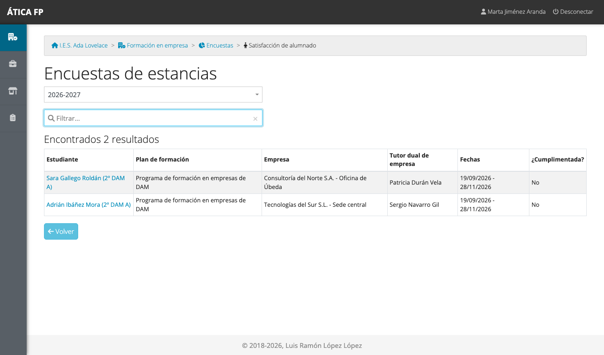

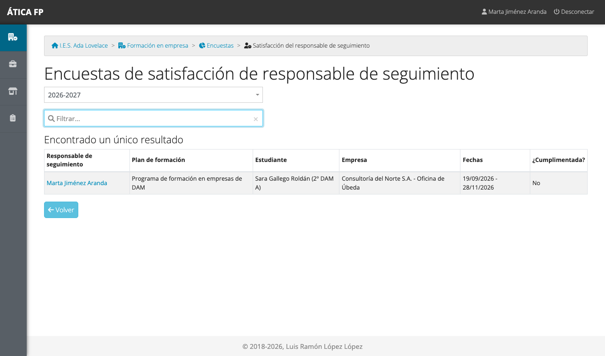

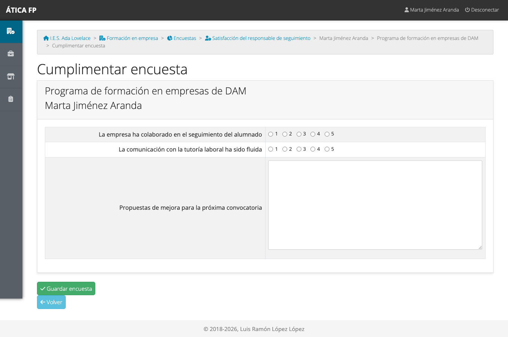

A diferencia de otras modalidades, las encuestas de la FFE no tienen fechas de apertura y cierre: se pueden contestar
mientras el curso académico esté activo; en un curso anterior solo se consultan.

## Qué no puedes hacer y a quién pedirlo

- **Crear estancias, calendarios, actividades o empresas del plan**: es de la gestión de la FFE, la jefatura y la
  administración ([capítulo 31](31-ffe-gestion.md)).
- **Ver el seguimiento de estancias ajenas.** Como responsable de seguimiento ves el de tu alumnado, no el de otras
  tutorías; los listados solo muestran lo que te corresponde.
- **Verificar itinerarios**: es tarea del [responsable económico](36-ffe-responsable-economico.md).
