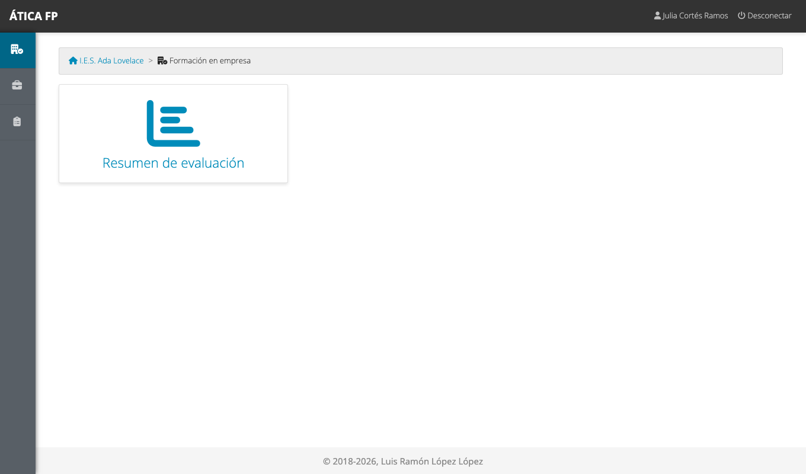
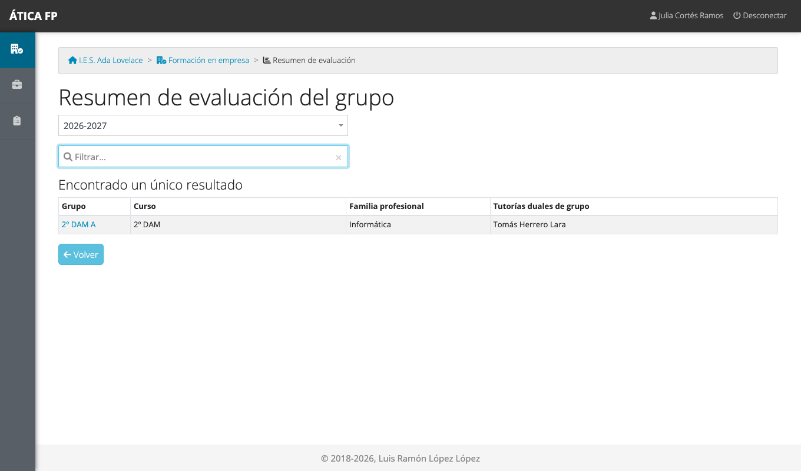
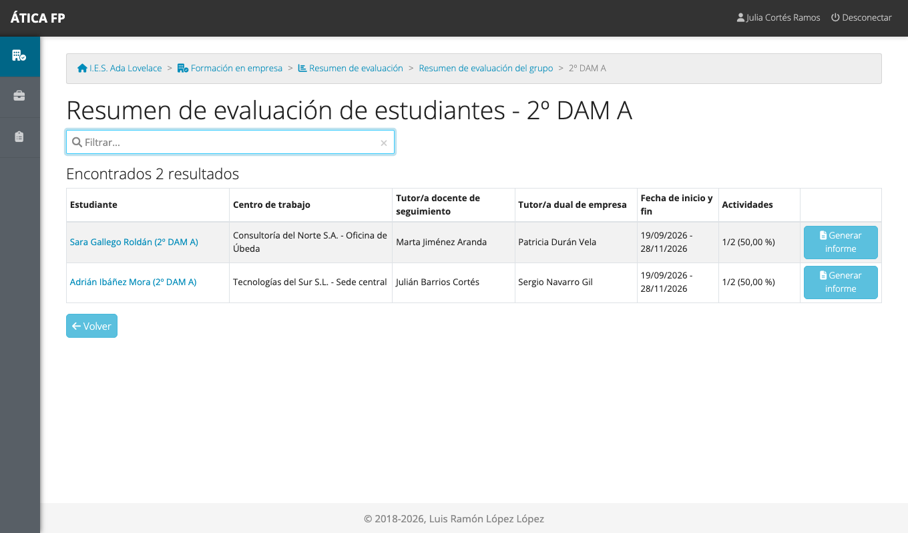

# FFE: profesorado y evaluación

Este capítulo es para el **profesorado que da clase al alumnado de la formación en empresa** y necesita saber cómo
le ha ido en las empresas para **evaluarlo**. Si no eres además responsable de seguimiento ni tutoría de grupo, lo
tuyo es **consultar**: no registras jornadas ni valoras actividades.

## Qué puedes hacer

- Consultar el **resumen de evaluación** de las estancias del alumnado de los grupos en los que das clase: la nota de
  cada actividad, criterio de evaluación, resultado de aprendizaje y módulo profesional.
- Descargar ese resumen en **PDF** para cada estudiante.

No ves el seguimiento diario, la valoración de cada actividad, las visitas, los desplazamientos ni las encuestas.
La [matriz de permisos](37-ffe-permisos.md) lo resume. Si además eres responsable de seguimiento o tutoría de grupo, tienes
también las tareas del [capítulo 32](32-ffe-tutoria-docente-y-de-grupo.md).

## Dónde está

Tu menú de **Formación en empresa** tiene una sola tarjeta: **Resumen de evaluación**. Solo aparece si das clase en
algún grupo con plan de formación.

## El resumen de evaluación {#el-resumen-de-evaluacion}

**Resumen de evaluación** lista los grupos con plan de formación en los que das clase, con su curso, su familia
profesional y su tutoría dual de grupo. Con el selector de arriba consultas también los cursos anteriores.

Pulsa el grupo para ver su alumnado.

Cada fila es una **estancia**: ves el estudiante, el centro de trabajo, quién hace el seguimiento y cuántas actividades
llevan valoración. **Generar informe** descarga el resumen en PDF; el nombre del estudiante lo abre en pantalla.

### El informe de evaluación {#el-informe-de-evaluacion}

El informe tiene tres partes:

1. **Datos del estudiante y de la estancia**: el estudiante, la tutoría dual de empresa, el curso académico, la familia
   profesional, la enseñanza y el curso.
2. **Actividades formativas** de la estancia, con los criterios de evaluación que trabajan.
3. **Notas por módulo profesional**: para cada módulo, sus resultados de aprendizaje con la **nota de cada
   criterio** y el **promedio** del resultado de aprendizaje y del módulo.

La **nota de un criterio** es la **media de las valoraciones de las actividades que lo incluyen** (cada nivel de la escala
tiene su calificación numérica: «Notable» 8, «Suficiente» 6, «Insuficiente» 3 en el centro de ejemplo). Una
actividad que todavía no está valorada no cuenta. El promedio de un resultado de aprendizaje es el de sus
criterios, y el del módulo, el de sus resultados.

Esa nota es **una ayuda para tu evaluación**, no la evaluación misma: la tutoría laboral y el responsable de seguimiento
valoran el desempeño en la empresa y a ti te corresponde decidir cómo pesa en la nota de tu módulo.

!!! note "Solo lo que corresponde a tu grupo"
    Ves las estancias de los grupos en los que das clase (y solo el resumen, no la valoración de cada actividad). Si
    das clase en varios grupos del plan, aparecen todos. La gestión de la FFE, la jefatura, la tutoría de grupo y el
    responsable de seguimiento ven además el resto del seguimiento de su ámbito ([capítulo 32](32-ffe-tutoria-docente-y-de-grupo.md)).

## Qué no puedes hacer y a quién pedirlo

- **Valorar actividades o corregir una valoración**: es del responsable de seguimiento, de la tutoría de grupo o de la
  tutoría laboral.
- **Ver estancias de grupos en los que no das clase**: pídelo a la gestión de la FFE o a la jefatura.
