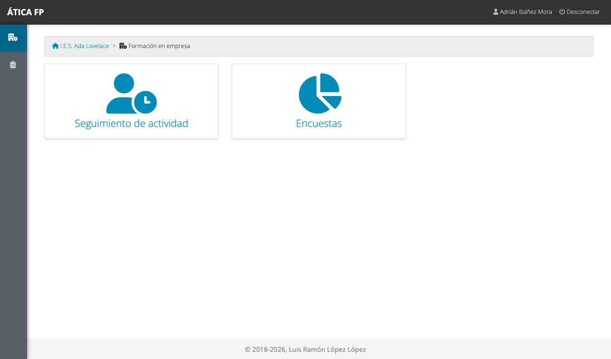
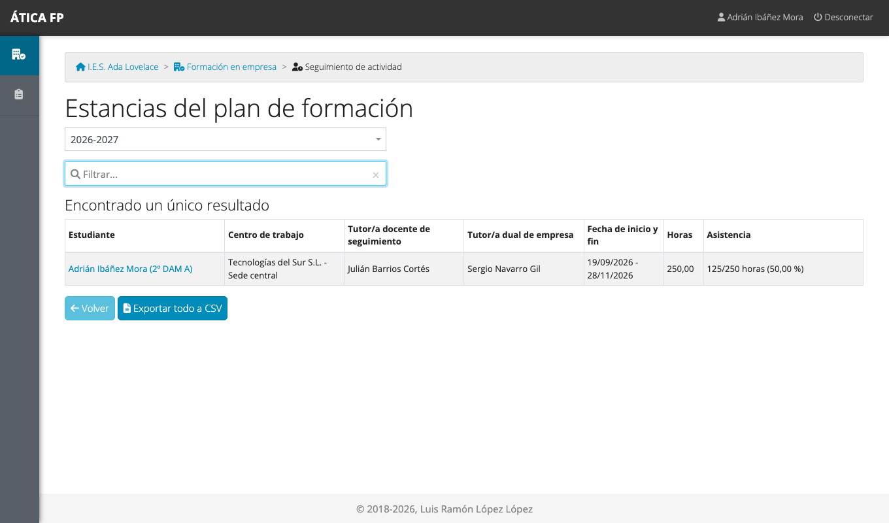
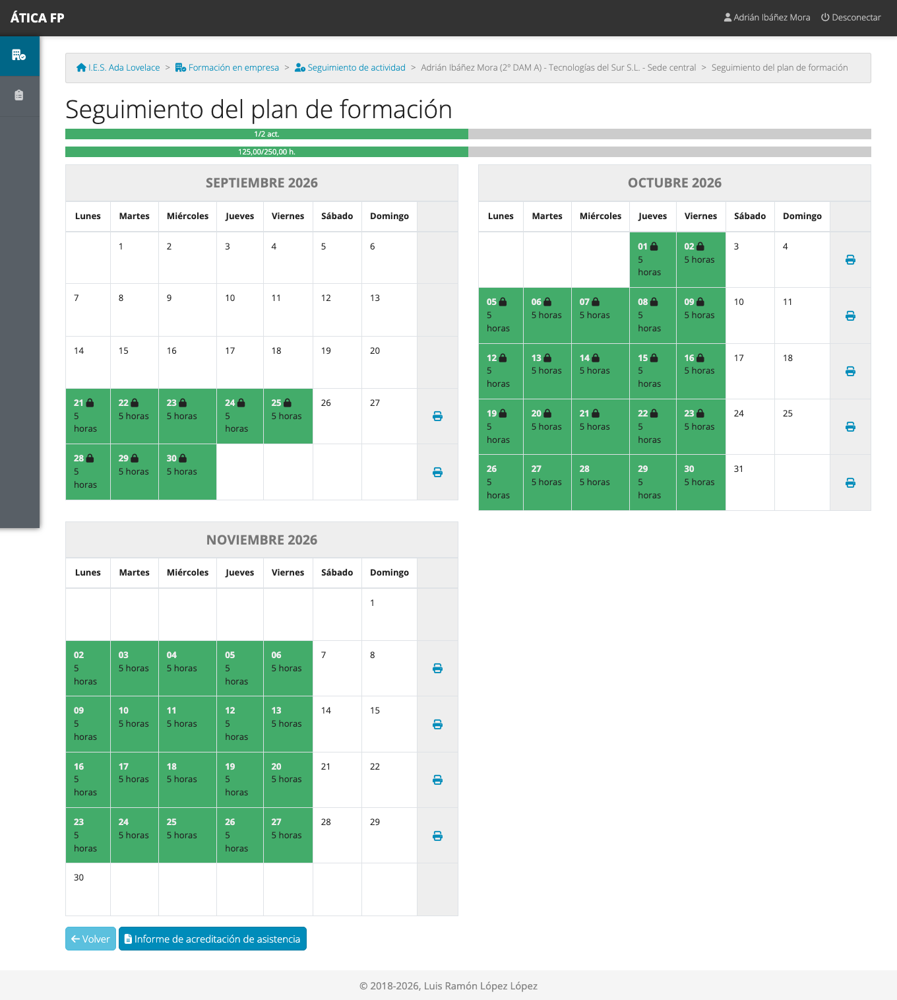
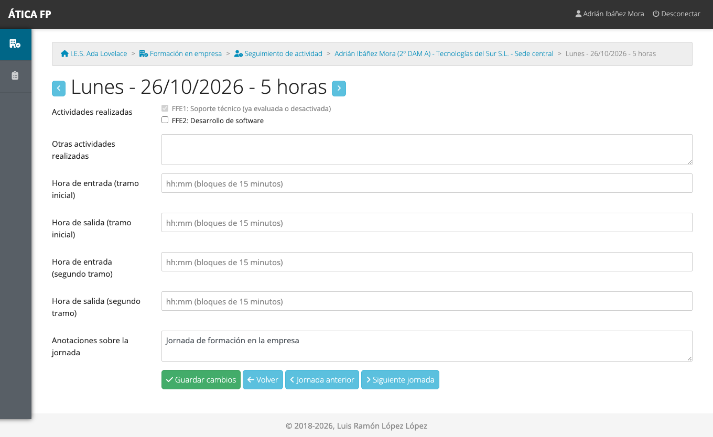
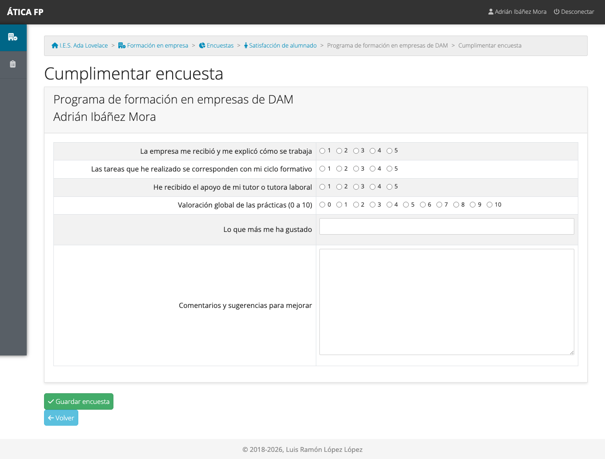

# FFEOE: alumnado

Este capítulo es para el **alumnado que hace una estancia de formación en empresa**. Explica qué tienes que hacer cada
jornada en la aplicación y qué documentos puedes descargar. Lo que registres lo usan tu responsable de seguimiento y tu
tutor o tutora de empresa para valorarte, y esa valoración llega después al profesorado de tus módulos, así que merece
la pena hacerlo bien.

## Qué puedes hacer

- **Registrar cada jornada**: qué actividades del plan has trabajado.
- **Consultar tu calendario** y ver cómo vas.
- **Descargar tu informe de asistencia** y la **ficha semanal de actividades**.
- **Contestar la encuesta de satisfacción** al terminar.

No ves al resto del alumnado, ni la valoración que hace de ti la empresa, ni puedes cambiar el calendario, la empresa o
las actividades de tu estancia. La [matriz de permisos](37-ffe-permisos.md) lo resume.

## Dónde está

Tu menú de **Formación en empresa** tiene dos tarjetas: **Seguimiento de actividad** y **Encuestas**. Solo ves el
módulo si tienes una estancia en el curso activo.

## Tu calendario {#tu-calendario}

**Seguimiento de actividad** lista tu estancia.

Pulsa tu nombre para abrir tu **calendario**: todas las jornadas de tu estancia, mes a mes.

Los colores son los mismos que en las otras modalidades ([capítulo 13](13-fct-alumnado.md#tu-calendario)): verde, jornada
registrada; azul, pendiente; rayado, falta (la marca tu tutoría). Las **barras de arriba** muestran cuántas
**actividades** de tu estancia has trabajado y valorado ya y cuántas **horas** te han confirmado (las de las jornadas
que tu tutoría ha bloqueado).

## Registrar una jornada

Pulsa el día que quieres rellenar.

1. **Actividades realizadas**: marca las actividades que has trabajado hoy. Solo aparecen las de tu estancia. No se
   reparten horas: solo marcas lo que has hecho.
2. **Otras actividades realizadas**: si has hecho algo que no está en tu lista, descríbelo aquí.
3. **Hora de entrada y de salida** (opcional): en tramos de 15 minutos, con un segundo tramo por si tu horario es
   partido.
4. **Anotaciones sobre la jornada** (opcional).
5. Pulsa **Guardar cambios**.

Las flechas junto al título y los botones **Jornada anterior** y **Siguiente jornada** te permiten rellenar varios
días seguidos.

!!! note "Actividades en gris"
    Una actividad en gris, con el aviso «ya evaluada o desactivada», ya no se puede marcar ni desmarcar. O bien tu
    tutoría o la empresa ya la han **valorado**, o bien la han **deshabilitado**. Lo que ya tienes marcado en jornadas
    anteriores se mantiene.

!!! warning "Una jornada bloqueada ya no se puede cambiar"
    Cuando tu tutoría bloquea una jornada, **ya no puedes modificarla**. Si hay un error, pídele que la desbloquee.

## Documentos

- **Informe de acreditación de asistencia**: el botón de debajo del calendario genera un PDF con tu asistencia.
- **Ficha semanal de actividades**: la impresora que hay a la derecha de cada semana genera el PDF con las
  actividades de esa semana.

## La encuesta de satisfacción {#la-encuesta-de-satisfaccion}

Cuando tu centro lo indica, tienes que contestar una encuesta sobre cómo ha ido la formación en la empresa. Está en
**Formación en empresa → Encuestas**. Pulsa tu nombre en el listado, contesta las preguntas y pulsa **Guardar
encuesta**.

Las preguntas obligatorias hay que contestarlas para guardar. Si la vuelves a abrir, aparece con lo que ya habías
contestado. Tus respuestas las ve el centro agrupadas con las del resto del alumnado.

## Qué no puedes hacer y a quién pedirlo

- **Cambiar jornadas bloqueadas**: pídeselo a tu responsable de seguimiento.
- **Marcar faltas** o cambiar tu calendario, tu empresa o tus actividades: es cosa de tu tutoría o de la gestión de
  la FFEOE.
- **Ver tu valoración**: la hacen la tutoría laboral y tu tutoría; el profesorado de tus módulos la consulta para
  evaluarte. Si quieres saber cómo vas, pregunta a tu responsable de seguimiento.
