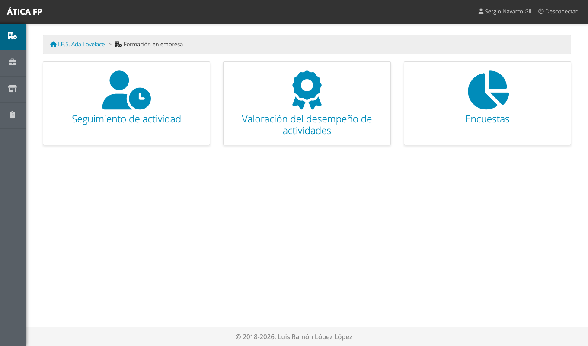
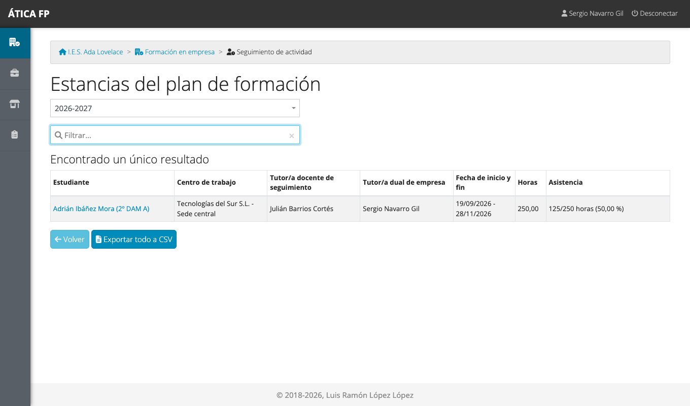
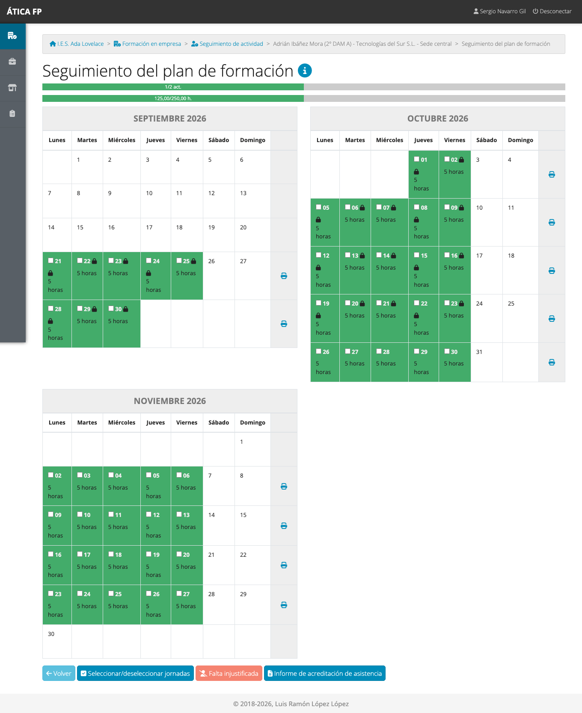
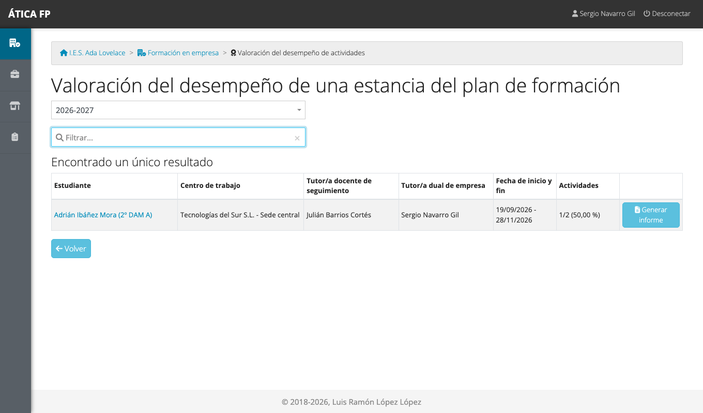
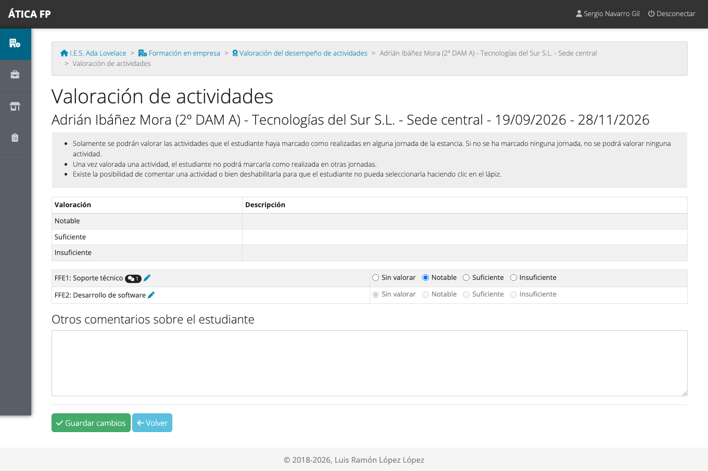
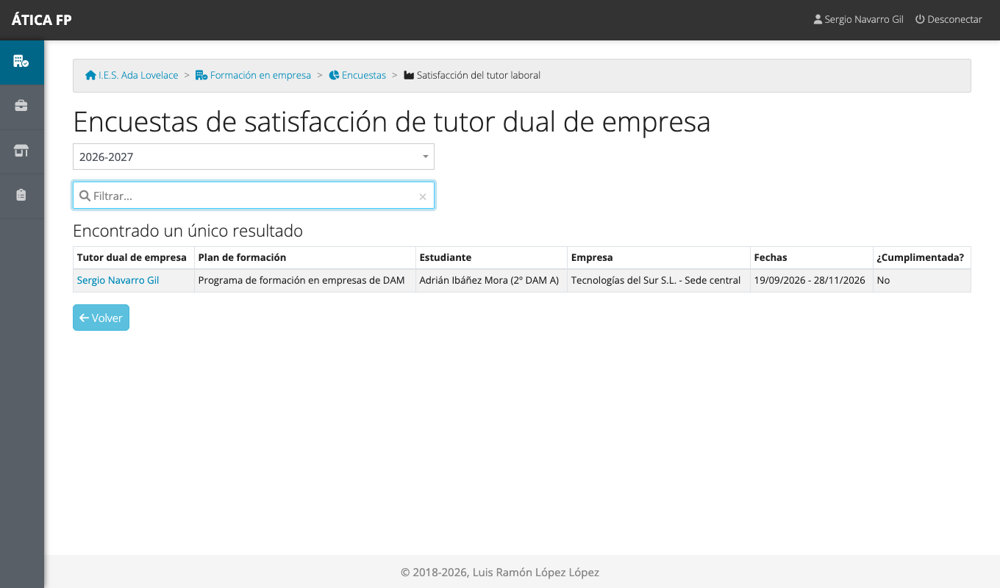
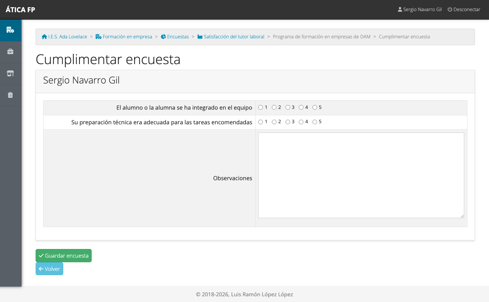

# FFEOE: tutoría laboral

Este capítulo es para la **persona de la empresa que tutoriza al alumnado** de formación en empresa: el **tutor o tutora
dual de empresa** de la estancia (en el resto del manual, la tutoría laboral). Explica lo que el centro educativo te
pide en la aplicación: confirmar la asistencia y las actividades del estudiante, **valorar su desempeño** en cada actividad
y contestar una encuesta sobre la colaboración.

Tu usuario lo crea el centro educativo cuando registra la estancia con tu empresa. Te comunicará tu nombre de usuario;
la **contraseña inicial es el identificador** (normalmente tu DNI o NIE) con el que te dieron de alta, y la aplicación te
obliga a **cambiarla en el primer acceso** (ver [Primeros pasos](02-primeros-pasos.md#cambiar-tu-contrasena)). Si te
registraron sin identificador, usa **¿Olvidó la contraseña?** con tu correo electrónico para elegir una.

## Qué puedes hacer

- **Consultar el calendario** de tu alumnado y revisar sus jornadas.
- **Completar o corregir** las actividades y la asistencia de cada jornada.
- Descargar la **hoja de asistencia**.
- **Valorar** cada actividad realizada, y comentarla.
- Contestar la **encuesta de satisfacción de la empresa**.

Solo ves **tu alumnado**: el de las estancias en las que figuras como tutor dual de empresa (principal o adicional). No
ves otras estancias, las visitas ni los gastos del profesorado, y tampoco el resumen de evaluación. La
[matriz de permisos](37-ffe-permisos.md) lo resume.

## Dónde está

En el menú de **Formación en empresa** tienes tres tarjetas: **Seguimiento de actividad**, **Valoración del desempeño
de actividades** y **Encuestas**.

## Seguimiento de tu alumnado

**Seguimiento de actividad** lista tus estancias.

Pulsa el nombre del estudiante para abrir su **calendario**.

Verde significa jornada registrada; azul, pendiente. Pulsa un día para ver o completar su ficha. En ella puedes marcar las
**actividades** que ha trabajado el estudiante, añadir otras y las anotaciones, e indicar la **asistencia** (ha acudido, o
falta justificada o injustificada; con una falta se borran las actividades de esa jornada). El centro educativo
**bloquea** cada jornada cuando la da por revisada; a partir de ahí no se puede modificar. Debajo del calendario,
**Informe de acreditación de asistencia** genera la hoja de asistencia en PDF, que normalmente tendrás que firmar.

## Valorar al alumnado {#valorar-al-alumnado}

Tu tarea principal en la aplicación es **valorar el desempeño**. **Valoración del desempeño de actividades** lista tus
estancias.

Pulsa el estudiante para valorar sus actividades.

1. Para cada **actividad realizada**, elige el **nivel de desempeño** que corresponde («Notable», «Suficiente»,
   «Insuficiente»...) o déjala **sin valorar**.
2. Solo se pueden valorar las actividades que el estudiante ha marcado como realizadas. **Una vez valorada, el estudiante
   ya no puede marcarla** en otras jornadas.
3. El **lápiz** de cada actividad abre sus **comentarios**: puedes añadirlos y también **deshabilitar la actividad** para
   que el estudiante deje de poder seleccionarla.
4. Escribe, si quieres, **otros comentarios sobre el estudiante** y pulsa **Guardar cambios**.

Esta valoración llega al profesorado del grupo en el
[resumen de evaluación](33-ffe-profesorado-y-evaluacion.md#el-informe-de-evaluacion), así que cuanto más concreta sea, más
útil resulta para evaluar al estudiante.

## La encuesta de la empresa {#la-encuesta-de-la-empresa}

Cuando el centro lo indica, te pide que contestes una breve encuesta sobre la colaboración. Está en **Formación en empresa →
Encuestas**.

Pulsa tu nombre, contesta las preguntas y pulsa **Guardar encuesta**.

Las preguntas obligatorias hay que contestarlas para guardar. Si la vuelves a abrir, aparece con lo que ya habías
contestado.

## Qué no puedes hacer y a quién pedirlo

- **Cambiar jornadas bloqueadas, el calendario o las actividades de la estancia**: es cosa del responsable de seguimiento
  o de la gestión de la FFEOE.
- **Ver estancias de otros tutores**: solo ves las tuyas.
- **Valorar a un estudiante que no tienes asignado**: pide al centro que te dé de alta como tutor dual en esa estancia.
