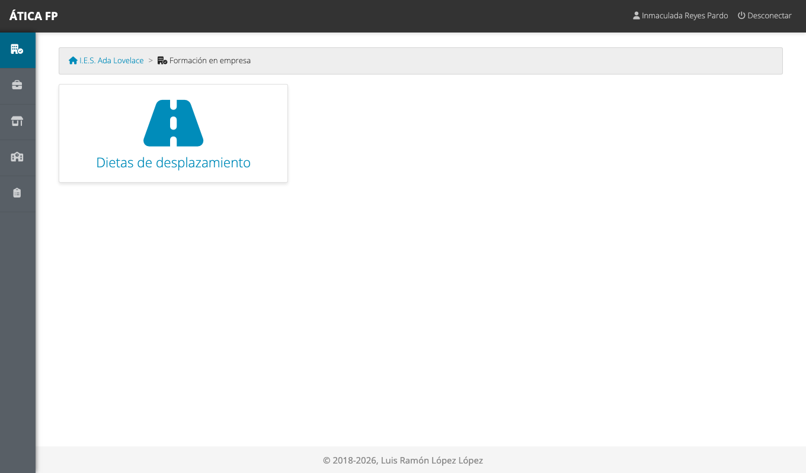
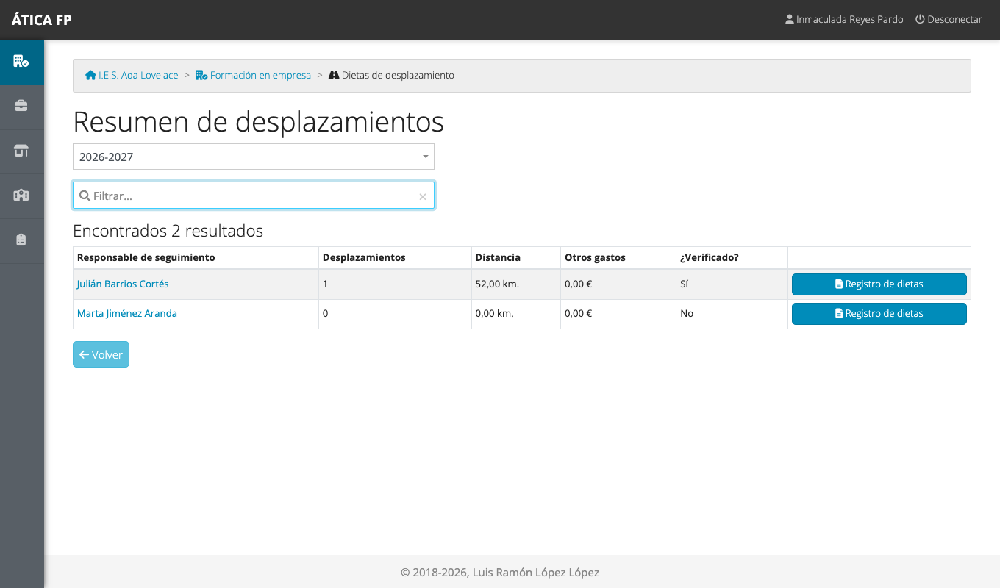
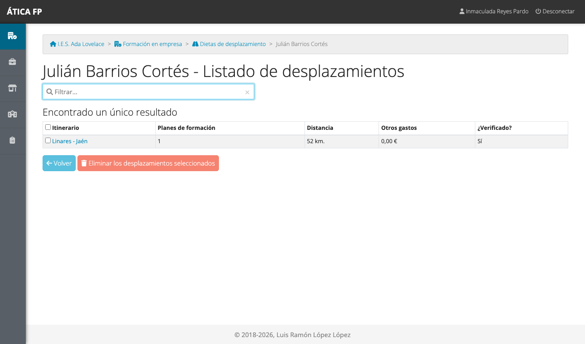
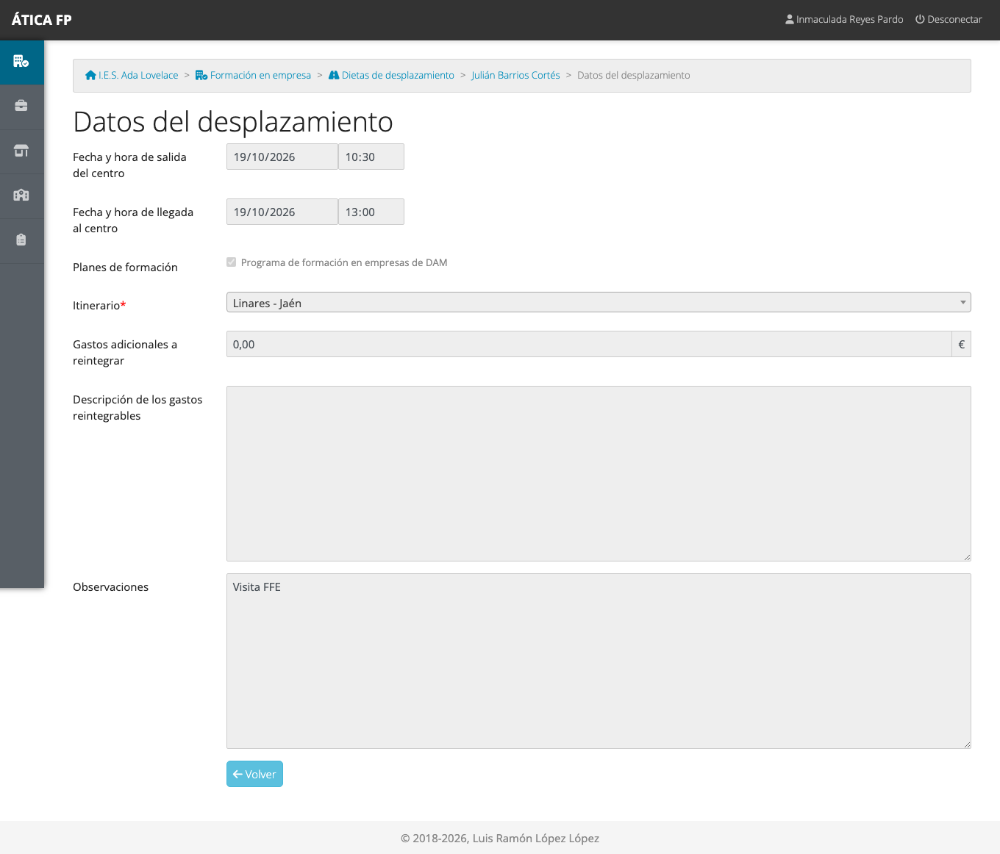

# FFE: responsable económico

Este capítulo es para el **responsable económico** del centro: la persona designada como **secretario o secretaria** en
los [datos del curso](03-preparar-el-curso-academico.md#los-datos-de-un-curso). En la formación en empresa tienes el
mismo papel que en la FCT: consultar, corregir y eliminar los **desplazamientos** que hace el profesorado para visitar
a las empresas, y comprobar sus kilómetros. Los gastos de los tres módulos funcionan de la misma manera; este capítulo
recoge solo lo que cambia. El procedimiento completo, con todas las pantallas, está en
[FCT: responsable económico](15-fct-responsable-economico.md).

## Qué puedes hacer

- Ver el **resumen de desplazamientos** del profesorado de FFE.
- Consultar, **modificar** y **eliminar** los desplazamientos de cualquier docente.
- Descargar el **registro de dietas** de cada docente en PDF.
- **Verificar los itinerarios** del catálogo del centro (son los mismos para los tres módulos).

No ves el seguimiento del alumnado, las valoraciones, las visitas ni las encuestas. A diferencia de la FCT y la FP
dual, en la FFE **no puedes registrar** un desplazamiento nuevo en nombre de un docente: lo registra cada docente (o la
administración del centro, la jefatura o la gestión de la FFE). La [matriz de permisos](37-ffe-permisos.md) lo resume.

## Dónde está

En **Formación en empresa** solo tienes la tarjeta **Dietas de desplazamiento**.

## Desplazamientos de FFE

**Dietas de desplazamiento** abre el resumen del curso con el profesorado de FFE.

Cada fila muestra los desplazamientos de un docente, sus kilómetros, los otros gastos y si todos sus itinerarios están
verificados. El botón **Registro de dietas** descarga la relación de gastos en PDF. Pulsa el nombre de un docente para ver
su listado y abrir cada desplazamiento.

Puedes **corregir cualquier dato** y **eliminar** los desplazamientos que marques (con confirmación). A diferencia de la
FCT, aquí el desplazamiento se relaciona con **planes de formación** de FFE.

## Verificar los itinerarios

El catálogo de itinerarios es **único para los tres módulos**: un trayecto que se verifica en uno se considera verificado
en los demás. Se gestiona en **Gestión del centro → Itinerarios de desplazamiento**, como se explica en
[FCT: responsable económico](15-fct-responsable-economico.md#verificar-los-itinerarios).

## Qué no puedes hacer y a quién pedirlo

- **No ves el alumnado, las jornadas ni las visitas a empresas.** Si necesitas contrastar un viaje con una visita,
  pídeselo a la gestión de la FFE.
- **No registras desplazamientos nuevos** en nombre del profesorado: pide al docente que lo registre, o a la gestión de
  la FFE o a la jefatura.
- **No gestionas el resto de «Gestión del centro»**: solo los itinerarios.
